# Application Architecture

Frontend pages, backend APIs, domain services, data and live communication. The flowchart below (Flowchart B)
is reproduced exactly as supplied in the master specification of 26 November 2026; do not edit it. How the
repository implements it, and where it deliberately extends it, follows the diagram.

```mermaid
flowchart TB

    subgraph APP["NEXTRON FRONTEND — localhost:8080"]
        ROOT["/"]
        DASH["/dashboard"]
        CASES["/investigations"]
        NEW["/investigations/new"]
        DETAIL["/investigations/:caseId"]
        EVID["/evidence"]
        SOURCES["/sources"]
        LINEAGE["/lineage"]
        INTEL["/intelligence"]
        GRAPH["/graph"]
        REPORTS["/reports"]
        NOTIFY["/notifications"]
        SYSTEM["/system"]
        SETTINGS["/settings"]

        NAV["Global Navigation"]
        SEARCH["Global Search"]
        JOBMON["Job Monitor"]
        STATUS["System Status"]

        ROOT --> DASH
        NAV --> DASH
        NAV --> CASES
        NAV --> EVID
        NAV --> SOURCES
        NAV --> LINEAGE
        NAV --> INTEL
        NAV --> GRAPH
        NAV --> REPORTS
        NAV --> NOTIFY
        NAV --> SYSTEM
        NAV --> SETTINGS

        CASES --> NEW
        CASES --> DETAIL
        DETAIL --> EVID
        DETAIL --> SOURCES
        DETAIL --> LINEAGE
        DETAIL --> GRAPH
        DETAIL --> REPORTS

        DASH --> SEARCH
        DASH --> JOBMON
        DASH --> STATUS
    end

    subgraph APILAYER["FASTAPI — localhost:8000"]
        API["/api/v1"]
        CASEAPI["Case APIs"]
        EVDAPI["Evidence APIs"]
        SRCAPI["Source APIs"]
        ANALYSISAPI["Analysis APIs"]
        TMIRAPI["T-MIR APIs"]
        GRAPHAPI["Graph APIs"]
        REPORTAPI["Report APIs"]
        JOBAPI["Job APIs"]
        HEALTHAPI["Health APIs"]

        API --> CASEAPI
        API --> EVDAPI
        API --> SRCAPI
        API --> ANALYSISAPI
        API --> TMIRAPI
        API --> GRAPHAPI
        API --> REPORTAPI
        API --> JOBAPI
        API --> HEALTHAPI
    end

    DASH --> CASEAPI
    DASH --> EVDAPI
    DASH --> JOBAPI
    DASH --> HEALTHAPI

    CASES --> CASEAPI
    NEW --> CASEAPI
    DETAIL --> CASEAPI
    EVID --> EVDAPI
    SOURCES --> SRCAPI
    LINEAGE --> TMIRAPI
    INTEL --> TMIRAPI
    GRAPH --> GRAPHAPI
    REPORTS --> REPORTAPI
    JOBMON --> JOBAPI
    STATUS --> HEALTHAPI

    subgraph SERVICES["BACKEND DOMAIN SERVICES"]
        CS["Case Service"]
        ES["Evidence Service"]
        SS["Source Service"]
        AS["Analysis Service"]
        TS["T-MIR Service"]
        GS["Evidence Graph Service"]
        RS["Report Service"]
        JS["Job Service"]
    end

    CASEAPI --> CS
    EVDAPI --> ES
    SRCAPI --> SS
    ANALYSISAPI --> AS
    TMIRAPI --> TS
    GRAPHAPI --> GS
    REPORTAPI --> RS
    JOBAPI --> JS

    subgraph DATA["DATABASE AND STORAGE"]
        CASEDB[("cases")]
        EVDB[("evidence")]
        SRCDB[("source_records")]
        JOBDB[("analysis_jobs")]
        RESDB[("analysis_results")]
        RELDB[("media_relationships")]
        GRAPHDB[("evidence_nodes / edges")]
        REPORTDB[("reports")]
        OBJ[("Object Storage")]
    end

    CS <--> CASEDB
    ES <--> EVDB
    ES <--> OBJ
    SS <--> SRCDB
    AS <--> RESDB
    AS <--> JOBDB
    TS <--> RELDB
    GS <--> GRAPHDB
    RS <--> REPORTDB

    subgraph LIVE["LIVE COMMUNICATION"]
        EVENT["Event Publisher"]
        WS["WebSocket / SSE"]
        STATE["Frontend State Update"]
    end

    JS --> EVENT
    AS --> EVENT
    TS --> EVENT
    EVENT --> WS
    WS --> STATE
    STATE --> DASH
    STATE --> DETAIL
    STATE --> JOBMON
    STATE --> GRAPH
```

## How the repository implements it

| Element | Implementation | Status (see [Implementation Status](../Implementation/Implementation%20Status.md)) |
|---|---|---|
| 14 routes | `Frontend/Web/src/app/(workspace)/…`; `/` redirects to `/dashboard`, landing page at `/about` | All exist: `/` redirects, 8 pages run on live data, 5 say "not available yet" (sources, lineage, graph, reports, notifications) |
| Global navigation, search, job monitor, system status | `Frontend/Web/src/layouts/` | Implemented; job monitor reports the job service as not built |
| API base | `http://localhost:8000/api/v1`, configured once in `Frontend/Web/src/api/config.ts` | Implemented |
| Case / Evidence / Health APIs | `Backend/App/Api/V1/{Cases,Evidence,Health,System}.py` | Implemented |
| Source, Analysis, T-MIR, Graph, Report, Job APIs | — | Steps 3, 5, 7 |
| `analysis_jobs`, `analysis_results` | Tables created in migration `0004` (Step 2); written from Step 3 | Schema only |
| `source_records`, `media_relationships`, `evidence_nodes/edges`, `reports` | — | Steps 5 and 7 |
| Event Publisher → WebSocket | Outbox table in `0004`; dispatcher and WebSocket in Step 3 | Schema only |

## Deliberate extensions (documented conflicts)

| Extension | Reason | Conflict ID |
|---|---|---|
| Job records are written only by the Job Service, although the diagram links `analysis_jobs` to the Analysis Service | One owner of job state (claim, lease, retry, cancel); Analysis, T-MIR, Source and Report services create jobs through it | C-7 / D-7 |
| Review APIs → Review Service (NEX-INV); Notification, Preferences and Search APIs | Required by the module set and page specifications but absent from the diagram | C-8 |
| Health APIs → the existing `HealthService` | The diagram names no service for them | C-8 |
| Case and Evidence services also publish events | Page specifications require events for case and evidence changes; every service writes to one transactional outbox | C-9 / D-10 |
| Global pages accept `?case=` | Keeps investigation context on global routes (§7.5) | D-19 |
