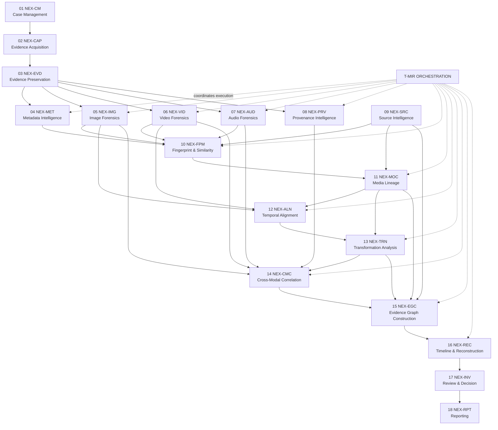
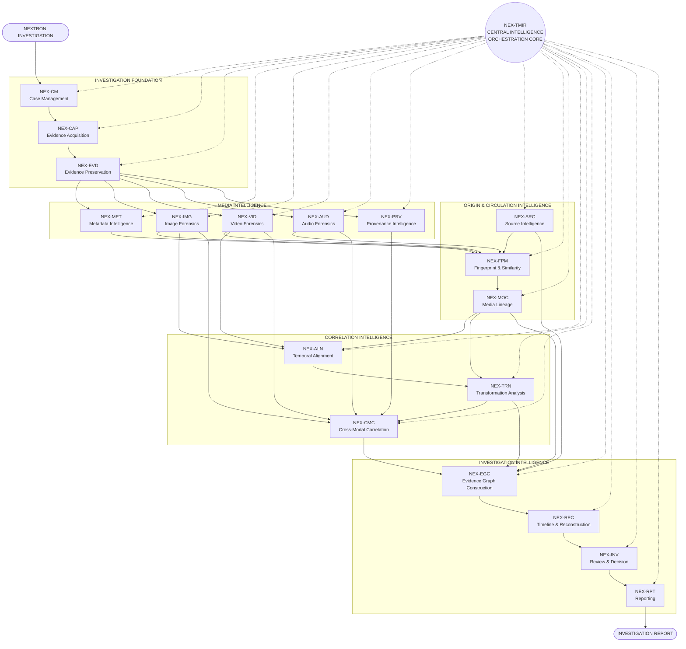

# Module Connectivity

The investigation modules and how they connect. Two flowcharts were supplied; both are reproduced below
exactly as given (transcribed from the specification messages of 26 November 2026). Do not edit the Mermaid
blocks: they are the canonical specifications. Interpretation and decisions are in the sections after them.

| Flowchart | Authority | Use |
|---|---|---|
| **A1** — latest module connectivity | **Highest.** Defines exact module relationships and T-MIR's coordination boundary | Source of the dependency registry (`Backend/App/Orchestration/TMir/DependencyRegistry.py`) |
| **A2** — grouped module flowchart | Second. Useful visualization of the five groups | Group names and visual structure |

The registry test (`Tests/Unit/Backend/test_dependency_registry.py`) parses the A1 block in this file and fails
if the registry's edges differ from it by a single arrow.

## A1 — Latest canonical module connectivity

## A2 — Grouped module flowchart

## How the two differ, and what is implemented

| Difference | A1 | A2 | Implemented (decision) |
|---|---|---|---|
| `SRC --> MOC` | present | absent | **Present** — A1 is the higher authority (conflict C-2) |
| T-MIR dotted edges | 12 modules (MET … REC) | all 18 | **T-MIR executes the 12**; CM, CAP, EVD, SRC, INV, RPT are owned by domain services and observed through events (C-1 / D-2) |
| START / END nodes | absent | present | Entry and output labels only; not modules |

Every other solid edge is identical in both: 31 module-to-module edges in A1, 30 in A2.

## Reading the arrows

- A **solid arrow** is data flow: the downstream module consumes the upstream module's persisted results.
  It is not automatically a blocking dependency. Each edge is typed in the registry:
  - `REQUIRED` — the downstream cannot run without a completed upstream result.
  - `CONDITIONAL` — required only when the upstream applies to the same evidence or pair (e.g. IMG → FPM only for images).
  - `OPTIONAL` — used when present; its absence or failure becomes a recorded limitation.
- A **dotted arrow** is control: T-MIR schedules and coordinates that module. Modules never call each other.
- Modules may read **foundation records** (cases, evidence, artifacts) by reference without an edge (decision D-6).

The complete edge table, with types and the reason for each, is generated from the registry in
[Orchestration.md](Orchestration.md#dependency-registry).

## Edges in neither flowchart (documented, not added)

| Missing edge | Why it matters | Resolution |
|---|---|---|
| `AUD --> ALN` | The archive gives NEX-ALN audio alignment | ALN reaches audio through MOC's version pairs and FPM's audio fingerprints (C-4) |
| `MET --> CMC` | The archive lists metadata as a correlation input | Metadata reaches correlation through FPM/MOC; MET reports its own inconsistencies (C-5) |
| `CM --> SRC`, an entry for SRC | SRC has no upstream in either flowchart | Sources enter by an investigator-supplied URL; a source-resolution job (D-13) |
| `VID --> IMG`, `VID --> AUD` | The archive had VID hand frames to IMG and audio to AUD | IMG analyses images; VID its own frames; AUD extracts the audio track itself (C-6) |
