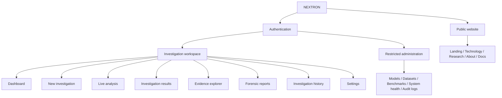
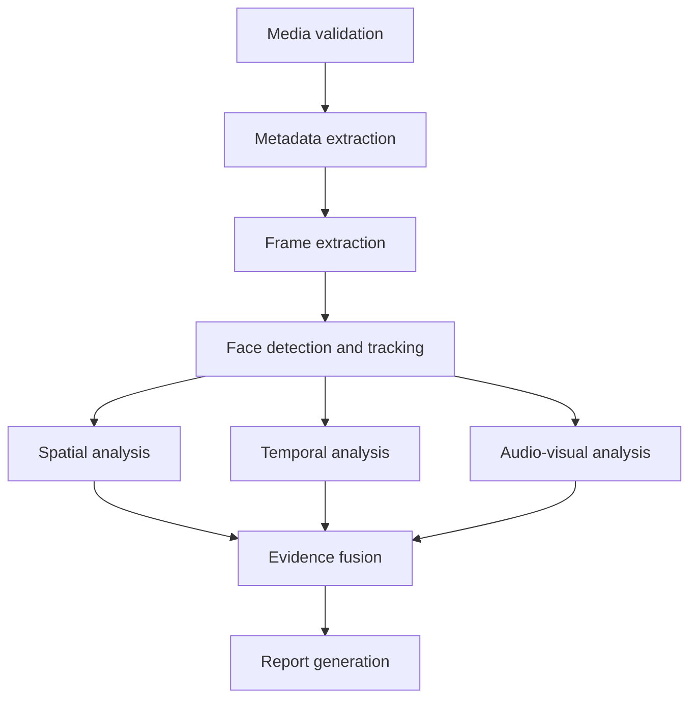
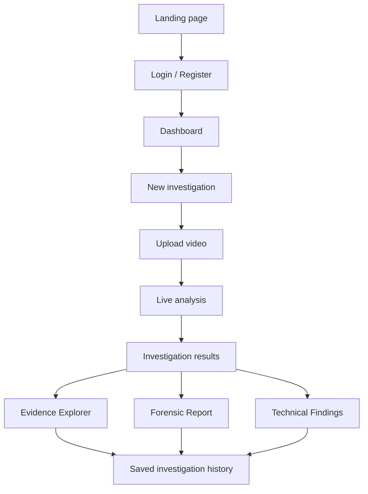

# NEXTRON — Frontend Information Architecture

**Intelligent Deepfake & Digital Media Verification System**  
**Status:** Proposed frontend architecture, based on Master Architecture v1.0.

NEXTRON should feel like a professional digital forensic investigation platform, not a basic real-or-fake video classifier. This document establishes which pages exist, what each contains, and how users navigate between them before selecting design repositories, animations, colours or frameworks.

## 1. Complete frontend architecture



Three interfaces: public website, investigator workspace, and restricted administration panel. Authentication includes sign in, account creation and password recovery.

## 2. Landing page

Purpose: establish NEXTRON's identity, demonstrate capabilities and encourage visitors to start an investigation.

| Section | Elements |
|---|---|
| Navigation | Logo, technology, research, about, sign in |
| Hero | Headline, animated forensic visual, primary CTA |
| Problem statement | Why deepfakes are a threat |
| Capabilities | Three detection engines: spatial, temporal and audio-visual |
| How it works | Upload → Analyze → Investigate → Report |
| Interactive demonstration | Sample video with forensic findings |
| Manipulation types | Face swap, reenactment, synthetic video, lip-sync |
| Technology | Detection architecture overview |
| Research | Methodology, datasets and validated benchmarks |
| Use cases | Journalism, cybersecurity, digital forensics |
| Privacy and security | Evidence protection and limitations |
| Final CTA | Start an investigation |
| Footer | Documentation, GitHub, policies, contact |

### Illustrative wireframe

```text
[NEXTRON]                 Technology  Research  Sign in
-------------------------------------------------------
       INTELLIGENT DIGITAL MEDIA VERIFICATION
              Beyond what meets the eye.
 Investigate digital media. Uncover manipulation.
                 Understand the evidence.
              [Animated forensic visual]
                 [Start Investigation →]
-------------------------------------------------------
       Spatial       Temporal       Audio-visual
```

## 3. Authentication pages

Keep these minimal and distraction-free. Authentication controls access to private investigations and administrator functionality.

| Page | Elements |
|---|---|
| Sign in | Logo, welcome message, email, password, forgot password link, sign-in button, create account link |
| Create account | Logo, full name, email, password, confirm password, create account button |
| Forgot password | Email, recovery submission, return to login |

## 4. Main dashboard

The home page after login provides an overview of the investigator's activity.

- Sidebar navigation and user profile.
- New investigation button.
- Total investigation count.
- Manipulation suspected, authentic-consistent and inconclusive counts.
- Investigation activity graph.
- Recent investigations.
- Currently processing videos.
- Recent forensic reports.
- Notifications and analysis completion alerts.

### Illustrative wireframe (fictional data)

```text
NEXTRON                                    Notifications | Profile
------------------------------------------------------------------
Dashboard       Overview                    [+ New investigation]
New analysis    [24 Investigations]         [11 Manipulation suspected]
Investigations  [9 No strong indications]   [4 Inconclusive]
Reports         [Investigation activity graph]
History         Recent investigations
Settings        Interview.mp4       Manipulation suspected
                Recording.mp4       Inconclusive
                News_clip.mp4       Analysis completed
```

Keep AI technical details inside individual investigations rather than overloading the dashboard.

## 5. New investigation page

Purpose: submit a video for analysis.

- Breadcrumb: Workspace / New investigation.
- Heading and short description.
- Drag-and-drop upload area and browse files button.
- Supported formats and file limits.
- Video preview, filename, duration, resolution, file size and validation status when available.
- Investigation name and optional contextual notes.
- Analysis engines: spatial (visual manipulation), temporal (motion and sequence), audio-visual (speech and lip-sync consistency), metadata (file and provenance information).
- Initialize investigation button.

Full analysis should be the default. If no usable audio exists, automatically mark the audio-visual branch unavailable.

## 6. Live analysis page

Show actual forensic pipeline stages rather than a generic loading spinner.



| Element | Purpose |
|---|---|
| Job ID | Identifies the investigation |
| Progress indicator | Displays actual processing progress |
| Pipeline stages | Shows what is currently happening |
| Engine status | Completed, running, pending, failed or unavailable |
| Processing time | Elapsed analysis time |
| Video information | Identifies submitted media |
| Error handling | Explains failures |
| Cancel button | Cancels processing, if supported |

Illustrative UI: Investigation #NXT-0024, analysis in progress, 4 of 9 stages completed (44%). Progress must come from the backend, not a fake frontend animation. The diagram is a simplified flow, not an exact execution schedule.

## 7. Investigation results page

The most important page: distinguish NEXTRON from an ordinary deepfake detector by exposing evidence behind the assessment.

### Illustrative wireframe (fictional findings)

```text
INVESTIGATION #NXT-0024   Interview.mp4             [Download]
-------------------------------------------------------------
FORENSIC ASSESSMENT: Manipulation suspected
Suspected type: Face swap
-------------------------------------------------------------
Overview | Spatial | Temporal | Audio-visual | Metadata | Fusion
                       [Video player]
                  00:18 / 01:00
Suspicious segments: [Interactive timeline with highlighted regions]
[Spatial: High]   [Temporal: High]   [Audio-visual: Low]
Evidence summary: Facial region inconsistencies and abnormal frame
transitions identified in selected segments. Audio-visual findings
show limited inconsistency.
[Explore evidence]                         [Export report]
```

| Tab | Content |
|---|---|
| Overview | Final assessment, uncertainty, evidence summary |
| Spatial | Suspicious frames, heatmaps, bounding boxes |
| Temporal | Frame consistency graph, suspicious time segments |
| Audio-visual | Audio waveform, speech alignment, synchronization findings |
| Metadata | Codec, resolution, timestamps, encoding and provenance |
| Evidence fusion | How findings contribute to the assessment |
| Technical details | Models used, versions and processing information |

Never simply display a large fake probability without supporting evidence. All example findings above are hypothetical.

## 8. Evidence Explorer

Dedicated interactive workspace to examine suspicious videos in depth.

```text
Evidence Explorer                                      [Fullscreen]
[Original frame]                         [Evidence overlay]
[Previous frame] [Play] [Next frame]      Frame 450 · 00:18.00
[Interactive suspicion graph and video timeline]
Evidence layers:
  Region localization | Face bounding boxes
  Temporal anomalies  | Audio-visual inconsistencies
Selected finding: Timestamp 00:18.00, facial area, spatial engine
```

### Essential tools

- Frame-by-frame navigation.
- Zoom and pan.
- Original versus analyzed view.
- Toggleable evidence overlays.
- Heatmap opacity control.
- Suspicious frame thumbnails.
- Interactive video timeline.
- Timestamp navigation.
- Audio waveform.
- Evidence filtering by detection engine.
- Individual finding details.
- Export selected evidence.

Only show heatmaps when the underlying engine produces them. Clearly distinguish model attention maps from verified manipulation masks.

## 9. Investigation history page

Manage previous investigations with search, date and assessment filters, sorting, pagination, opening old investigations, report downloads and deletion according to retention policy.

| Media | Assessment | Date (illustrative) |
|---|---|---|
| Interview.mp4 | Manipulation suspected | Nov 24 |
| News.mp4 | Authentic-consistent | Nov 23 |
| Clip.mp4 | Inconclusive | Nov 22 |
| Speech.mp4 | Processing | Nov 22 |

## 10. Forensic reports page

View and export generated reports. Include NEXTRON branding, report ID and the following sections:

1. Executive summary
2. Media information
3. Forensic assessment
4. Detection methodology
5. Spatial findings
6. Temporal findings
7. Audio-visual findings
8. Metadata and provenance
9. Evidence fusion
10. Uncertainty and limitations
11. Evidence integrity and model versions
12. Conclusion

Export options: PDF, JSON and print. Reports must be generated from actual backend evidence and include original media hash, report hash and model versions.

## 11. Technology and research pages

Public-facing pages explain the scientific foundation.

| Page | Elements |
|---|---|
| Technology | Three detection engines, architecture diagrams, evidence fusion |
| Research | Research papers, methodology, research objectives |
| Benchmarks | Validated accuracy, F1, ROC-AUC, robustness and localization metrics |
| Datasets | Dataset descriptions, versions, licenses and limitations |
| Documentation | User guide, API documentation and technical explanations |
| About | Mission, team, project objectives and GitHub |

Do not publish fabricated accuracy metrics or claim unimplemented capabilities.

## 12. Settings page

| Section | Elements |
|---|---|
| Profile | Name, email, profile picture |
| Appearance | Dark/light mode |
| Preferences | Default analysis preferences |
| Notifications | Analysis completion and failure alerts |
| Privacy | Data retention and deletion |
| Security | Password management and sessions |
| Storage | Uploaded files and storage usage |

## 13. Administration and ML monitoring panel

Separate from the normal dashboard and accessible only to authorized administrators. Connects to layers 7, 8, 9 and 10 of the master architecture.

- Model registry management and approval workflows.
- Dataset registry and experiment tracking.
- Benchmark evaluation.
- Worker monitoring and system health.
- Task queues and active jobs.
- User management and audit logs.
- CPU, GPU, RAM and storage utilization.

Illustrative dashboard (not real metrics): 8 active jobs, queue size 3, GPU utilization 64%, 4 approved models; CPU 42%, RAM 57%, storage 28%. Model registry lists spatial, temporal, audio-visual and fusion configuration versions.

## 14. Frontend routing architecture

```text
NEXTRON
│
├── /                          Landing page
├── /technology
├── /research
├── /benchmarks
├── /about
├── /docs
│
├── /login
├── /register
├── /forgot-password
│
├── /workspace
│   ├── /dashboard
│   ├── /investigate/new
│   ├── /investigations
│   │   └── /:id
│   │       ├── /processing
│   │       ├── /overview
│   │       ├── /spatial
│   │       ├── /temporal
│   │       ├── /audio-visual
│   │       ├── /metadata
│   │       ├── /fusion
│   │       ├── /evidence
│   │       └── /report
│   ├── /reports
│   ├── /notifications
│   └── /settings
│
└── /admin
    ├── /dashboard
    ├── /models
    ├── /datasets
    ├── /experiments
    ├── /evaluation
    ├── /jobs
    ├── /workers
    ├── /users
    └── /audit-logs
```

## 15. User navigation flow



## 16. Reusable frontend components

| Category | Components |
|---|---|
| Layout | Navbar, sidebar, footer, breadcrumbs |
| Media | Video player, frame viewer, waveform viewer |
| Forensics | Heatmap overlay, bounding box, evidence card |
| Visualization | Timeline, score graph, benchmark charts |
| Upload | Drag-and-drop zone, file preview, validation |
| Analysis | Pipeline tracker, engine status, progress indicator |
| Reporting | Assessment card, evidence summary, report viewer |
| General UI | Modals, tooltips, tables, tabs, filters |
| System states | Loading, empty, error, unavailable, inconclusive |

## 17. Frontend development priority

| Page | Priority |
|---|---|
| Landing page | Essential |
| Authentication | Essential |
| Dashboard | Essential |
| Video upload | Essential |
| Live analysis | Essential |
| Investigation results | Essential |
| Evidence Explorer | Essential |
| Forensic reports | Essential |
| Investigation history | Essential |
| Technology and research | Secondary |
| Settings | Secondary |
| Administration panel | Later phase |
| ML monitoring dashboard | Later phase |

## Overall design direction

- **Public website:** Cinematic, immersive, premium and visually engaging.
- **Investigation workspace:** Professional, precise, information-rich and easy to navigate.
- **Evidence Explorer:** A sophisticated forensic workstation.
- **Administration panel:** Technical, functional and data-oriented.

Visual inspiration: premium dark cybersecurity SaaS dashboards, cinematic AI technology landing pages, digital forensic video evidence timelines and scientific ML analytics interfaces. Illustrative wireframes use dark navy backgrounds, restrained blue accents, and meaningful status colours. The public website can use advanced animation; the forensic workspace should prioritize readability and functionality over decoration.

## Open decisions and limitations

Nothing about the visual design is finalized. Authentication requirements, public benchmark pages, optional settings and administration are proposed additions, not confirmed requirements. Frontend framework, specific design repositories, backend integrations and actual model capabilities remain to be established. All sample data and findings are illustrative. Original interactive chat wireframes and reference imagery have been converted into text and Mermaid diagrams for Markdown portability; they are not pixel-perfect reproductions.

Next step: review the design repositories, examine their components, layouts, animations, visual styles and interactions, and decide which belong on each NEXTRON page while maintaining a consistent design system.
