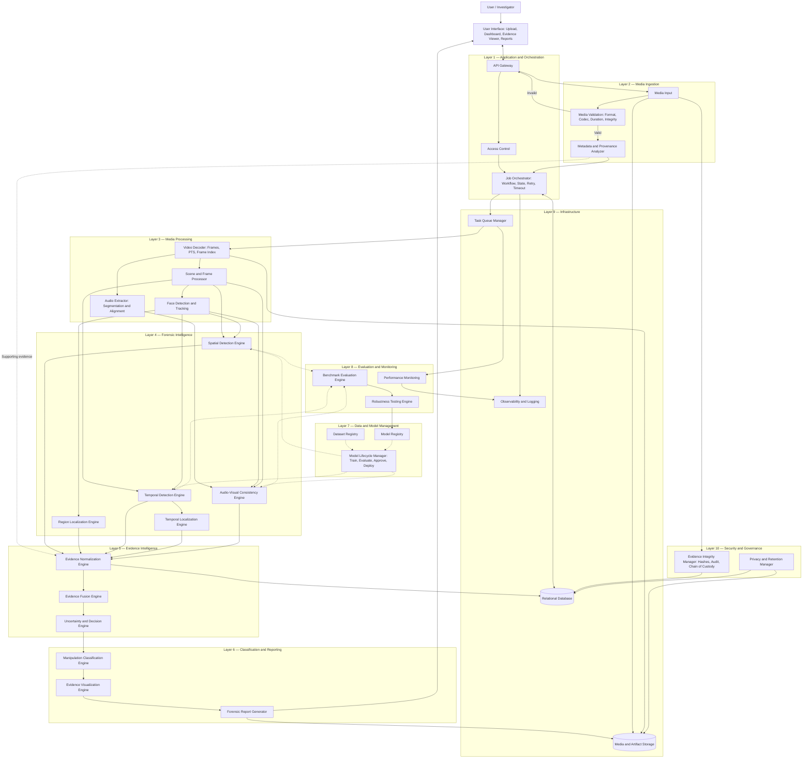
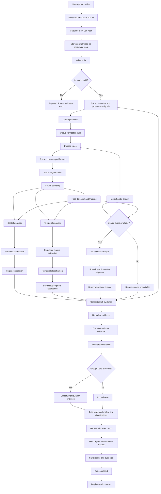
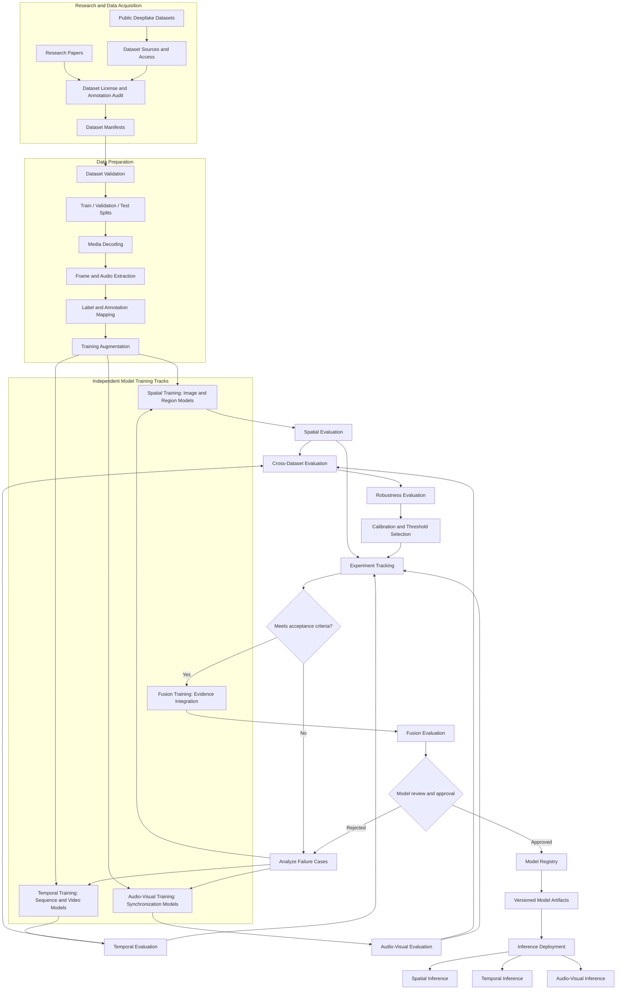
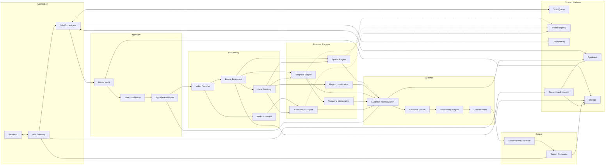
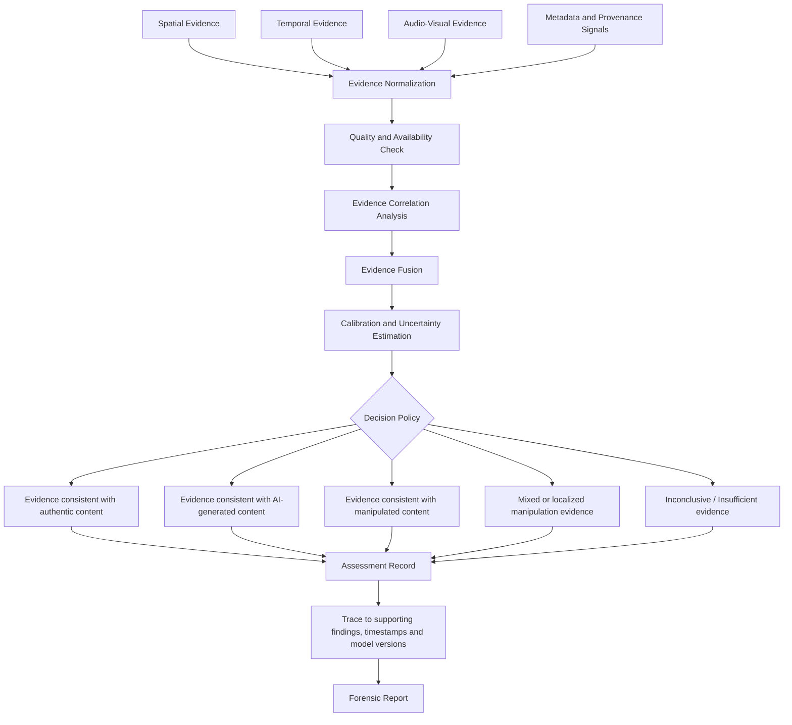
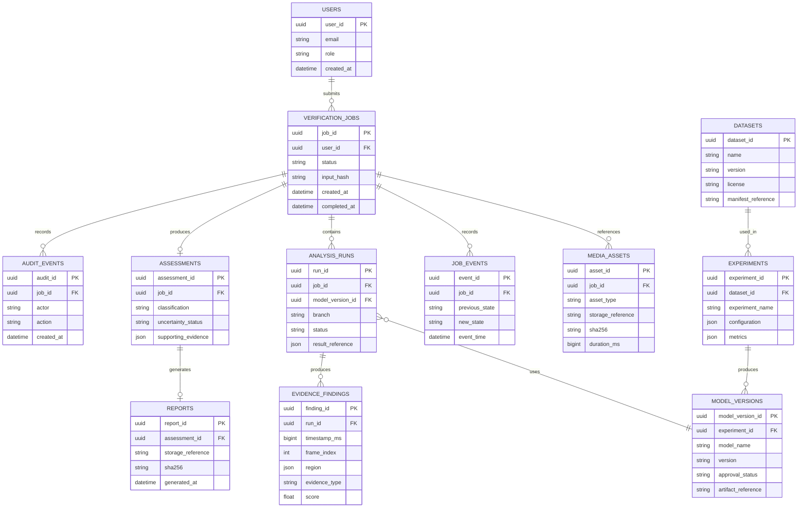
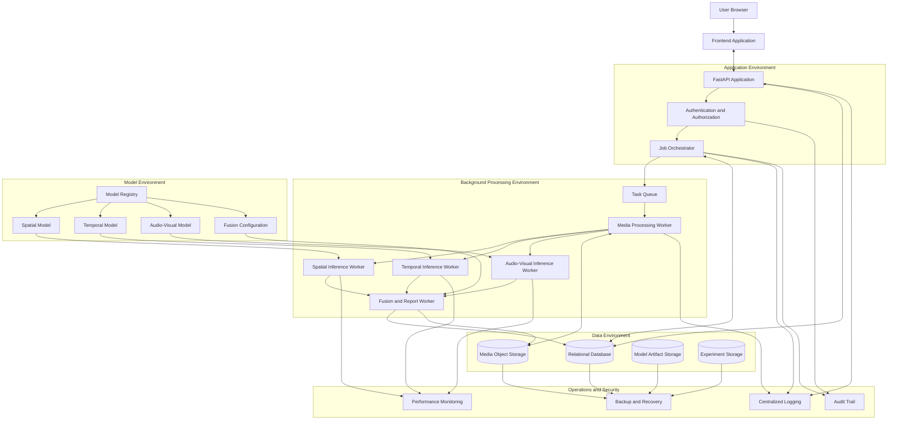
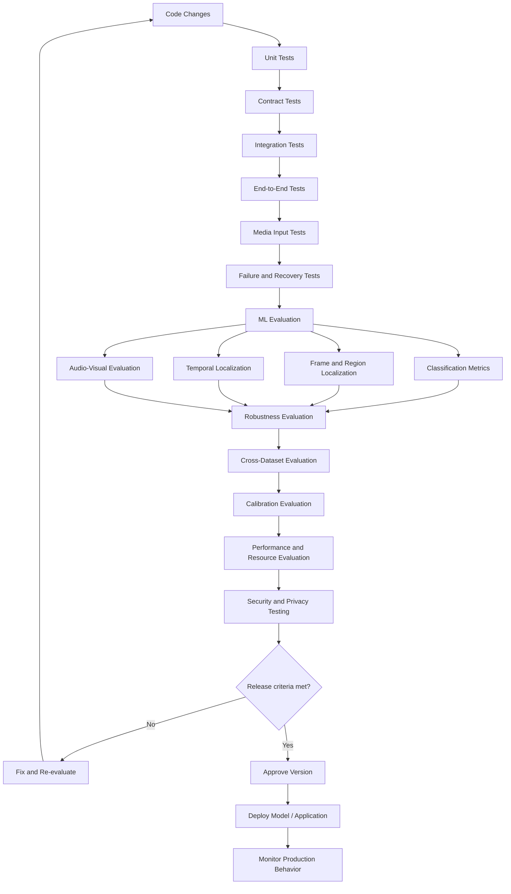
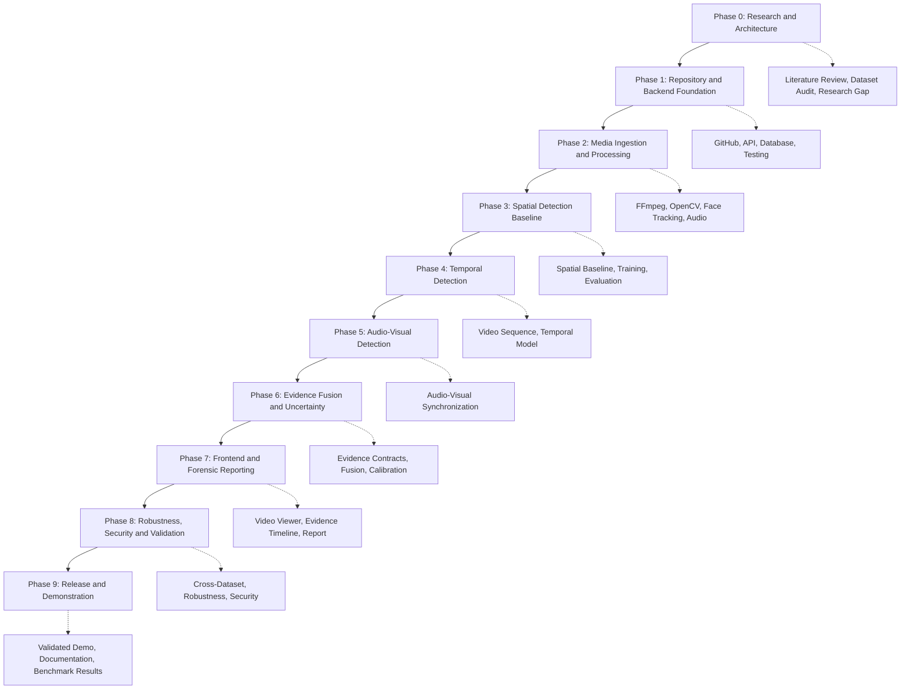

# NEXTRON — Master System Architecture

**Intelligent Deepfake & Digital Media Verification System**  
Version 1.0 · Proposed architecture baseline

10 layers · 33 logical modules · 3 forensic branches · 2 connected pipelines

## 1. Complete system architecture



Dotted arrows represent supporting information, governance or evaluation relationships, not necessarily runtime calls. The original baseline's stated 33-module count should be reconciled with the 32 explicitly named layer modules plus the UI; this document treats the UI as the 33rd component.

## 2. Complete video verification workflow



| Category | What NEXTRON investigates |
|---|---|
| Fully AI-generated | Entire video generated synthetically |
| Face swap | One person's face replaced with another |
| Facial reenactment | Facial expressions or movements manipulated |
| Lip-sync manipulation | Visible speech does not match audio |
| Partial manipulation | Selected frames or regions altered |
| Inconclusive | Insufficient or conflicting evidence |

Mixed cases must also be supported, including authentic footage with manipulated sections.

## 3. ML training and research architecture

Training is separate from normal video verification. Training creates model versions; inference consumes approved versions.



### 3.1 ML tracks and inputs/outputs

| Track | Input | Expected output |
|---|---|---|
| Spatial | Video frames and regions | Visual manipulation evidence |
| Temporal | Ordered frame sequences | Temporal inconsistency and suspicious segments |
| Audio-visual | Audio and corresponding video segments | Synchronization evidence |
| Fusion | Standardized evidence from branches | Combined assessment |

### 3.2 Candidate datasets

- FaceForensics++ — manipulated facial videos.
- Celeb-DF — face manipulation research.
- DFDC — large-scale deepfake detection.
- DeeperForensics-1.0 — robustness evaluation.
- FakeAVCeleb — audio-visual manipulation.
- Deepfake-Eval-2024 — real-world generalization evaluation.

These are candidates, not final selections. Audit licensing, label quality, annotation granularity and task suitability. Keep test data separate from training, calibration and threshold selection.

## 4. Repository and GitHub architecture

```mermaid
flowchart TD
 ROOT[NEXTRON MONOREPO]
 ROOT --> DOCS[docs/]
 ROOT --> RESEARCH[research/]
 ROOT --> DATA[data/]
 ROOT --> TRAIN[training/]
 ROOT --> SRC[src/nextron/]
 ROOT --> MODELS[models/]
 ROOT --> FRONT[frontend/]
 ROOT --> TESTS[tests/]
 ROOT --> SCRIPTS[scripts/]
 ROOT --> DEPLOY[deployment/]
 ROOT --> GITHUB[.github/workflows/]
 DOCS --> D1[architecture/] & D2[research/] & D3[decisions/]
 RESEARCH --> R1[notebooks/] & R2[experiments/] & R3[baselines/] & R4[paper_reproductions/] & R5[findings/]
 DATA --> DA1[manifests/] & DA2[splits/] & DA3[schemas/]
 TRAIN --> TR1[spatial/] & TR2[temporal/] & TR3[audio_visual/] & TR4[fusion/] & TR5[common/]
 SRC --> S1[api/] & S2[orchestration/] & S3[ingestion/] & S4[validation/] & S5[preprocessing/] & S6[spatial/] & S7[temporal/] & S8[audio_visual/] & S9[evidence/] & S10[classification/] & S11[localization/] & S12[reporting/] & S13[storage/] & S14[security/] & S15[common/]
 MODELS --> M1[registry/] & M2[configs/]
 TESTS --> T1[unit/] & T2[integration/] & T3[contract/] & T4[end_to_end/] & T5[robustness/]
 SCRIPTS --> SC1[prepare_dataset.py] & SC2[validate_dataset.py] & SC3[run_training.py] & SC4[benchmark.py]
 DEPLOY --> DP1[Dockerfile] & DP2[compose.yaml]
 GITHUB --> CI1[tests.yml] & CI2[lint.yml] & CI3[security.yml]
```



| Directory | Responsibility | GitHub? |
|---|---|---|
| `docs/` | Architecture and research documentation | Yes |
| `research/` | Notebooks, experiments and findings | Yes, excluding large outputs |
| `data/` | Manifests, splits and schemas | Yes |
| `training/` | Model training code | Yes |
| `src/` | Application and inference source code | Yes |
| `models/` | Model configuration and registry metadata | Yes |
| `frontend/` | User-facing application | Yes |
| `tests/` | Automated testing | Yes |
| `deployment/` | Container and deployment configuration | Yes |
| Raw datasets | Actual video/audio files | Separate storage |
| Model checkpoints | Large trained model artifacts | Separate artifact storage |

## 5. Internal module dependency architecture



**Dependency rule:** Independent forensic branches publish findings through standardized contracts rather than calling one another directly. This avoids tight coupling and allows model replacement.

## 6. Evidence fusion and decision architecture



### Decision safeguards

- A missing branch is not a negative result.
- Multiple correlated models are not automatically independent evidence.
- A high raw model score is not automatically a calibrated probability.
- A video-level classification is not a localization result.
- A provenance signal cannot establish authenticity by itself.
- A conflicting result must be visible in the report.

## 7. Database architecture and entity relationships



This is a conceptual ER diagram. Exact SQL types, indexes, foreign-key policies, partitioning and database choice remain open.

## 8. Infrastructure and deployment architecture



| Environment | Components |
|---|---|
| Development laptop | Source code, tests, API, small experiments |
| GPU training environment | Model training and evaluation |
| Application server | Frontend/backend and orchestration |
| Worker environment | Media processing and inference |
| Database environment | Structured application records |
| Object storage | Videos and evidence artifacts |
| Model storage | Checkpoints and approved models |

Local CPU development is a reasonable starting point; large CUDA-based training requires a suitable NVIDIA GPU environment. Actual resource requirements depend on the chosen models.

## 9. Testing, evaluation and quality architecture



| Capability | Measurements |
|---|---|
| Video classification | ROC-AUC, precision, recall, F1 |
| Frame detection | Frame-level precision, recall, F1 |
| Region localization | IoU, AP |
| Temporal localization | Temporal IoU, segment AP |
| Audio-visual | Synchronization accuracy/error |
| Calibration | Brier score, expected calibration error |
| Runtime | Latency, throughput, memory |
| Robustness | Cross-dataset performance and degradation |

## 10. Complete project development map



## 11. Architecture decisions and open questions

| Component | Status |
|---|---|
| NEXTRON project identity | Confirmed baseline |
| Video-first scope | Confirmed baseline |
| 10-layer architecture | Architecture baseline |
| 33 logical components including UI | Architecture baseline |
| Spatial + temporal + AV branches | Confirmed baseline |
| Evidence fusion and uncertainty | Confirmed baseline |
| Modular monolith | Recommended |
| Python + PyTorch | Recommended |
| FFmpeg + OpenCV | Recommended |
| FastAPI | Recommended |
| Dataset selection | Research pending |
| Specific model architectures | Research pending |
| Fusion algorithm | Research pending |
| Database/provider | Not selected |
| GPU provider | Not selected |
| Frontend framework | Not selected |
| Deployment infrastructure | Not selected |

## 12. Using and maintaining these diagrams

The Mermaid blocks are editable source code. Render them with [Mermaid Live Editor](https://mermaid.live/), maintain the Markdown in [GitHub](https://github.com/), or edit it in [Visual Studio Code](https://code.visualstudio.com/).

Suggested documentation layout if the master document is later split:

```text
NEXTRON/
└── docs/
    └── architecture/
        ├── 00_MASTER_ARCHITECTURE.md
        ├── 01_SYSTEM_OVERVIEW.md
        ├── 02_VIDEO_VERIFICATION_FLOW.md
        ├── 03_ML_TRAINING_ARCHITECTURE.md
        ├── 04_REPOSITORY_ARCHITECTURE.md
        ├── 05_MODULE_DEPENDENCIES.md
        ├── 06_EVIDENCE_FUSION.md
        ├── 07_DATABASE_ARCHITECTURE.md
        ├── 08_DEPLOYMENT_ARCHITECTURE.md
        ├── 09_TESTING_ARCHITECTURE.md
        └── 10_DEVELOPMENT_ROADMAP.md
```

## Next engineering milestone

Define the exact interface, inputs, outputs, dependencies, failure conditions and acceptance tests for each component before building the implementation skeleton. This is an architecture proposal, not evidence that the modules are implemented or validated. The goal is a system whose conclusions withstand technical scrutiny.
