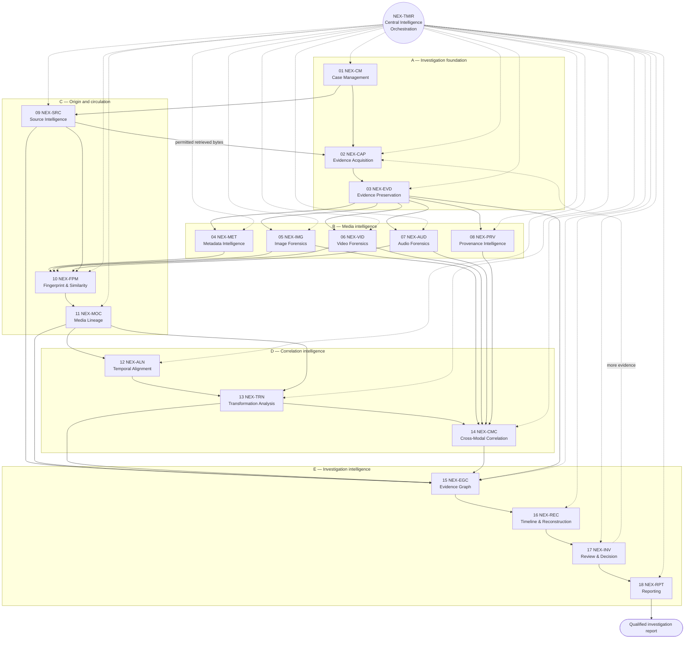
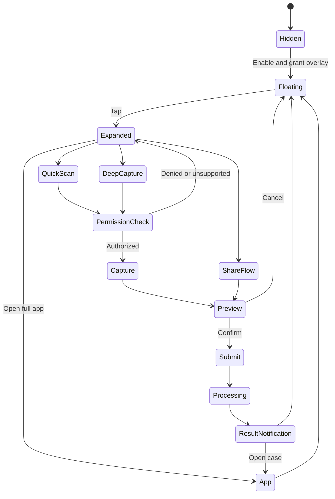
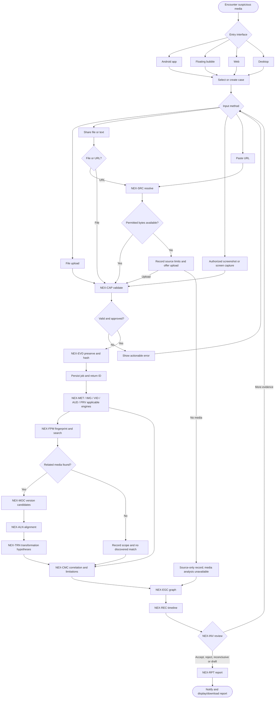
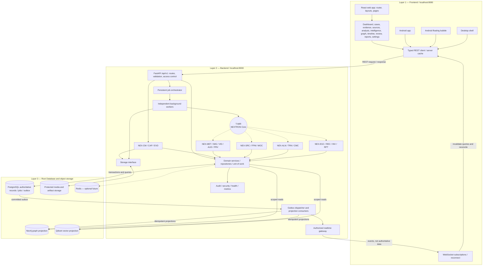
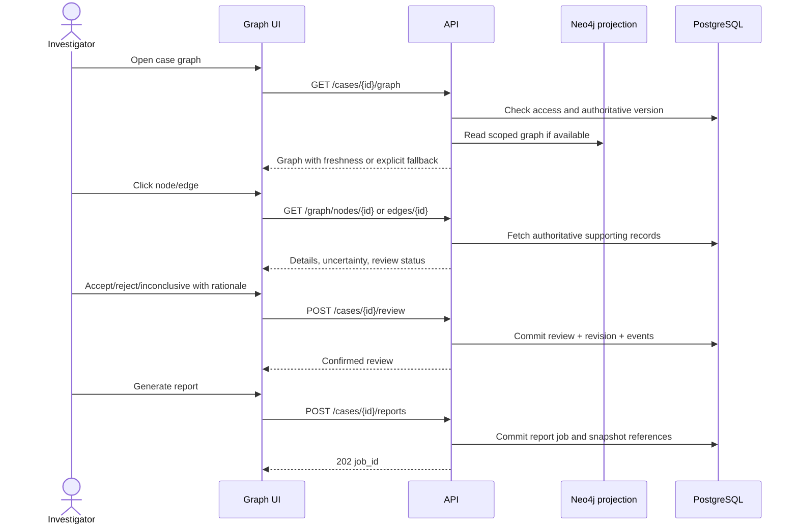
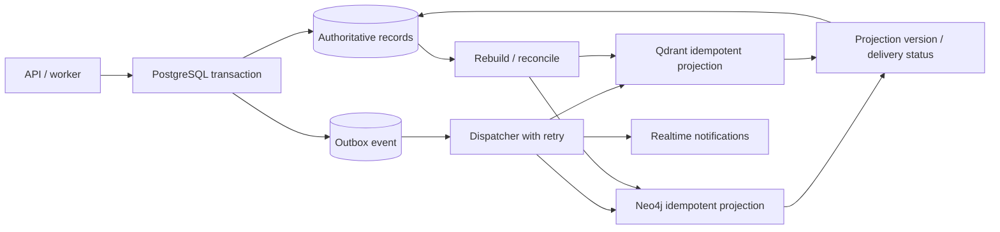
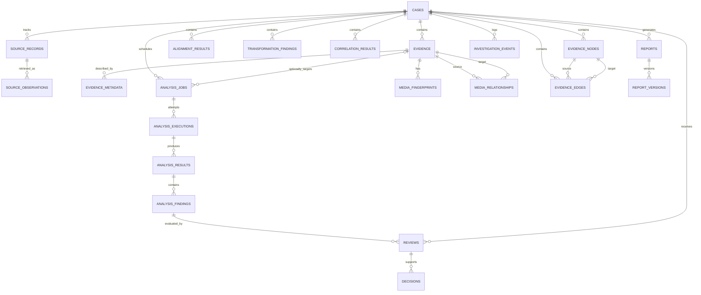

# NEXTRON — Master Project Archive & Engineering Blueprint

**Detect · Correlate · Reconstruct · Investigate**  
Digital Media Intelligence & Forensic Investigation Platform  
**Archive date:** 26 November 2026 | **Architecture baseline:** v1.0 (proposed engineering baseline)  
**Status:** Planning completed sufficiently to start Phase 1; implementation and performance have not been verified.

> **Scope and provenance of this archive:** This is a detailed consolidation of the NEXTRON conversation visible in the current project context, including the sequence of decisions, specifications, examples, prompts, diagrams, and corrections. It is not a verbatim chat export. Some earlier project messages are represented only by summaries or skipped-message markers; screenshots, research reports, original citation results and omitted messages cannot be reconstructed exactly. The document preserves available substantive details and explicitly distinguishes user-confirmed decisions, assistant proposals, and additional engineering clarifications. External technical references are collected in §23; key claims are linked inline. Links are not proof that integrations have been implemented or licensed for this project.

## Contents

1. Project identity and competition context
2. Chronological decision register
3. Final product architecture and constraints
4. The 18 official domain modules and earlier platform-module registry
5. T-MIR research architecture and module dependency graph
6. Product surfaces and complete user journey
7. Three-layer system master blueprint
8. Frontend routes, navigation, and page-action connectivity
9. Backend API endpoint catalogue and contract examples
10. Live data, events, and job orchestration
11. Balanced database architecture and performance
12. Logical data model and evidence lifecycle
13. Final root directory and naming rules
14. Detailed backend directory structure
15. Detailed frontend directory structure
16. Database, datasets, tests, and supporting directory structures
17. Security, privacy, reliability, failure handling
18. Research, datasets, evaluation, and competitive strategy
19. Development roadmap and Phase 1 instructions
20. Backend master prompt
21. Frontend master prompt and naming prompt
22. Acceptance criteria, unresolved decisions, and change history
23. Technical references and source links

---

# 1. Project identity and competition context

## 1.1 Problem statement

The selected competition problem statement is **2. Intelligent Deepfake and Digital Media Verification System**:

> Develop an AI-powered system that analyzes images, videos, and audio recordings to identify potential deepfakes, detect digital manipulation, and help users verify the authenticity of digital media.

The user reported 25 teams competing on the same problem statement and 112 teams in total. These are user-provided competition figures, not independently verified statistics. The competition is at the final hackathon stage; deadline and judging criteria had not been received at the time of discussion. Team size: four. The user wants a high-impact, memorable, technically defensible product, with strong problem relevance and originality, practical implementation and longevity. No jury score or win can be guaranteed.

## 1.2 Product and team

| Item | Established context |
|---|---|
| Name | NEXTRON |
| Category | Digital Media Intelligence & Forensic Investigation Platform |
| Research engine | T-MIR — Transformation-aware Multimodal Investigation & Reconstruction |
| Positioning | Intelligence-first, investigator-oriented, not merely fake/real classification |
| Philosophy | Detect. Correlate. Reconstruct. Investigate. |
| Team | Four members; user owns backend; Raghav owns frontend; two teammates focus on presentation, with research/documentation/testing support proposed |
| Research direction | Direction D was chosen in earlier project discussions; available context describes cross-version lineage, cross-modal manipulation correlation and reproducible investigation |
| Origin intelligence | User explicitly wanted it included because of relevance to cybercrime investigations |
| Cost/hardware | Free and easy to work with wherever feasible; GPU availability uncertain; CPU-first, optional pretrained detectors |
| Priority | Performance, while maintaining a balanced database architecture |
| Implementation status | No verified code, database connections, model benchmarks or deployed integrations supplied in this conversation |

The earlier discussion referenced a teammate's literature review and a report on OMNI's flaws/loopholes. The source reports and full original discussion are not available here. Do not infer specific weaknesses, paper conclusions or competitive claims from those references alone.

## 1.3 What the product must answer

- What exact evidence was received? From what source and acquisition method?
- Was the received byte stream preserved? Does the current file match its recorded hash?
- What metadata, signal properties, detector results and provenance observations exist?
- Are related media versions discoverable within the accessible sources?
- Which visual/audio segments correspond, and where do they diverge?
- What transformations could explain the observed differences?
- Which observations support or contradict a hypothesis? What remains unknown?
- Can another investigator reproduce the analysis from recorded inputs and tool/model versions?
- What human review decisions were made, and on what evidence?

Three questions must remain separate: **integrity** (bytes match a recorded digest), **lineage** (media versions may be related), and **origin** (where content was created or first published). Neither hashing nor similarity can establish authorship or truth of the depicted event.

# 2. Chronological decision register

| Sequence | Discussion or user request | Result / status |
|---|---|---|
| 01 | Research competitor landscape, trusted open-source components, dataset needs, feasibility, jury differentiation | Research-driven positioning; avoid unsupported novelty. Earlier detailed results unavailable. |
| 02 | Make Media Origin & Circulation Intelligence compulsory | Include accessible source history and related-version discovery; important for investigations. |
| 03 | How can the jury trust an alleged original? | Earliest discoverable appearance only; preserve URLs, timestamps and evidence; never claim global first upload. |
| 04 | How does a normal user supply Instagram, Facebook, X or WhatsApp content? | URL-first experience with reliable file upload fallback; Android sharing and screenshots as additional inputs. |
| 05 | Idea: floating mobile bubble with screenshot animation and automatic analysis | Bubble becomes a contextual acquisition launcher; screenshot is not full video/audio or original media. |
| 06 | Mobile app + bubble + system; Android first | User selected `both` from options originally meaning Android + bubble + web. Assistant subsequently included a desktop client as a fourth surface. Later repeated four-surface design became the planning baseline; native desktop scope still should be confirmed before implementation. |
| 07 | Complete product architecture | Shared backend, modular monolith, persistent background workers; no duplicated algorithms per client. |
| 08 | Every feature divided into meaningful abbreviated independent modules | Initial 18 platform-level modules proposed, then a refined 18 backend domain module registry adopted. Both are archived in §4. |
| 09 | Entire user flow | Capture → preserve → analyze → discover → compare → correlate → graph → review → report, with failure paths. |
| 10 | URL symbols, all frontend URLs and active backend connectivity | React routes and API catalogue; no public signup page; database accessed through backend only. |
| 11 | API contracts and live updates | REST + WebSocket; response envelopes, status codes, persistent jobs, query invalidation and reconciliation. |
| 12 | Three-layer dependency diagram and central core | Frontend → backend → data; T-MIR central coordinator; 18 domain modules, named connections. |
| 13 | Official shortcuts | NEX-CM, CAP, EVD, MET, IMG, VID, AUD, PRV, SRC, FPM, MOC, ALN, TRN, CMC, EGC, REC, INV, RPT. |
| 14 | New backend development chat prompt | Backend master context, implementation order, test expectations and API contracts. |
| 15 | Frontend structure and prompt | React/TypeScript/Vite; module-specific UI, Pages/Modules/Features separation; frontend-to-backend contracts. |
| 16 | Human-readable project naming | Capitalized folders/files; no custom underscores; spaces for human-readable names, hyphens/dots or PascalCase for code; tooling exceptions. |
| 17 | Complete backend architecture | Python/FastAPI, 18 packages, T-MIR, workers, API, storage, realtime, audit, shared services. |
| 18 | Different databases? | Options lean, balanced, full ecosystem. User explicitly chose balanced and performance-focused. |
| 19 | Balanced database finalization | PostgreSQL authoritative, Neo4j graph, Qdrant vectors, S3-compatible storage; Redis deferred; transactional outbox. |
| 20 | Separate Database folder | User clarified Database is a sibling of Backend/Frontend, not inside Backend. |
| 21 | Entire end-to-end project tree | Independent Datasets, Tests, Documentation, Design, Infrastructure, Research, Scripts, Tools, Security, GitHub workflows. |
| 22 | Remove duplicate Database inside Backend | Exactly one physical root-level Database directory; move existing content safely before removal. Earlier assistant deletion instruction was unsafe if files existed. |
| 23 | Start step by step | Phase 1 environment checks in VS Code/PowerShell; no actual local repository inspection or installation completed here. |
| 24 | Archive every detail in Markdown | This document. |

# 3. Final product architecture and constraints

## 3.1 Established or recommended baseline

| Area | Decision | Status |
|---|---|---|
| Product | Unified digital media intelligence platform | Established |
| Mobile | Android first; iOS future-compatible | User selected |
| Interfaces | Android app + floating bubble + web dashboard; desktop client included in subsequent roadmap | Desktop native packaging needs confirmation |
| Frontend | React, TypeScript, Vite, React Router | Proposed standard |
| Backend | Python 3.11+; FastAPI modular monolith | Proposed standard |
| Execution | Separate persistent workers; dependency-aware T-MIR | Proposed standard |
| Database | PostgreSQL + Neo4j + Qdrant | User selected balanced |
| Media storage | Protected filesystem initially, S3-compatible object storage as deployment target | Proposed |
| Redis | Deferred until profiling justifies it | Established balanced baseline |
| Sync | Transactional outbox; graph/vector projections eventually consistent | Proposed standard |
| Signup | No public signup page | User specified |
| Local auth | Single-operator development mode, protected sessions; later proper multi-user RBAC | Proposed |
| Research | Controlled evaluation before claims of novelty or accuracy | Required |
| Project root | Backend, Frontend, Database, Datasets, Tests and support areas as siblings | User clarified |
| Actual repository | Unknown; inspect before edits | Open |

Do not confuse logical independent modules with separate deployable microservices. The recommended runtime is one API application plus one or more worker processes with bounded concurrency. Independent modules have contracts and tests, not necessarily network endpoints.

## 3.2 Technology allocation

| Layer | Technologies considered | Role |
|---|---|---|
| Web | React, React DOM, TypeScript, Vite | UI and build |
| Routes | React Router | Nested routes, page state |
| Server state | TanStack Query | Fetch, mutation, cache and invalidation |
| UI state | Zustand | Sidebar, viewport, local selections |
| HTTP | Axios or fetch (choose one central transport) | Typed API client |
| Forms | Zod, React Hook Form, @hookform/resolvers | Validation and forms |
| Visualizations | @xyflow/react (React Flow), Recharts, Lucide React, date-fns | Graph, charts, icons, dates |
| Android | Kotlin, Jetpack Compose, MediaProjection, overlay and Share intents | Native mobile acquisition |
| Desktop | Shared web frontend; Tauri candidate, Electron alternative | Optional native shell |
| API | FastAPI, Pydantic, ASGI server such as Uvicorn | Validation, routing, OpenAPI |
| Persistence | SQLAlchemy, Alembic, PostgreSQL driver | Transactions and migrations |
| Media | FFmpeg, FFprobe, OpenCV, Pillow | Decode, metadata, frames, processing |
| Audio | Chromaprint, pyacoustid (optional interface; test fit) | Fingerprint comparison |
| Provenance | C2PA Python SDK | Credential inspection and verification |
| Models | Optional pretrained inference via PyTorch or other evaluated runtime | Actual AI deepfake detection; not yet selected |
| Search | Qdrant, deterministic hashes, optional pgvector alternative | Candidate retrieval |
| Graph | Neo4j and Cypher | Graph projection, traversals |
| Storage | Filesystem adapter / S3-compatible adapter | Original and derived bytes |
| Tests | pytest, HTTPX/TestClient, Vitest, React Testing Library, Playwright | Unit and integration checks |
| Infrastructure | Docker Compose, CI/CD; Kubernetes deferred | Local reproducibility, deployment |

No model is currently approved or benchmarked in the available record. A hashing/metadata-only demonstration does **not** satisfy the AI-powered deepfake detection requirement by itself. A credible MVP must include evaluated pretrained image/video/audio detection paths (or explicitly scope and disclose unsupported modalities), not merely heuristic artifact flags. Free tooling does not guarantee free external API access, hosting, GPU, or dataset rights.

# 4. The 18 official domain modules

## 4.1 Canonical registry

The following IDs are the latest explicitly adopted backend domain names. Use uppercase IDs in architecture and API metadata; use importable PascalCase Python packages (`NexCm`, etc.). Frontend folder naming may use exact uppercase ID or matching PascalCase; see §13 for the casing discrepancy.

| # | ID | Name | Input | Output | Main storage |
|---:|---|---|---|---|---|
| 01 | NEX-CM | Case Management | Operator, case metadata | Case and lifecycle events | PostgreSQL |
| 02 | NEX-CAP | Evidence Acquisition | File, shared URI, screenshot, URL request | Validated acquisition record | PostgreSQL, object storage staging |
| 03 | NEX-EVD | Evidence Preservation | Validated byte stream | Evidence ID, SHA-256, manifest, custody | PostgreSQL + object storage |
| 04 | NEX-MET | Metadata Intelligence | Preserved evidence | Versioned technical metadata | PostgreSQL |
| 05 | NEX-IMG | Image Forensics | Image or derived frame | Image observations/artifacts | PostgreSQL + objects |
| 06 | NEX-VID | Video Forensics | Video stream | Frame/segment observations | PostgreSQL + objects |
| 07 | NEX-AUD | Audio Forensics | Audio or extracted track | Signal/segment observations | PostgreSQL + objects |
| 08 | NEX-PRV | Provenance Intelligence | Preserved asset | C2PA status, assertions, limitations | PostgreSQL + objects |
| 09 | NEX-SRC | Source Intelligence | User URL, permitted query | Source observations/retrieval status | PostgreSQL |
| 10 | NEX-FPM | Fingerprint & Similarity | Media features, search scope | Fingerprints and ranked candidates | PostgreSQL + Qdrant |
| 11 | NEX-MOC | Media Lineage | Candidates and source records | Qualified version relationships | PostgreSQL + Neo4j projection |
| 12 | NEX-ALN | Temporal Alignment | Comparable media pairs | Segment correspondence/time mapping | PostgreSQL |
| 13 | NEX-TRN | Transformation Analysis | Pair, alignment, observations | Transformation hypotheses | PostgreSQL |
| 14 | NEX-CMC | Cross-Modal Correlation | Available multimodal findings | Support/conflict/uncertainty records | PostgreSQL |
| 15 | NEX-EGC | Evidence Graph Construction | Evidence, sources, findings, hypotheses | Typed graph nodes/edges | PostgreSQL + Neo4j projection |
| 16 | NEX-REC | Timeline & Reconstruction | Graph and time observations | Discoverable timeline, alternatives | PostgreSQL + Neo4j projection |
| 17 | NEX-INV | Review & Decision | Findings, reviewer rationale | Versioned human decisions | PostgreSQL |
| 18 | NEX-RPT | Reporting | Case snapshot and analysis/review versions | PDF/JSON report, artifact hash | PostgreSQL + objects |

## 4.2 Detailed independent module profiles

### 01. NEX-CM — Case Management (`NexCm`)
- Create, list, retrieve, patch case title/description/priority/tags/notes. Archive/reopen with audit history. Associate evidence, source records, jobs, review and reports through IDs, not copied objects.
- Components: CaseService, CaseRepository, validation, lifecycle and case summary/statistics. Optional case-level access enforcement is required before multi-user deployment.
- API: `/cases`, `/cases/statistics`, `/cases/{case_id}`, `/summary`, `/statistics`, `/events`, `/archive`, `/reopen`.
- Independent acceptance: create valid case, reject invalid fields, refresh/restart retrieves committed record, forbidden case inaccessible, archive/reopen follows state rules.

### 02. NEX-CAP — Evidence Acquisition (`NexCap`)
- Inputs: uploaded images/video/audio, screenshots, shared content, authorized screen capture, source URL record, investigator-supplied metadata. Support MIME/size/signature validation, file streaming, cancellation, safe temporary staging, context, permission/consent record and standardized acquisition result.
- Earlier submodule IDs: CAP-FIL, CAP-URL, CAP-SHR, CAP-SCR, CAP-VID, CAP-IMG, CAP-AUD, CAP-OCR, CAP-MET, CAP-VAL, CAP-NRM.
- Components: FileAcquisition, UrlAcquisition (delegates to NEX-SRC), Validation, capture text extraction (OCR), source candidate extraction. OCR only sees visible text; a hidden post URL is not automatically available.
- Acceptance: supported files acquired through common contract, invalid media rejected safely, source restriction returns actionable fallback, no processing before authorized submission.

### 03. NEX-EVD — Evidence Preservation (`NexEvd`)
- Preserve exact received bytes, compute SHA-256 server-side, assign evidence ID/storage key, acquisition metadata, manifest and custody records. Never overwrite originals. Store each derived item independently with parent references and hash. Verify stored bytes on demand/export.
- Earlier submodules: EVD-HSH, EVD-ORG, EVD-MAN, EVD-VER, EVD-MET (now NEX-MET owns extraction), EVD-DER, EVD-REL, EVD-LOG, EVD-COC, EVD-RET.
- Components: HashService, IntegrityService, ChainOfCustody. Canonical cryptographic hash ownership resides here; NEX-FPM references the same digest rather than implementing duplicate SHA-256 logic.
- Acceptance: byte-for-byte preservation; deliberate modification detected; invalid or failed storage never marked preserved; audit event committed; original and derived hashes traceable.

### 04. NEX-MET — Metadata Intelligence (`NexMet`)
- Extract container/codec, resolution, frame rate, duration, audio sample rate/channels, EXIF where present, file metadata, and extractor version using FFprobe/Pillow or suitable libraries. Keep original and extracted timestamps separate; absence and malformed metadata are explicit states.
- Components: MetadataExtractor, ExifAnalyzer, media probe adapter. Do not treat metadata as inherently truthful.
- Acceptance: known fixtures produce expected values, invalid files do not crash system, missing fields remain null/unavailable, extractor version and input hash recorded.

### 05. NEX-IMG — Image Forensics (`NexImg`)
- Image decode/preprocess; perceptual features; compression/resampling/frequency/artifact clues; optional evaluated synthetic-image detector and localization. ELA is a limited heuristic, not a reliable standalone deepfake detector. Re-encoding may alter observations.
- Earlier submodules: IMG-MET, IMG-ELA, IMG-PRC, IMG-FFT, IMG-RES, IMG-ART, IMG-FIN, IMG-DET, IMG-LOC.
- Components: ImageAnalyzer, ImageArtifacts, ImageSimilarity (feature generation; NEX-FPM owns retrieval). Inputs may include screenshot or derived frame, identified explicitly. Output records method/version/score meaning/region/limitations.
- Acceptance: controlled genuine/manipulated/benignly compressed examples; deterministic feature generation where appropriate; localization only when supported; no fabricated results if model unavailable.

### 06. NEX-VID — Video Forensics (`NexVid`)
- Probe video, decode/sample frames and keyframes, record timestamps, visual/temporal signatures, possible discontinuities/splices, candidate segments, optional pretrained deepfake detector. Extract audio as a separately tracked derivative for NEX-AUD.
- Earlier submodules: VID-DEC, VID-FRM, VID-KFR, VID-FIN, VID-TMP, VID-SEG, VID-SPL, VID-CMP, VID-DET, VID-LOC.
- Components: VideoAnalyzer, FrameExtractor, TemporalAnalyzer, VideoFingerprint. Preserve frame timestamp/timebase mapping; avoid loading large video into RAM.
- Acceptance: known clips with variable frame rates and missing audio handled; frame/time mapping reproducible; localized candidates evaluated against labels; bounded memory/runtime.

### 07. NEX-AUD — Audio Forensics (`NexAud`)
- Decode/extract audio, normalize working copy, fingerprint and compare audio, spectral/signal/speech observations, possible splice/replacement and synthetic speech detector. Audio fingerprint similarity is not synthetic speech detection.
- Earlier submodules: AUD-EXT, AUD-FIN, AUD-SPE, AUD-VOI, AUD-SYN, AUD-SPL, AUD-TMP, AUD-DET.
- Components: AudioAnalyzer, AudioFingerprint, SignalAnalyzer; NEX-ALN owns cross-version alignment; NEX-CMC owns multimodal conclusions.
- Acceptance: test known audio pairs, silence, absent audio, compression, replacement; record failures independently of video findings. Validate Chromaprint suitability for short clips/speech rather than assuming it works.

### 08. NEX-PRV — Provenance Intelligence (`NexPrv`)
- Inspect C2PA manifests, assertions, supported signatures, trust status, available history and limitations. Distinguish absent credentials, invalid credentials, unsupported verification, valid signatures and trust-policy outcomes. A valid credential is evidence of signed assertions, not proof of truth.
- Earlier submodules: PRV-C2P, PRV-SIG, PRV-MAN, PRV-HIS, PRV-STA. Components: C2PAAnalyzer, ProvenanceValidator.
- Acceptance: verified fixtures for signed, modified, missing and unsupported credentials; clear output without asserting fake solely because credentials are absent. Reference: [C2PA specification](https://spec.c2pa.org/).

### 09. NEX-SRC — Source Intelligence (`NexSrc`)
- Detect platform, normalize/validate URL, use approved connector, retrieve only permitted metadata/media, retain retrieval history and failures, associate with case. Connectors for Instagram, Facebook, X, YouTube and generic authorized URL; WhatsApp/private material normally user-shared/uploaded.
- Earlier submodules: SRC-DET, SRC-URL, SRC-VAL, SRC-INS, SRC-FBK, SRC-X, SRC-YTB, SRC-GEN, SRC-API, SRC-MET, SRC-MED, SRC-ERR.
- Components: SourceResolver, SourceCollector, BaseAdapter, platform adapters. Contract: `can_handle`, `validate_url`, `retrieve_metadata`, `retrieve_media`, `get_access_status`.
- Record source URL, normalized URL, platform, post/account ID when available and permitted, publication timestamp supplied by source, retrieval UTC timestamp, retrieval method, media hash/reference, status and restrictions. Source access is not guaranteed by a public URL. See [Meta API docs](https://developers.facebook.com/docs/), [X developer docs](https://docs.x.com/), [YouTube Data API](https://developers.google.com/youtube/v3).
- Acceptance: permitted retrieval or explicit unavailable/restricted/not-found/unsupported/rate-limited outcome; fallback to user upload. Retrieved bytes return to NEX-CAP/EVD for preservation before analysis. No private-account scraping or policy bypass.

### 10. NEX-FPM — Fingerprint & Similarity (`NexFpm`)
- Use existing exact digest for byte matches, perceptual image/frame hashes, temporal features and audio fingerprints; optional evaluated visual/audio embeddings. Index permitted corpus, filter scope before candidate retrieval, retain method/model/version, score metric, threshold and rank. Do not confuse hash distance, cosine similarity and calibrated probability.
- Components: FingerprintEngine, SimilarityEngine, CandidateMatcher. Qdrant used for suitable vectors; binary/perceptual hashes may need separate exact/Hamming matching rather than a dense-vector approximation.
- Acceptance: controlled originals/derivatives vs unrelated examples; precision/recall/false matches and search latency measured; enforce case/tenant access; do not invent matches when corpus unavailable.

### 11. NEX-MOC — Media Lineage (`NexMoc`)
- Turn candidate matches into typed version relationship hypotheses with supporting observations, provenance and source timestamps; compare versions; distinguish similarity, shared segment, possible derivation and proven evidence linkage.
- Earlier umbrella MOCI (Media Origin & Circulation Intelligence) submodules: MOCI-SRC, SEA, FIN, MAT, LIN, VER, TIM, CIR, ATR, UNC. Those responsibilities are now spread across NEX-SRC, FPM, MOC, REC and T-MIR. MOCI remains a product capability label, not a 19th domain module.
- Components: LineageEngine, RelationshipBuilder, VersionComparator.
- Acceptance: related versions grouped with evidence, earliest discoverable timestamp correctly qualified, conflicting or missing times displayed, no absolute original claim or unsupported direction inference.

### 12. NEX-ALN — Temporal Alignment (`NexAln`)
- Align corresponding image/video frames or audio/video intervals across versions; record offset, segment mapping, added/missing portions, match support and uncertainty. Account for different frame rates, crops, speed changes where supported, partial overlaps.
- Earlier submodules: TAL-FRM, TAL-SEG, TAL-TIM, TAL-GAP, TAL-ERR. Components: TemporalAligner, FrameAligner, AudioAligner.
- Acceptance: known offset/trim/splice cases evaluated with temporal IoU and boundary error; no mapping when similarity insufficient.

### 13. NEX-TRN — Transformation Analysis (`NexTrn`)
- Compare aligned versions, detect observations consistent with compression, re-encoding, crop, resizing, audio replacement, segment insertion/removal, possible frame editing. Store alternative explanations and parameters, not invented transformation history.
- Earlier submodules: TRA-CMP, RES, CRP, ENC, AUD, SPL, FRM, SEQ. Components: TransformationDetector, TransformationClassifier, TransformationTimeline.
- Acceptance: known benign and malicious transformations distinguishable where supported; evaluate individual/combined operations, unknown cases remain inconclusive; exact order only if evidence supports it.

### 14. NEX-CMC — Cross-Modal Correlation (`NexCmc`)
- Correlate visual/audio/metadata/provenance observations and transformation hypotheses; locate temporal agreement, conflicts and unavailable modalities. Preserve raw detector scores and distinguish them from aggregate or calibrated confidence.
- Earlier submodules: CMC-AV, TMP, FRM, CON, UNC. Components: CrossModalAnalyzer, EvidenceCorrelator, ConflictAnalyzer.
- Acceptance: controlled audio replacement and legitimate edit counterexamples; no mandatory audio dependency for still images; preserve partial results and alternate interpretations.

### 15. NEX-EGC — Evidence Graph Construction (`NexEgc`)
- Build typed nodes and edges for evidence, source records, analysis runs, findings, hypotheses, reviews. Edge carries evidence IDs, method/version, score semantics, uncertainty and review status; stable IDs and graph versions. Neo4j projection rebuildable from PostgreSQL.
- Earlier submodules: EGC-NOD, EDG, REL, SCO, COR, CON, UNC, VAL, VIS. Components: GraphBuilder, NodeManager, EdgeManager.
- Acceptance: every edge traceable to stored observations, correct case scope, clicking a node/edge fetches details, graph eventually converges after projection outage.

### 16. NEX-REC — Timeline & Reconstruction (`NexRec`)
- Build discoverable sequence from source observations, alignment, graph and investigation events. Separate publication, file metadata, retrieval and processing time; support uncertain/missing/conflicting timestamps and alternative explanations. Candidate DAG for lineage hypotheses only; evidence graph itself need not be acyclic.
- Earlier reconstruction submodules: REC-VER, DAG, SEQ, ALT, CON. Components: TimelineBuilder, ReconstructionEngine, UncertaintyAnalyzer.
- Acceptance: known ground-truth partial histories; no chronology invented from file metadata; reproducibility records include tool versions, parameters, input/output hashes.

### 17. NEX-INV — Review & Decision (`NexInv`)
- Investigator sees findings and supporting evidence, accepts/rejects/marks inconclusive or requests more evidence, records rationale and revision history. Machine observations immutable as produced; human review is a separate record.
- Earlier submodules: INV-CASE (now NEX-CM), EVD, QUE, REV, DEC, NOT, TIM, COL, STA. Components: ReviewManager, DecisionManager. Collaborative review is future-scope unless authenticated access implemented.
- Acceptance: review references specific finding and version; reviewer identity from session; review audit; request additional evidence loops into same case.

### 18. NEX-RPT — Reporting (`NexRpt`)
- Generate versioned PDF/JSON from committed snapshot, with inventory, original hashes, sources, methods, engine/model versions, findings, graph, timeline, contradictions, alternatives, human decisions and limitations. Draft reports can be generated without mandatory review if marked clearly; final reviewed reports require applicable review policy.
- Earlier submodules: RPT-SUM, EVD, MET, FOR, LIN, GRF, TIM, UNC, REV, EXP. Components: ReportBuilder, ReportRenderer, ReportVersioning.
- Acceptance: report downloadable with authorized access, hashes and references resolve; regeneration preserves old version; failed report job does not damage case.

## 4.3 Historical 18 platform-level module registry (not an additional 18 backend modules)

Earlier response organized the **entire product** into 18 top-level logical modules, before the final domain breakdown. Preserve this mapping for understanding earlier diagrams, not as duplicate packages.

| Earlier ID | Meaning | Current location |
|---|---|---|
| NEX-MOB | NEXTRON Mobile | Android client |
| NEX-BUB | NEXTRON Bubble Interface | Android overlay/capture capability |
| NEX-WEB | NEXTRON Web Workspace | React client |
| NEX-DESK | NEXTRON Desktop Environment | Desktop shell |
| NEX-API | API Gateway | Backend API infrastructure |
| NEX-ID | Identity & Access Management | Security/session infrastructure |
| NEX-CAP | Capture & Acquisition | NEX-CAP |
| NEX-SRC | Source Integration & Resolution | NEX-SRC |
| NEX-EVD | Evidence Preservation & Management | NEX-EVD |
| NEX-MFA | Media Forensic Analysis | NEX-MET/IMG/VID/AUD/PRV |
| NEX-MOCI | Media Origin & Circulation Intelligence | NEX-SRC/FPM/MOC/REC |
| NEX-TMIR | Transformation-aware Multimodal Investigation & Reconstruction | Central intelligence and orchestration |
| NEX-EGC | Evidence Graph & Correlation | NEX-EGC, NEX-CMC |
| NEX-INV | Investigation Management | NEX-CM, NEX-INV |
| NEX-RPT | Reporting & Explainability | NEX-RPT |
| NEX-DAT | Data & Storage Infrastructure | Root Database and backend Storage adapter |
| NEX-OPS | Operations & Orchestration | Workers, orchestration, monitoring |
| NEX-SEC | Security, Privacy & Compliance | Backend Core + root Security policies |

Supporting IDs discussed: NEX-SHARED (contracts), NEX-JOB (jobs), NEX-WS (realtime), NEX-DB (persistence), NEX-STORAGE (object storage). These are infrastructure labels, not new domain modules.

# 5. T-MIR research architecture and dependency graph

**T-MIR = Transformation-aware Multimodal Investigation & Reconstruction.** Research question discussed:

> How can we reconstruct and investigate the discoverable transformation history of suspicious digital media by correlating cross-modal forensic evidence, media-version relationships and reproducible investigation records?

T-MIR combines cross-version media lineage, cross-modal manipulation correlation and reproducible investigations. The research contribution is a hypothesis, not a validated novelty claim. It must be compared against relevant literature and baselines.

| Earlier T-MIR subsystem | Responsibility / final owners |
|---|---|
| TMIR-01 Multimodal Fingerprint Engine | Image perceptual features, video frames/temporal signatures, audio fingerprints, metadata; NEX-FPM and media engines |
| TMIR-02 Cross-Version Matching | CVM-IMG, VID, AUD, MUL, SCO; candidate retrieval and score semantics; NEX-FPM/MOC |
| TMIR-03 Temporal Alignment | TAL-FRM, SEG, TIM, GAP, ERR; NEX-ALN |
| TMIR-04 Transformation Analysis | TRA-CMP, RES, CRP, ENC, AUD, SPL, FRM, SEQ; NEX-TRN |
| TMIR-05 Cross-Modal Correlation | CMC-AV, TMP, FRM, CON, UNC; NEX-CMC |
| TMIR-06 Reconstruction | REC-VER, DAG, SEQ, ALT, CON; NEX-MOC/EGC/REC |
| TMIR-07 Reproducibility | REP-PAR, VER, ENV, EVT, RUN, CMP; orchestration manifests and immutable run records |

T-MIR determines applicable stages, schedules independent engines, checks prerequisites, passes execution context, records outcomes, aggregates observations and manages downstream graph/reconstruction work. It does not perform every algorithm itself, nor should it own all CRUD. Separate domain services manage cases, capture and review; T-MIR consumes their contracts. A completed analysis may be partial; absent inputs are explicit SKIPPED/UNAVAILABLE rather than false negatives.

## 5.1 Master named connectivity diagram

Solid arrows are data/dependency flow; dashed arrows denote orchestration or optional branches. The core is central logically; a Mermaid renderer may lay out nodes differently. A source-discovered file returns to acquisition and preservation as a new evidence object; it must not bypass integrity handling.



Historical direct dependency table: CM→CAP; CAP→EVD; EVD→MET/IMG/VID/AUD/PRV; MET→FPM; IMG/VID→FPM/ALN/CMC; AUD→FPM/CMC; PRV→CMC; SRC→FPM/EGC; FPM→MOC; MOC→ALN/TRN/EGC; ALN→TRN; TRN→CMC/EGC; CMC→EGC; EGC→REC; REC→INV; INV→RPT. Clarification: ALN and TRN are skipped when no comparable pairs; CMC/EGC still consume whatever evidence exists. A job-run DAG is acyclic per evidence snapshot; discovery/additional-evidence iterations create new runs rather than endlessly recursing within a run.

## 5.2 Shared module contracts

Shared identifiers: `case_id`, `evidence_id`, `source_id`, `acquisition_id`, `analysis_id`, `execution_id`, `job_id`, `finding_id`, `relationship_id`, `event_id`, `report_id`. Prefer canonical UUIDs with optional human-friendly display numbers (`CASE-0001`, `EVD-0001`). IDs in example payloads are illustrative display IDs; resolve actual identifier rules before implementation. Timestamps UTC ISO 8601. Use versioned schemas and avoid shared mutable global state.

Example evidence contract (illustrative):

```json
{"evidence_id":"EVD-0001","case_id":"CASE-0001","media_type":"video","source_id":"SRC-0001","sha256":"<64 hexadecimal characters>","storage_reference":"originals/example-key","original_preserved":true,"created_at":"2026-11-26T12:00:00Z","status":"PRESERVED"}
```

Proposed finding contract includes finding ID, evidence IDs, run/execution ID, engine and version, finding type, observed measurement, score and metric semantics (nullable if unsupported), optional time range/region, supporting artifact IDs, limitations, parameters, status and timestamp. Human review is a separate object. Reproducibility manifest records input hashes, model/checkpoint hash, code/build version, library versions, parameter set, relevant random seeds, execution environment, artifacts and hashes. Reproducibility does not guarantee bitwise equality for nondeterministic inference.

Independent implementation: each module can receive fixture inputs, return a typed result, use mocked repository/storage ports and have independent unit tests. Real persistence and platform access require integration tests. A module is not complete merely because its folder exists. A central contracts version and API schema prevent divergent IDs or enum meanings across clients.

# 6. Product surfaces and complete user journey

## 6.1 Entry points and interaction modes

| Surface | User workflow | Constraints |
|---|---|---|
| Android app | Quick investigation/new case → upload/paste URL/import shared content → context → preview/consent → submit → job status → findings/history/report | Native application, common APIs |
| Floating bubble | Enable overlay → tap/drag orb → expand actions → capture/share → preview → confirm → submit → progress/result notification → app | Android permissions; cannot silently read other apps |
| Web dashboard | Open `/dashboard` → create case or select existing → file/URL → evidence preview → analysis → graph/timeline → review/report | No public signup page; local operator session initially |
| Desktop | Open shared investigation workspace → local file/folder ingestion → same case → comparison/export | Optional native shell, local processing/offline sync later |

The product should have three depths: **Quick Check** (ordinary user, simple results), **Source Investigation** (discoverable related versions and timeline), **Full Forensic Investigation** (multiple evidence objects, graph, review, reproducibility and report). The same case can be opened across clients when authenticated and network-accessible. No duplicate forensic code per client.

## 6.2 Android mobile and floating bubble detail

The user's idea: a floating bubble visible while scrolling a social app, tap animation simulating scanning/screenshot, automatically extract available information and initiate NEXTRON investigation. The technical design turns it into a permission-aware acquisition launcher. Capture does not imply that the underlying post URL, all frames, original audio or media file is accessible.

- Quick Scan: user-authorized capture of visible screen; OCR visible account name/caption/URL where present, possible visual matching; screenshot is a new evidence object.
- Source Investigation: Android Sharesheet receives text/URL or actual media if source application shares it; user may paste link manually.
- Deep Capture: user-authorized screen/app session, record available frames; playback audio requires separate support and permissions; protected windows may refuse capture. Do not capture continuously without informed authorization.
- Before upload: hide own overlay from capture where possible, preview relevant content, allow cancellation/redaction for unrelated private data; if redaction is used preserve only user-approved submission and describe acquisition accurately. Stop projection when done; maintain appropriate foreground-service indicator/lifecycle.
- Android overlay permission (`SYSTEM_ALERT_WINDOW`) is distinct from MediaProjection. Android 14-targeting apps need appropriate foreground service declarations and fresh user consent per projection session; token reuse is restricted. Use `ACTION_SEND`/`ACTION_SEND_MULTIPLE` intent filters for sharing. Sources: [MediaProjection](https://developer.android.com/media/grow/media-projection), [Android 14 behavior changes](https://developer.android.com/about/versions/14/behavior-changes-14), [overlay permission](https://developer.android.com/reference/android/Manifest.permission#SYSTEM_ALERT_WINDOW), [receive shared data](https://developer.android.com/develop/ui/compose/sharing/receive).
- Do not use Accessibility Services to secretly inspect other apps or bypass capture restrictions. User can stop or disable bubble.
- A physical Android phone cannot connect to the developer's computer through its own `localhost`. Use a secure, explicitly configured development endpoint reachable on the LAN, emulator host mapping where applicable, or deployment URL. Do not expose unauthenticated backend publicly.

Historical submodule inventory: MOB-HOME, UPL, URL, SHR, CAS, PRG, RES, GRF, RPT, SET, NOT. BUB-ORB (render/animate), OVL (overlay lifecycle), ACT (tap/drag), MNU (menu), QSC (quick scan), SHR (share/link), CAP (authorized capture), EXT (extract), PRE (preview), SUB (submit), STS (status). WEB-DASH, CASE, EVD, MED, LIN, GRF, TIM, ANL, REV, RPT, ADM. DESK-SHL, FIL, LOC, CAS, CMP, EXP, SYN, OFF. Local worker/offline support is a later capability, not a prerequisite.



## 6.3 Full system user flow



## 6.4 Example signature jury demonstration

Use consented/staged media rather than a real public figure's fabricated statement: an original controlled video, a benign re-encoded/cropped version, and a version with edited/replaced audio. Provide two permitted source records or clearly marked synthetic fixture records. Show upload or Android share, preserved bytes and SHA-256, matching visual segments, aligned timelines, differing audio intervals, possible transformation history and supporting graph. Explain alternatives (e.g., legitimate dubbing or separate edits), reviewer decision and report. A screenshot-only submission should demonstrate its limitations and request the actual media. Do not present controlled-corpus discovery as global internet search.

Illustrative conclusion: “The submitted video shares visual segments with another discovered version. Its audio differs over the identified interval. These observations are consistent with editing or audio replacement; the identity of the editor and time of modification are not established.”

## 6.5 Proposed screen layout

Mobile splash → welcome/local access → Home → input selection → evidence preview/consent → progress workspace → findings → report/history. Proposed mobile tabs: Home, Investigations, Explore (accessible source collection only), Reports, Profile/settings. Web application: persistent sidebar, topbar, global search, notifications, job status, breadcrumbs, status bar. Investigation workspace: left case/evidence/source panel; main media comparison/graph; bottom timeline and processing events; right finding, uncertainty and review controls. Desktop can reuse web workspace. Dark-first charcoal/graphite UI with restrained accents, high contrast, clear typography, keyboard navigation, meaningful status text, accessible charts. Avoid generic admin templates or decorative effects that reduce readability.

# 7. Three-layer system master blueprint



Logical dependencies are not a literal deployment topology. Worker claims and retries use persistent jobs, not frontend events. API returns only after appropriate committed operation. Original file storage and database commit cannot be made atomic with an ordinary SQL transaction; reconcile staged objects explicitly. No frontend-to-database connection.

# 8. Frontend routes, navigation and page-action connectivity

## 8.1 URL syntax and environment

Example supplied by user: `localhost:8080/homepage?login=signup` (illustrative only; no signup page). Actual example: `http://localhost:8080/investigations?status=active&page=2`.

| Part | Meaning |
|---|---|
| `http://` | Protocol/scheme |
| `localhost` | Host (the device running browser) |
| `:8080` | Port |
| `/investigations` | Route/path |
| `?` | Starts query string |
| `status=active` | Parameter name/value |
| `&page=2` | Adds another parameter |
| `/evidence/:evidenceId` | Router template for dynamic resource ID |
| `#fragment` | Optional client fragment; not sent as ordinary HTTP path/query |

Use paths for resource identity, query parameters for filters/pagination/selected view, request body for creation/update. Use URL encoding. Do not put passwords, tokens or private evidence content in query strings. Default `/` redirects to `/dashboard`; no public `/signup`. Development frontend `http://localhost:8080`, backend `http://localhost:8000`, base `http://localhost:8000/api/v1`, Swagger `/docs`, OpenAPI `/openapi.json`, WS base `ws://localhost:8000/api/v1/ws`; PostgreSQL `localhost:5432` (private). Set Vite port explicitly if required; local ports are proposals, not confirmed open services.

```dotenv
VITE_API_BASE_URL=http://localhost:8000/api/v1
VITE_WS_BASE_URL=ws://localhost:8000/api/v1/ws
```

## 8.2 Complete route tree

```text
/
├── dashboard
├── investigations
│   ├── new
│   ├── active
│   ├── completed
│   ├── archived
│   └── :caseId
│       ├── evidence
│       │   └── add
│       ├── sources
│       ├── analysis
│       │   ├── image
│       │   ├── video
│       │   ├── audio
│       │   └── provenance
│       ├── lineage
│       ├── timeline
│       ├── graph
│       ├── review
│       ├── report
│       ├── events
│       └── settings
├── evidence
│   └── :evidenceId
│       ├── preview
│       ├── metadata
│       ├── integrity
│       ├── analysis
│       ├── versions
│       └── history
├── sources
│   ├── discover
│   ├── connectors
│   ├── instagram
│   ├── facebook
│   ├── x
│   ├── youtube
│   └── :sourceId
├── lineage
├── intelligence
│   ├── matching
│   ├── alignment
│   ├── transformations
│   ├── correlation
│   ├── reconstruction
│   ├── uncertainty
│   ├── reproducibility
│   ├── experiments
│   ├── datasets
│   └── evaluation
├── graph
│   └── :graphId
│       ├── nodes/:nodeId
│       └── relationships/:edgeId
├── reports
│   └── :reportId
│       ├── preview
│       └── history
├── notifications
├── system
│   ├── health
│   ├── database
│   ├── workers
│   ├── storage
│   ├── connectors
│   ├── jobs
│   └── logs
├── settings
│   ├── general
│   ├── privacy
│   ├── permissions
│   ├── notifications
│   └── retention
└── help
```

Use nested layouts and error boundaries. Refresh/deep-link and browser back/forward work. SPA hosting must rewrite application paths to `index.html`; API paths must not be intercepted by that fallback. Static route names must not conflict with IDs (`statistics`, `connectors`, `new`, `active`, etc.). Use case-scoped graph as canonical view; global graph and global intelligence pages should use authorized case selection or aggregate API rather than assuming global access. Planned research/admin routes must not appear as live features until data/permissions are implemented.

## 8.3 Global navigation nodes (original proposed inventory)

| ID | Label | Destination/action |
|---|---|---|
| NAV-001 | Dashboard | `/dashboard` |
| NAV-002 | Investigations | `/investigations` |
| NAV-003 | New Investigation | `/investigations/new` |
| NAV-004 | Evidence Library | `/evidence` |
| NAV-005 | Sources | `/sources` |
| NAV-006 | Media Lineage | `/lineage` |
| NAV-007 | Intelligence | `/intelligence` |
| NAV-008 | Evidence Graph | `/graph` |
| NAV-009 | Reports | `/reports` |
| NAV-010 | Notifications | `/notifications` |
| NAV-011 | System Health | `/system` |
| NAV-012 | Settings | `/settings` |
| NAV-013 | Global Search | Search overlay (contract not finalized) |
| NAV-014 | Job Monitor | `/system/jobs` |
| NAV-015 | User/Workspace | Workspace menu; no signup |

Secondary case navigation: Overview, Evidence, Sources, Analysis (four modality tabs), Lineage, Timeline, Graph, Review, Report, Events, Settings. Preserve `caseId` and selected evidence/run across views. Clicking graph node/edge opens detail panel and retrieves supporting records without full page reload.

## 8.4 Page-to-API matrix

Paths in the API column are relative to `/api/v1`. `C`, `E`, `A`, `S`, `R`, `J`, `N`, `G` denote case, evidence, analysis, source, report, job, node, edge IDs respectively. `GET` implied for page load. Asterisks mark gaps/new proposals rather than established endpoints.

| Frontend path | Load | Clicks / actions |
|---|---|---|
| `/` | None | Redirect dashboard |
| `/dashboard` | `/cases/statistics`, `/evidence/statistics`, `/cases`, `/jobs`, `/system/status`, `/notifications` | Create, open case/job, inspect service; live refresh |
| `/investigations` | `/cases` | Search/filter/sort/paginate; create, archive |
| `/investigations/new` | optional `/settings` | POST `/cases` → case workspace |
| `/investigations/active` | `/cases?status=...` | Open case |
| `/investigations/completed` | `/cases?status=...` | Open case |
| `/investigations/archived` | `/cases?status=ARCHIVED` | POST `/cases/C/reopen` |
| `/investigations/:caseId` | `/cases/C`, `/cases/C/summary`, `/cases/C/statistics`, `/cases/C/events`, `/jobs?case_id=C` | PATCH case, archive/reopen, navigate tabs |
| `/investigations/:caseId/evidence` | `/cases/C/evidence` | Add/select evidence |
| `/investigations/:caseId/evidence/add` | `/cases/C`, optional settings | POST `/cases/C/evidence` multipart; show upload progress |
| `/investigations/:caseId/sources` | `/cases/C/sources`, `/sources/connectors` | POST source, resolve/refresh, upload fallback |
| `/investigations/:caseId/analysis` | `/cases/C/evidence`, `/evidence/E/analysis`, `/jobs?case_id=C` | Select evidence/run, start engines |
| `/investigations/:caseId/analysis/image` | `/analyses/A/image`, `/analyses/A/artifacts` | inspect region/preview, retry |
| `/investigations/:caseId/analysis/video` | `/analyses/A/video`, `/analyses/A/artifacts` | seek to finding, inspect frames, retry |
| `/investigations/:caseId/analysis/audio` | `/analyses/A/audio`, `/analyses/A/artifacts` | play/seek interval, retry |
| `/investigations/:caseId/analysis/provenance` | `/analyses/A/provenance` | inspect manifest and limits |
| `/investigations/:caseId/lineage` | `/cases/C/lineage`, `/cases/C/lineage/relationships` | POST lineage search, GET compare pair |
| `/investigations/:caseId/timeline` | `/cases/C/timeline`, `/cases/C/reconstruction` | inspect event and source evidence |
| `/investigations/:caseId/graph` | `/cases/C/graph`, `/nodes`, `/edges`, `/statistics` (under graph) | `/graph/nodes/N`, `/graph/edges/G` |
| `/investigations/:caseId/review` | `/cases/C/review`, `/cases/C/decisions` | POST review/decision, PATCH review; request evidence |
| `/investigations/:caseId/report` | `/cases/C/reports` | POST generation, preview/download |
| `/investigations/:caseId/events` | `/cases/C/events` | filter event, inspect details |
| `/investigations/:caseId/settings` | `/cases/C` | PATCH allowed fields; case policy contract TBD |
| `/evidence` | global evidence list* or scoped case selection | Filter, open details |
| `/evidence/:evidenceId` | `/evidence/E` | Analyze, preview, download |
| `/evidence/:evidenceId/preview` | `/evidence/E/preview` | Media controls; seek supported ranges |
| `/evidence/:evidenceId/metadata` | `/evidence/E/metadata` | Refresh via reprocess where implemented |
| `/evidence/:evidenceId/integrity` | `/evidence/E/integrity` | POST `/evidence/E/verify-integrity` |
| `/evidence/:evidenceId/analysis` | `/evidence/E/analysis` | POST analyze/reprocess, retry |
| `/evidence/:evidenceId/versions` | `/evidence/E/versions` | Compare candidate pair |
| `/evidence/:evidenceId/history` | `/evidence/E/history` | Inspect acquisition/audit |
| `/sources` | global list* or selected `/cases/C/sources` | Filter, open source |
| `/sources/discover` | `/sources/connectors` | Select/create case, submit URL |
| `/sources/connectors` | `/sources/connectors` | GET `/sources/connectors/{platform}` |
| `/sources/instagram`, `/facebook`, `/x`, `/youtube` (under sources) | case-scoped or global source list with platform filter* | Open source; no invented provider access |
| `/sources/:sourceId` | `/sources/S`, `/sources/S/history` | POST `/resolve` or `/refresh` |
| `/lineage` | choose case then `/cases/C/lineage` | Search, compare |
| `/intelligence` | choose case, summary, job list | Navigate feature tabs |
| `/intelligence/matching` | `/cases/C/lineage`, relationships | POST search |
| `/intelligence/alignment` | `/cases/C/alignment` | POST alignment for pair |
| `/intelligence/transformations` | `/cases/C/transformations` | POST transformations/analyze |
| `/intelligence/correlation` | `/cases/C/correlation` | POST correlation |
| `/intelligence/reconstruction` | `/cases/C/reconstruction` | Inspect timeline/hypotheses |
| `/intelligence/uncertainty` | findings/correlation/reconstruction | Inspect conflicts/limitations |
| `/intelligence/reproducibility` | `/analyses/A/reproducibility` | inspect run metadata; rerun via reprocess |
| `/intelligence/experiments`, `/datasets`, `/evaluation` | research APIs* | research results only once implemented |
| `/graph` | case selection* | open graph |
| `/graph/:graphId` | resolve graphId to case* then `/cases/C/graph` | select nodes/edges |
| `/graph/:graphId/nodes/:nodeId` | `/graph/nodes/N` | supporting evidence |
| `/graph/:graphId/relationships/:edgeId` | `/graph/edges/G` | supporting findings |
| `/reports` | case selection or global report list* | open report |
| `/reports/:reportId` | `/reports/R` | preview/download/history |
| `/reports/:reportId/preview` | `/reports/R/preview` | download |
| `/reports/:reportId/history` | `/reports/R/history` | choose report version |
| `/notifications` | `/notifications` | PATCH read; POST read-all |
| `/system` | `/system/status`, `/system/metrics` | service drilldowns |
| `/system/health` | `/health`, `/health/ready` | refresh |
| `/system/database` | `/system/database` | actual health probe |
| `/system/workers` | `/system/workers` | worker health |
| `/system/storage` | `/system/storage` | storage health |
| `/system/connectors` | `/system/connectors` | connector status |
| `/system/jobs` | `/jobs`, `/jobs/J` | cancel/retry; subscribe WS |
| `/system/logs` | `/events` (authorized, redacted) | filter; no raw secrets |
| `/settings` and `/settings/general`, `/privacy`, `/permissions`, `/notifications`, `/retention` | `/settings`, `/preferences` | PATCH permitted configuration |
| `/help` | versioned local documentation | troubleshooting; no required API |

All components need loading, successful data, genuine empty, error, offline/stale/reconnecting states. Never display zero as a substitute for an unavailable statistic. For disabled/unimplemented features display explicit unavailable state, not active fake button.

# 9. API endpoint catalogue and contract examples

## 9.1 Common contract

Versioned prefix `/api/v1`. GET reads; POST creates/starts; PATCH partial updates; PUT full replace when designed; DELETE only for expressly permitted lifecycle actions. Original evidence deletion requires retention and authorization policy; no unrestricted DELETE. JSON success envelope (except binary streaming/204):

```json
{"success":true,"message":"Investigation retrieved successfully","data":{"case_id":"CASE-0001","title":"Suspicious media investigation","status":"OPEN"},"meta":{"request_id":"req_123","timestamp":"2026-11-26T10:30:00Z"}}
```

Pagination: `data` array, `pagination` with `page`, `page_size`, `total_items`, `total_pages`, `has_next`, `has_previous`; include `meta`. Error:

```json
{"success":false,"error":{"code":"EVIDENCE_NOT_FOUND","message":"The requested evidence does not exist","details":null},"meta":{"request_id":"req_456","timestamp":"2026-11-26T10:30:00Z"}}
```

HTTP: 200 successful read/update, 201 created, 202 accepted async job, 204 no content, 400 bad request, 401 unauthenticated, 403 forbidden, 404 not found, 409 conflict, 413 too large, 415 unsupported media, 422 validation, 429 rate limit, 500 internal error, 503 dependency unavailable. Structured codes (DATABASE_UNAVAILABLE, WORKER_UNAVAILABLE, INVALID_MEDIA_FORMAT, ANALYSIS_FAILED, EVIDENCE_NOT_FOUND). Do not return stack traces. Multipart for evidence; binary download/preview or authorized short-lived URL. Support HTTP range where needed for playback. All mutations validate authorization, inputs, lifecycle, idempotency where relevant; record durable events.

Earlier query examples used both `q`, `search`, `limit`, `page_size`, `sort` and `sort_by`. Canonical recommended reconciliation: `search`, `page`, `page_size`, `sort_by`, `sort_order`, `status`, `priority`, `from`, `to`, `case_id`, media type and platform when relevant. Keep frontend query spelling consistent with OpenAPI. `status=active` is a UI filter, not necessarily a stored case status. Resolve mapping in enum spec.

## 9.2 Consolidated endpoint inventory

The following preserves all explicitly proposed endpoint families, including later additions. They are not implemented or verified. All HTTP paths below are relative to `/api/v1`.

| Method | Endpoint | Purpose |
|---|---|---|
| GET | `/health` | Liveness (API running) |
| GET | `/health/ready` | Required dependency readiness |
| GET | `/system/status` | Overall status |
| GET | `/system/database` | Real DB probes |
| GET | `/system/storage` | Storage readiness |
| GET | `/system/workers` | Worker heartbeat and availability |
| GET | `/system/connectors` | Source integration health |
| GET | `/system/metrics` | Operational metrics |
| POST | `/cases` | Create case |
| GET | `/cases` | List/filter/page cases |
| GET | `/cases/statistics` | Aggregate case statistics |
| GET | `/cases/{case_id}` | Read case |
| PATCH | `/cases/{case_id}` | Update allowed fields |
| POST | `/cases/{case_id}/archive` | Archive |
| POST | `/cases/{case_id}/reopen` | Reopen |
| GET | `/cases/{case_id}/summary` | Case overview |
| GET | `/cases/{case_id}/events` | Case events |
| GET | `/cases/{case_id}/statistics` | Case counts |
| POST | `/cases/{case_id}/evidence` | Multipart upload |
| GET | `/cases/{case_id}/evidence` | Case evidence list |
| GET | `/evidence/statistics` | Evidence counts |
| GET | `/evidence/{evidence_id}` | Evidence detail |
| GET | `/evidence/{evidence_id}/metadata` | Metadata |
| GET | `/evidence/{evidence_id}/integrity` | Recorded hash and verification state |
| POST | `/evidence/{evidence_id}/verify-integrity` | Recalculate and compare hash |
| GET | `/evidence/{evidence_id}/history` | Custody events |
| GET | `/evidence/{evidence_id}/preview` | Preview/thumbnail |
| GET | `/evidence/{evidence_id}/download` | Authorized original bytes |
| GET | `/evidence/{evidence_id}/versions` | Related versions |
| PATCH | `/evidence/{evidence_id}` | Permitted annotations only |
| POST | `/evidence/{evidence_id}/reprocess` | New run |
| POST | `/cases/{case_id}/sources` | Create URL/source record |
| GET | `/cases/{case_id}/sources` | List sources |
| GET | `/sources/connectors` | Connector list |
| GET | `/sources/connectors/{platform}` | Connector details |
| GET | `/sources/{source_id}` | Source detail |
| POST | `/sources/{source_id}/resolve` | Permitted resolution |
| POST | `/sources/{source_id}/refresh` | New retrieval observation |
| GET | `/sources/{source_id}/history` | Retrieval history |
| POST | `/evidence/{evidence_id}/analyze` | Create analysis job |
| GET | `/evidence/{evidence_id}/analysis` | Analysis runs/summary |
| GET | `/analyses/{analysis_id}` | Run/result detail |
| GET | `/analyses/{analysis_id}/image` | Image findings |
| GET | `/analyses/{analysis_id}/video` | Video findings |
| GET | `/analyses/{analysis_id}/audio` | Audio findings |
| GET | `/analyses/{analysis_id}/provenance` | Provenance findings |
| POST | `/analyses/{analysis_id}/retry` | Retry failed engine(s) |
| GET | `/analyses/{analysis_id}/artifacts` | Result artifacts |
| GET | `/analyses/{analysis_id}/reproducibility` | Execution manifest |
| POST | `/cases/{case_id}/lineage/search` | Start candidate search |
| GET | `/cases/{case_id}/lineage` | Lineage results |
| GET | `/cases/{case_id}/lineage/relationships` | Version relationships |
| GET | `/cases/{case_id}/lineage/compare` | Read pair comparison (`evidence_a`, `evidence_b`) |
| POST | `/cases/{case_id}/alignment` | Start alignment |
| GET | `/cases/{case_id}/alignment` | Alignment results |
| POST | `/cases/{case_id}/transformations/analyze` | Transformation analysis |
| GET | `/cases/{case_id}/transformations` | Transformation findings |
| POST | `/cases/{case_id}/correlation` | Correlate findings |
| GET | `/cases/{case_id}/correlation` | Correlation results |
| GET | `/cases/{case_id}/reconstruction` | Reconstruction hypotheses |
| GET | `/cases/{case_id}/graph` | Full graph (bounded) |
| GET | `/cases/{case_id}/graph/nodes` | Nodes |
| GET | `/cases/{case_id}/graph/edges` | Edges |
| GET | `/cases/{case_id}/graph/statistics` | Graph stats |
| GET | `/graph/nodes/{node_id}` | Node detail |
| GET | `/graph/edges/{edge_id}` | Edge support and limits |
| GET | `/cases/{case_id}/timeline` | Timeline |
| GET | `/cases/{case_id}/review` | Review state |
| POST | `/cases/{case_id}/review` | Submit review |
| PATCH | `/reviews/{review_id}` | Revision of review |
| GET | `/cases/{case_id}/decisions` | Decision history |
| POST | `/cases/{case_id}/decisions` | Record decision |
| POST | `/cases/{case_id}/reports` | Generate report job |
| GET | `/cases/{case_id}/reports` | Case reports |
| GET | `/reports/{report_id}` | Report detail |
| GET | `/reports/{report_id}/preview` | Preview |
| GET | `/reports/{report_id}/download` | Authorized artifact |
| GET | `/reports/{report_id}/history` | Version history |
| GET | `/jobs` | Filter/page jobs |
| GET | `/jobs/{job_id}` | Job status |
| POST | `/jobs/{job_id}/cancel` | Cooperative cancellation |
| POST | `/jobs/{job_id}/retry` | Retry |
| GET | `/events` | Scoped events / replay |
| GET | `/settings` | Settings |
| PATCH | `/settings` | Update settings |
| GET | `/preferences` | Preferences |
| PATCH | `/preferences` | Update preferences |
| GET | `/notifications` | Notifications |
| PATCH | `/notifications/{notification_id}/read` | Mark read |
| POST | `/notifications/read-all` | Mark all read |
| WS | `/ws/jobs/{job_id}` | Live job events |
| WS | `/ws/cases/{case_id}` | Live case events |

Earlier singular `GET /cases/{id}/report` was superseded by the reports collection and report ID routes. Earlier top-level `/lineage`, `/alignment`, `/timeline`, etc. were domain labels, not alternate canonical routes. Long-running source/lineage/reconstruction/report operations should return 202/job ID instead of blocking. GET compare must not start an expensive write operation; use existing results or an explicit job-start endpoint.

**Missing contracts to freeze** (proposed additions, not original confirmed APIs): global `GET /evidence`, `/sources`, `/reports`, optional `/search`, case list/global event subscription or poll reconciliation, report version download endpoint, case-level investigation-run start (e.g. `POST /cases/{case_id}/investigations` or `/runs`), research dataset/experiment APIs, graph ID mapping, connector credential configuration, session/operator endpoints for secure deployment, allowed capability flags. Agree on exact paths and schemas before building corresponding screens. Avoid duplicate endpoints for the same operation.

## 9.3 Illustrative request/response examples

All examples are synthetic. They are not benchmark results or actual database records.

**Create case** — POST `/cases` → 201 with canonical case ID:

```json
{"title":"Suspicious video investigation","description":"Investigate suspected video manipulation","priority":"HIGH","tags":["video","manipulation"],"notes":"Initial report received"}
```

Response data: `{"case_id":"CASE-0001","title":"Suspicious video investigation","status":"OPEN","priority":"HIGH","created_at":"2026-11-26T10:30:00Z"}`. Commit case and event in same transaction. UI navigates only after response confirms persistence.

**Upload** — multipart fields `file=suspicious_video.mp4`, `source_type=USER_UPLOAD`, `description=Original submitted video`, `acquisition_method=DIRECT_UPLOAD`. Result includes `evidence_id`, `case_id`, `filename`, `media_type`, `sha256`, `file_size` (e.g. 10485760 bytes illustrative), `preservation_status=PRESERVED`, `created_at`. The hash must be a real 64-hex digest, never `a1b2c3...` in production. An acquisition job may be accepted first if storage/validation runs asynchronously; do not label evidence preserved until confirmed.

**Source** — POST `/cases/C/sources`:

```json
{"url":"https://example.com/public-media","source_type":"PUBLIC_URL","notes":"User-provided source"}
```

Response data: `source_id`, platform, original/normalized URL, resolution status, retrieval status, discovery time. Example `RESOLVED` and `NOT_ATTEMPTED` refer to URL resolution vs media retrieval, not proof of origin.

**Analyze** — POST `/evidence/E/analyze`:

```json
{"engines":["IMAGE","VIDEO","AUDIO","PROVENANCE"],"priority":"NORMAL","options":{"extract_metadata":true,"extract_keyframes":true,"perform_fingerprint_analysis":true}}
```

202 response data: `job_id`, `evidence_id`, `status=QUEUED`, requested/applicable engines; analysis ID if already assigned. Engine outcomes stored independently. Example finding (illustrative 0.82 score, not a calibrated probability):

```json
{"finding_id":"FND-001","finding_type":"TEMPORAL_DISCONTINUITY","description":"A measurable discontinuity was detected","score":0.82,"score_kind":"METHOD_SPECIFIC","time_range":{"start_seconds":12.4,"end_seconds":15.8},"limitations":["Compression artifacts may affect measurement"]}
```

**Related-version search** — POST `/cases/C/lineage/search`:

```json
{"evidence_id":"EVD-0001","search_methods":["PERCEPTUAL_HASH","VIDEO_KEYFRAME_MATCHING","AUDIO_FINGERPRINT"],"similarity_threshold":0.85,"max_results":50}
```

Earlier illustrative results used `search_id=LIN-0001`, `status=COMPLETED`, match evidence EVD-0002, similarity 0.91, method VIDEO_KEYFRAME_MATCHING, relationship POSSIBLY_RELATED, requires_review true. In implementation per-method thresholds/normalization must be defined; one universal 0.85 is not scientifically justified. Search completion returns results via GET, and expensive POST returns 202.

**Graph** — GET `/cases/C/graph`:

```json
{"nodes":[{"id":"N1","type":"MEDIA_EVIDENCE","label":"Submitted video"},{"id":"N2","type":"MEDIA_EVIDENCE","label":"Related version"}],"edges":[{"id":"EDGE-001","source":"N1","target":"N2","relationship":"POSSIBLE_REENCODING","score":0.91,"review_status":"PENDING","supporting_finding_ids":["FND-001"]}]}
```

**Review** — POST `/cases/C/review`:

```json
{"finding_id":"FND-001","decision":"ACCEPTED","reviewer_notes":"Finding supported by compared evidence","reason":"Supporting observations are available"}
```

Decision enum: ACCEPTED, REJECTED, INCONCLUSIVE, NEEDS_MORE_EVIDENCE. Reviewer identity and timestamp come from authenticated context/server, not trusted arbitrary user fields. Update preserves historical revision.

**Report** — POST `/cases/C/reports`:

```json
{"format":"PDF","include":{"evidence_summary":true,"forensic_findings":true,"lineage":true,"timeline":true,"evidence_graph":true,"human_reviews":true,"limitations":true,"processing_history":true}}
```

Response 202 data: `report_id`, `status=GENERATING`, `job_id`. Required evidence limitations cannot be omitted just by toggling a display preference. Versioned report snapshot downloadable when ready.

**Database status** — example data shape: `status`, `database=postgresql`, `connection_pool` (`active`, `idle`, `maximum`), `last_successful_check`, `latency_ms`. Probe real DB; expose detailed pool metrics to authorized operators only. Check Neo4j/Qdrant separately; optional projection failure should be visible as degraded rather than necessarily blocking core ingest.

# 10. Live data, events and job orchestration

## 10.1 Execution and synchronization rules

- Frontend → central typed HTTP client → FastAPI routing/validation/access → domain service → repository → PostgreSQL or authorized object storage. No direct browser DB connection. TanStack Query owns remote records; Zustand stores UI state (sidebar, selected node, viewport, transient preferences), not duplicate copies of cases/evidence/jobs.
- On route entry, fetch actual data. On successful mutation, update/invalidate affected queries. WebSocket is a notification channel, REST is authoritative. On reconnect, replay events after last durable cursor or reconcile REST snapshots. Do not refresh every query on every progress tick. Debounce/throttle frequent progress events.
- Persist jobs before responding 202. Use a separate process with database-backed job claiming, bounded concurrency, heartbeat/lease, attempt count, retry policy and cooperative cancellation. A worker crash is detected by lease expiry; recovery must not duplicate logical outputs. A new attempt gets a distinct execution record. PostgreSQL locking (e.g., `FOR UPDATE SKIP LOCKED`) can implement initial job claiming; test concurrent claims and lock behavior. Reference: [PostgreSQL SELECT locking](https://www.postgresql.org/docs/current/sql-select.html).
- Do not run heavy FFmpeg/model analysis synchronously in HTTP handlers or rely on ephemeral FastAPI background tasks for durable execution. Redis/Celery can be evaluated only after workload warrants them.
- API and worker are separate processes; an in-memory event manager alone cannot propagate worker events across processes. Use committed outbox/events, poll or notify with durable reconciliation. Ensure commit precedes event delivery. Subscriber authorization required per case/job. Global dashboard can use polling until a scoped global subscription is defined.
- Return real progress if measured (frames processed/total, known stage); indeterminate otherwise. Never animate a fictional percentage as a real backend result.

## 10.2 Status models

Historical case lifecycle: DRAFT → OPEN → EVIDENCE_COLLECTION → INVESTIGATION_IN_PROGRESS → REVIEW_REQUIRED → REVIEW_COMPLETED → REPORT_AVAILABLE → CLOSED; also ARCHIVED/reopen. Earlier route filters used COMPLETED/ACTIVE; decide canonical status vocabulary before database enum migration. Case state is not a job state. Earlier alternative case labels CREATED, ANALYSIS_IN_PROGRESS, FINDINGS_AVAILABLE, HUMAN_REVIEW, UNDER_REVIEW, NEEDS_MORE_EVIDENCE, REPORT_GENERATED describe substates; do not invent conflicting enums across clients.

Evidence lifecycle: RECEIVED → VALIDATED → HASHED → PRESERVED → METADATA_EXTRACTED → ANALYSIS_PENDING → ANALYZED → REVIEWED (analysis/review are better stored separately, so preservation state remains independent). Invalid/failed/quarantined storage must never become PRESERVED without validation.

Job state: QUEUED → RUNNING → COMPLETED / PARTIALLY_COMPLETED / FAILED / CANCELLED. Optional CANCELLING/RETRY_WAIT lease substates require explicit contract. Engine state: NOT_STARTED, QUEUED, RUNNING, COMPLETED, FAILED, SKIPPED, UNAVAILABLE. All terminal outcomes recorded. A failed audio engine does not erase video findings. All unavailable/no actual evidence is not a successful full investigation.

## 10.3 Event contract

```json
{"event_id":"EVT-0001","event":"analysis.progress","job_id":"JOB-0001","case_id":"CASE-0001","evidence_id":"EVD-0001","engine":"VIDEO","stage":"FRAME_EXTRACTION","progress":65,"status":"RUNNING","timestamp":"2026-11-26T10:30:00Z"}
```

Illustrative percentage only. Add schema version, durable ordering cursor/aggregate revision and actor when applicable; at-least-once delivery and deduplication. Never send sensitive media bytes or unredacted secrets in progress events.

| Event | Frontend effect |
|---|---|
| `case.created`, `case.updated`, `case.archived` | invalidate case lists, detail and statistics |
| `evidence.created` | refresh evidence and case summaries |
| `job.queued`, `job.started` | show queued/running |
| `analysis.progress` | update specific job progress |
| `analysis.engine_completed`, `analysis.engine_failed` | update engine status and findings |
| `job.completed`, `job.partially_completed`, `job.failed`, `job.cancelled` | refresh run/jobs, show valid results and retry path |
| `lineage.updated` | refresh candidate relationships |
| `graph.updated` | refresh graph projection version and related views |
| `review.submitted` | refresh review/case state |
| `report.generated` | enable report preview/download |
| `system.health_changed` | show actual dependency status |

Query groups from conversation: cases, evidence, metadata, integrity, sources, analyses, jobs, lineage, alignment, transformations, correlation, graph, timeline, reviews, reports, system, notifications. Scope query keys by case/evidence/run, filters and permission context. Clear private cache on session changes.

## 10.4 Click-to-database sequence diagrams

```mermaid
sequenceDiagram
  actor U as Investigator
  participant F as React page
  participant A as FastAPI
  participant S as Case service
  participant P as PostgreSQL
  U->>F: Open dashboard / click New Investigation
  F->>A: GET /api/v1/cases/statistics and health
  A->>P: Authorized aggregate queries
  P-->>A: Committed records
  A-->>F: JSON or explicit error
  U->>F: Submit title and description
  F->>A: POST /api/v1/cases
  A->>S: Validate and authorize
  S->>P: BEGIN; INSERT case + audit + outbox; COMMIT
  P-->>S: Success
  S-->>A: Case ID
  A-->>F: 201 Created
  F->>F: Invalidate case cache and navigate
  F->>A: GET /api/v1/cases/{case_id}
  A-->>F: Persisted case
```

```mermaid
sequenceDiagram
  actor U as Investigator
  participant F as Client
  participant A as API
  participant P as PostgreSQL
  participant O as Object storage
  participant W as Worker
  participant E as Outbox / WS gateway
  U->>F: Upload file
  F->>A: POST multipart evidence
  A->>O: Validate and stage, stream SHA-256, promote safely
  A->>P: Commit evidence record + event + object reference
  A-->>F: 201 preserved evidence (or 202 for staged workflow)
  U->>F: Analyze
  F->>A: POST /evidence/{id}/analyze
  A->>P: Commit job + requested engines
  A-->>F: 202 job_id
  W->>P: Claim job with lease
  W->>O: Read preserved bytes; write derived artifacts
  W->>P: Commit findings/progress/outbox
  P->>E: Read committed event
  E-->>F: analysis.progress / engine outcomes
  W->>P: Commit terminal job status
  P->>E: job.completed or partial/failed
  E-->>F: Notification
  F->>A: GET job and analyses
  A->>P: Query committed results
  A-->>F: Results and limitations
```



# 11. Balanced database architecture and performance

## 11.1 Options considered and selected

- A (lean): PostgreSQL + object storage, add other systems later.
- B (balanced, selected by user): PostgreSQL + Neo4j + Qdrant + object storage; Redis deferred. Main priority performance.
- C (full): PostgreSQL + Neo4j + Qdrant + Redis + object storage from day one; not selected.

| System | Owns | Does not own |
|---|---|---|
| PostgreSQL | Authoritative case/evidence/metadata/job/execution/finding/relationship/graph/review/audit/report records | Large raw media by default |
| Neo4j | Rebuildable graph projection with typed relations and bounded traversal | Independent canonical conclusions |
| Qdrant | Rebuildable vector collections and search payloads | Canonical evidence or unrestricted cross-case matches |
| S3-compatible object storage / protected local FS | Original bytes, derivatives, previews, extracted frames/audio, reports; optionally versioned embedding artifacts | Case business state |
| Redis (later) | Optional cache, rate limiting and coordination | Authoritative investigation history |

Previously mentioned MinIO/S3-compatible storage as candidate and pgvector as an alternative to standalone vector DB. They are options, not additional required deployments. Licensing/distribution and resource budgets must be reviewed for the actual chosen versions; do not claim free hosted access. SQLite was considered for early local development but PostgreSQL should be used for authoritative integration tests and job-locking semantics.

## 11.2 Transactional outbox and projection ownership



Avoid independent writes to all databases from the request handler. Commit authoritative records and outbox together, consume asynchronously with deterministic entity/point IDs, event deduplication and version fencing so stale events cannot overwrite newer state. Track per-consumer checkpoint/delivery, retry/backoff, dead-letter or operator remediation, reconciliation and index rebuild tools. This is eventually consistent, not distributed ACID. Expose projection lag/status; do not claim the graph or vector search is current if projection is behind. Reference: [Transactional outbox pattern](https://docs.aws.amazon.com/prescriptive-guidance/latest/cloud-design-patterns/transactional-outbox.html).

Rebuildability of Qdrant requires storing embedding vectors or immutable feature artifacts/inputs plus exact model/checkpoint/preprocessing version sufficient to regenerate them. PostgreSQL owns metadata and references; Qdrant owns the serving index. Neo4j IDs derive from canonical PostgreSQL entities and relationship IDs. Use constraints/parameterized Cypher, filter authorization by tenant/case and permitted corpus; verify candidate IDs against canonical access rules before returning. Store vector model, dimensions, distance metric, modality, segment timestamp, version, source/case scope and payload indexes. Do not mix incompatible embedding spaces. Exact hashes/perceptual distances remain separate where appropriate.

## 11.3 Performance and capacity engineering

- PostgreSQL: indexes on foreign keys/filter fields, case/status/created_at and job claim paths as measured; connection pool, bounded page sizes, avoid N+1, explain query plans, short transactions, no large binary payload in ordinary rows. Benchmark actual SQL queries; avoid speculative indexes everywhere.
- Neo4j: indexed canonical IDs, bounded depth and result limits, parameterized traversals and pagination. Graph projection freshness visible. [Neo4j schema and constraints](https://neo4j.com/docs/cypher-manual/current/schema/constraints/).
- Qdrant: use appropriate collections/named vectors per compatible model/modality, payload filters/indexes, top-k and candidate reranking; measure recall vs latency, model-specific score semantics. [Qdrant collections](https://qdrant.tech/documentation/manage-data/collections/), [payload](https://qdrant.tech/documentation/manage-data/payload/), [filtering](https://qdrant.tech/documentation/search/filtering/).
- Storage: stream large media, bounded uploads and memory, checksum/size verification, staged object reconciliation, range reads, cleanup of transient files; keep evidence and temporary scratch separate. Dedup exact bytes only if custody records and authorization remain distinct. Do not expose raw object keys publicly.
- Workers: separate CPU-heavy work, cap process/thread concurrency, model load reuse, avoid decoding repeatedly; use resource limits/timeouts; CPU-first and optional GPU acceleration after measured need.
- API: async I/O where useful, bounded fanout, connection pool capacity, pagination and sensible cache invalidation. Avoid synchronous source retrieval in request path. Redis only if profiling demonstrates benefit.
- Benchmark p50/p95/p99 API/query latency, throughput, peak RAM/CPU/disk, upload throughput, queue wait time, analysis duration by media type/resolution, Neo4j traversal scaling, Qdrant retrieval recall/latency across vector counts, outbox lag/retries, recovery time and end-to-end completion. No invented numerical targets or benchmark results; establish hardware and corpus-specific baseline first.

# 12. Logical data model and evidence lifecycle

## 12.1 Entity/table register

| Table / domain | Essential fields or references | Notes |
|---|---|---|
| `cases` | UUID, display number, title, description, status, priority, created/updated UTC, operator | owner/tenant when enabled |
| `evidence` | UUID, case_id, filename, detected media type, size, SHA-256, storage key, preservation status, acquisition time | originals and derivatives, parent link or relation |
| `evidence_metadata` | evidence_id, extractor/version, JSONB metadata, extracted_at | versioned |
| `source_records` | case_id, URL, normalized URL, platform, resolution status, discovered_at | source is not authorship |
| `source_observations` | source_id, publication timestamp, retrieval time/method, status, raw permitted record reference | many retrievals |
| `analysis_jobs` | case_id, optional evidence_id, job_type, state, progress, priority, lease, attempt, created/completed_at | supports case/report/source jobs too |
| `analysis_executions` | job_id, engine, attempt, parameters, runtime, status, tool/model version, timestamps | per-engine history |
| `analysis_results` | execution/job_id, evidence_id, result version, engine/status, JSONB result | immutable output version |
| `analysis_findings` | result_id, type, measurement/score semantics, time/region, support, limitations | reviewable findings |
| `media_fingerprints` | evidence_id, type, algorithm/model/version, value or artifact/vector reference | exact vs perceptual vs embedding |
| `media_relationships` | case_id, source/target evidence IDs, type, similarity/support, uncertainty, review status | enforce both evidence permissions |
| `alignment_results` | case_id, pair IDs, execution_id, mappings, metrics/status | explicit pair/snapshot |
| `transformation_findings` | case/pair/execution, transformation type, observations, score/limits | hypotheses |
| `correlation_results` | case/run, input finding IDs, result, uncertainty | modality applicability |
| `evidence_nodes` | case_id, node type, canonical referenced entity ID, label, properties | projection seed |
| `evidence_edges` | case_id, source/target node IDs, relationship type, supporting IDs, score, revision | enforce case consistency |
| `reviews` | case_id, finding/version ID, reviewer_id, status, notes, reviewed_at, revision | no overwriting original result |
| `decisions` | case_id, review_id or snapshot, decision, reason, created_at | versioned conclusion |
| `investigation_events` | case_id, actor, event type, payload, UTC, stable cursor | append-only within retention policy |
| `outbox_events` | event_id, type, entity, revision, payload, created_at, delivery metadata | commit with domain change |
| `reports` | case_id, format, status, snapshot references, generated_at | logical report |
| `report_versions` | report_id, version number, storage key, digest, created_at | immutable artifacts |
| `notifications` | recipient/operator, related entity, type, read timestamp | real notifications |
| `system_health_checks` | component, measured state/time, latency | proposed, retention needed |
| `users`, `devices`, `sessions`, `settings`, `preferences` | identity/access and configuration records | needed when corresponding features implemented; no public signup |
| `source_evidence_links`, `artifact_records`, `projection_checkpoints` | association, artifact hash/size and sync metadata | recommended normalization additions |

Use UUID PKs, FKs, unique constraints, CHECK/enum status constraints, UTC timestamps, migrations and indexes. Apply restrictive deletes to preserved records and explicitly authorized retention workflows. Historical diagrams included only a subset of the entities; this is a logical starting model, not finished SQLAlchemy schema. Normalize or use JSONB for variable observations according to query patterns; avoid two independently maintained definitions of same schema.



## 12.2 Evidence acquisition and consistency

1. Create/authorize case, validate input limits and user consent. Stream upload to quarantine/staging with bounded size and server-side SHA-256. Validate actual media format; isolate parser and malware checks. Reject unsupported/corrupt content or retain a policy-governed failed acquisition record, not a fake preserved record.
2. Promote object to protected immutable original key, verify size/hash and record metadata in PostgreSQL together with custody event/outbox. Because object and SQL transactions differ, implement a staging state machine and cleanup/reconciliation for crashes before/after commit; avoid deleting referenced evidence. Return preserved only after both requirements satisfied.
3. Derive working copies, thumbnails, frames, extracted audio, report artifacts separately; record parent/input references, algorithm and output hashes. Original means bytes as received, not necessarily camera-original or unmodified media.
4. Verify integrity on request/export; compare recalculated digest to recorded digest, log mismatch, do not silently overwrite expected hash. Store access/export custody events according to policy. Hash proves byte equality to recorded digest, not content authenticity or identity.
5. Record source publication, file creation metadata, retrieval UTC and event processing time distinctly. A screenshot, downloaded video and URL observation are distinct evidence/record types.
6. Version the analysis and report snapshot. Reports can be regenerated; old report bytes and references remain identifiable. Retention/deletion policy must propagate to projections/caches and respect authorized evidence preservation needs.

Graph node types: MEDIA_EVIDENCE, SOURCE_RECORD, ANALYSIS_RUN, FINDING, TRANSFORMATION_HYPOTHESIS, REVIEW, REPORT, EVENT. Example edge types: `SIMILAR_TO`, `POSSIBLY_DERIVED_FROM`, `OBSERVED_ON`, `CONTAINS_SEGMENT_OF`, `SUPPORTS`, `CONTRADICTS`, `DERIVED_ARTIFACT_FROM` (known pipeline-derived artifacts only). Each edge exposes supporting observations, method/version, uncertainty and review. Similarity is usually symmetric; direction requires independent support. Source/account IDs are source-record observations, not proof of identity/culpability.

# 13. Final root directory and naming rules

User repeatedly clarified that Database must be a root sibling, not inside Backend. Also wants capitalized human-readable folders/files, no custom underscores, spaces/hyphens/dots where suitable. Python packages use PascalCase (valid identifiers); spaces/hyphens in normal importable Python module names are inappropriate. Preserve required conventional names: `__init__.py`, `conftest.py`, `pyproject.toml`, `requirements.txt`, `alembic.ini`, `package.json`, `index.html`, `tsconfig.json`, `vite.config.ts`, `build.gradle.kts`, `settings.gradle.kts`, Android `app/src/main/res`, `.github/workflows`, `CODE_OF_CONDUCT.md`, etc. Lowercase URL paths, API JSON snake_case fields, SQL table names and environment variable underscores are protocol/technical conventions, not folder naming violations.

Earlier frontend suggestions alternated `nex-cm`, `NexCm` and Title Case folders. Recommended consistent resolution: official IDs in docs/API (`NEX-CM`), frontend folder `NEX-CM` (or `NexCm` if existing convention already adopted), Python package `NexCm`. Use PascalCase component/file names (`DashboardPage.tsx`), Title Case directories, spaces in documentation only where possible. Do not rename framework-required files blindly or make case-only renames without updating Git references. The user asked for a professional appearance; tooling correctness overrides aesthetics. Exact chosen casing of source root `src`/`Src` needs config alignment, not arbitrary duplication.

```text
NEXTRON/
├── Backend/
├── Frontend/
├── Database/                 # ONLY physical Database root
│   ├── PostgreSQL/
│   ├── Neo4j/
│   ├── Qdrant/
│   └── Redis/                # optional documentation only until introduced
├── Datasets/
├── Tests/
├── Design/
├── Documentation/
├── Infrastructure/
├── Research/
├── Scripts/
├── Security/
├── Tools/
├── .github/
├── .gitignore
├── .gitattributes
├── .editorconfig
├── LICENSE
├── CONTRIBUTING.md
├── CODE_OF_CONDUCT.md
├── SECURITY.md
├── CHANGELOG.md
├── Makefile
├── README.md
└── VERSION
```

Earlier example root was mistakenly written as `Pragnya/`; canonical project name is NEXTRON. Some earlier variants put tests, docs, scripts and storage inside Backend. Local tests/docs/scripts may be appropriate component-specific files, but do not duplicate identical root-owned content. The latest clear user directive removes **any `Backend/Database` or `Backend/App/Database` directory**. Do not delete uninspected content. First inventory both folders, reconcile/move unique models, repositories, migrations/config, update imports and references, verify tests, then remove empty duplicate. Backend's storage adapter is not a second database. Root `Database/` holds the actual data integration code and infrastructure. This archive resolves the earlier contradictory suggestion to place SQLAlchemy models in Backend by keeping one root-level data package, imported by Backend using a configured monorepo/package layout. Confirm import/build packaging before implementing; do not use scattered sys.path hacks.

# 14. Detailed backend directory structure

Proposed target, not a list of files already created. Add `__init__.py` to importable packages as needed. Avoid duplicate router/schema/repository implementations; centralized API router imports domain-owned services and schemas; database repositories live only in root Database. Cross-cutting services do not duplicate domain service code. Naming is normalized to valid Python imports.

```text
Backend/
├── App/
│   ├── Main.py
│   ├── Config.py
│   ├── Dependencies.py
│   ├── Lifespan.py
│   ├── __init__.py
│   ├── Api/
│   │   └── V1/
│   │       ├── Router.py
│   │       ├── Health.py
│   │       ├── System.py
│   │       ├── Cases.py
│   │       ├── Evidence.py
│   │       ├── Sources.py
│   │       ├── Analysis.py
│   │       ├── Lineage.py
│   │       ├── Alignment.py
│   │       ├── Transformations.py
│   │       ├── Correlation.py
│   │       ├── Graph.py
│   │       ├── Timeline.py
│   │       ├── Reviews.py
│   │       ├── Reports.py
│   │       ├── Jobs.py
│   │       ├── Events.py
│   │       ├── Notifications.py
│   │       └── Settings.py
│   ├── Core/
│   │   ├── Security.py
│   │   ├── Permissions.py
│   │   ├── Exceptions.py
│   │   ├── Logging.py
│   │   ├── Middleware.py
│   │   ├── RequestContext.py
│   │   ├── Constants.py
│   │   ├── Enums.py
│   │   └── Validators.py
│   ├── Schemas/
│   │   ├── Common.py
│   │   ├── Pagination.py
│   │   ├── Events.py
│   │   └── Jobs.py
│   ├── Modules/
│   │   ├── NexCm/
│   │   │   ├── Service.py
│   │   │   ├── Schemas.py
│   │   │   └── Lifecycle.py
│   │   ├── NexCap/
│   │   │   ├── Service.py
│   │   │   ├── FileAcquisition.py
│   │   │   ├── UrlAcquisition.py
│   │   │   ├── Validation.py
│   │   │   ├── CaptureExtraction.py
│   │   │   └── Schemas.py
│   │   ├── NexEvd/
│   │   │   ├── Service.py
│   │   │   ├── HashService.py
│   │   │   ├── IntegrityService.py
│   │   │   ├── ChainOfCustody.py
│   │   │   └── Schemas.py
│   │   ├── NexMet/
│   │   │   ├── Service.py
│   │   │   ├── MetadataExtractor.py
│   │   │   ├── ExifAnalyzer.py
│   │   │   └── Schemas.py
│   │   ├── NexImg/
│   │   │   ├── Service.py
│   │   │   ├── ImageAnalyzer.py
│   │   │   ├── ImageArtifacts.py
│   │   │   ├── ImageSimilarity.py
│   │   │   ├── Detectors/
│   │   │   └── Schemas.py
│   │   ├── NexVid/
│   │   │   ├── Service.py
│   │   │   ├── VideoAnalyzer.py
│   │   │   ├── FrameExtractor.py
│   │   │   ├── TemporalAnalyzer.py
│   │   │   ├── VideoFingerprint.py
│   │   │   ├── Detectors/
│   │   │   └── Schemas.py
│   │   ├── NexAud/
│   │   │   ├── Service.py
│   │   │   ├── AudioAnalyzer.py
│   │   │   ├── AudioFingerprint.py
│   │   │   ├── SignalAnalyzer.py
│   │   │   ├── Detectors/
│   │   │   └── Schemas.py
│   │   ├── NexPrv/
│   │   │   ├── Service.py
│   │   │   ├── C2PAAnalyzer.py
│   │   │   ├── ProvenanceValidator.py
│   │   │   └── Schemas.py
│   │   ├── NexSrc/
│   │   │   ├── Service.py
│   │   │   ├── SourceResolver.py
│   │   │   ├── SourceCollector.py
│   │   │   ├── Connectors/
│   │   │   │   ├── BaseAdapter.py
│   │   │   │   ├── InstagramAdapter.py
│   │   │   │   ├── FacebookAdapter.py
│   │   │   │   ├── XAdapter.py
│   │   │   │   ├── YouTubeAdapter.py
│   │   │   │   └── GenericUrlAdapter.py
│   │   │   └── Schemas.py
│   │   ├── NexFpm/
│   │   │   ├── Service.py
│   │   │   ├── FingerprintEngine.py
│   │   │   ├── SimilarityEngine.py
│   │   │   ├── CandidateMatcher.py
│   │   │   └── Schemas.py
│   │   ├── NexMoc/
│   │   │   ├── Service.py
│   │   │   ├── LineageEngine.py
│   │   │   ├── RelationshipBuilder.py
│   │   │   ├── VersionComparator.py
│   │   │   └── Schemas.py
│   │   ├── NexAln/
│   │   │   ├── Service.py
│   │   │   ├── TemporalAligner.py
│   │   │   ├── FrameAligner.py
│   │   │   ├── AudioAligner.py
│   │   │   └── Schemas.py
│   │   ├── NexTrn/
│   │   │   ├── Service.py
│   │   │   ├── TransformationDetector.py
│   │   │   ├── TransformationClassifier.py
│   │   │   ├── TransformationTimeline.py
│   │   │   └── Schemas.py
│   │   ├── NexCmc/
│   │   │   ├── Service.py
│   │   │   ├── CrossModalAnalyzer.py
│   │   │   ├── EvidenceCorrelator.py
│   │   │   ├── ConflictAnalyzer.py
│   │   │   └── Schemas.py
│   │   ├── NexEgc/
│   │   │   ├── Service.py
│   │   │   ├── GraphBuilder.py
│   │   │   ├── NodeManager.py
│   │   │   ├── EdgeManager.py
│   │   │   └── Schemas.py
│   │   ├── NexRec/
│   │   │   ├── Service.py
│   │   │   ├── TimelineBuilder.py
│   │   │   ├── ReconstructionEngine.py
│   │   │   ├── UncertaintyAnalyzer.py
│   │   │   └── Schemas.py
│   │   ├── NexInv/
│   │   │   ├── Service.py
│   │   │   ├── ReviewManager.py
│   │   │   ├── DecisionManager.py
│   │   │   └── Schemas.py
│   │   └── NexRpt/
│   │       ├── Service.py
│   │       ├── ReportBuilder.py
│   │       ├── ReportRenderer.py
│   │       ├── ReportVersioning.py
│   │       └── Schemas.py
│   ├── Orchestration/
│   │   └── TMir/
│   │       ├── Engine.py
│   │       ├── Pipeline.py
│   │       ├── ExecutionManager.py
│   │       ├── DependencyResolver.py
│   │       ├── ExecutionContext.py
│   │       ├── ResultAggregator.py
│   │       ├── StateManager.py
│   │       ├── EngineRegistry.py
│   │       ├── FailureHandler.py
│   │       └── ReproducibilityManager.py
│   ├── Workers/
│   │   ├── Worker.py
│   │   ├── JobManager.py
│   │   ├── JobDispatcher.py
│   │   ├── JobExecutor.py
│   │   ├── JobRegistry.py
│   │   ├── RetryManager.py
│   │   ├── CancellationManager.py
│   │   ├── OutboxDispatcher.py
│   │   └── Tasks/
│   │       ├── EvidenceTasks.py
│   │       ├── ImageTasks.py
│   │       ├── VideoTasks.py
│   │       ├── AudioTasks.py
│   │       └── InvestigationTasks.py
│   ├── Storage/
│   │   ├── StorageManager.py
│   │   ├── StorageInterface.py
│   │   ├── LocalStorage.py
│   │   ├── ObjectStorage.py
│   │   ├── ArtifactStorage.py
│   │   ├── StorageValidation.py
│   │   └── RetentionManager.py
│   ├── Realtime/
│   │   ├── ConnectionManager.py
│   │   ├── WebSocketRouter.py
│   │   ├── EventPublisher.py
│   │   ├── EventRegistry.py
│   │   └── EventSchemas.py
│   ├── Audit/
│   │   ├── AuditLogger.py
│   │   ├── EventRecorder.py
│   │   └── AuditSchemas.py
│   ├── Services/
│   │   ├── NotificationService.py
│   │   └── HealthService.py
│   └── Utils/
│       ├── DateUtils.py
│       ├── FileUtils.py
│       ├── MediaUtils.py
│       └── ValidationUtils.py
├── .env.example
├── pyproject.toml
├── requirements.txt
└── README.md
```

Original proposals also named `Backend/Documentation`, `Backend/Scripts`, `Backend/Tests`, runtime `Backend/Storage/{Originals,Derived,Thumbnails,Frames,Audio,Reports,Temporary}`, and `THIRD_PARTY_COMPONENTS.md`. Keep canonical docs/scripts/tests in root folders where practical; local runtime bytes live in configured untracked storage outside the source tree or ignored directory. `Backend/App/Storage` is code, not runtime bytes. Model checkpoints and large datasets should be stored with license/manifests, outside ordinary Git history. Alembic config moved to root Database/PostgreSQL in §16 to honor single Database boundary. Existing `Backend/alembic.ini` can instead point to root migrations if one canonical config is maintained; no duplicate migration history.

# 15. Detailed frontend directory structure

The initial tree placed the Web app directly under `Frontend`; the complete product tree later nested it under `Frontend/Web` and added `Android` and `Desktop`. This document uses the latter as the target, with the user's capitalization preference and corrected indentation. If an existing web app is already at the Frontend root, migrate deliberately rather than breaking it. Keep Vite `public` and `index.html` conventional unless configured. `Pages` own route composition; `Modules` own domain UI/hooks; `Features` own cross-module workflows; `Components` contain genuinely shared UI. `Api` is the single transport and endpoint layer. Module services call that layer rather than duplicate Axios. Domain types/schemas live once; shared/generated types are imported, not recopied.

```text
Frontend/
├── Web/
│   ├── public/
│   │   ├── favicon.ico
│   │   ├── Logo.svg
│   │   ├── Nextron-Symbol.svg
│   │   ├── manifest.json
│   │   └── Assets/
│   │       ├── Images/
│   │       ├── Icons/
│   │       └── Fonts/
│   ├── Src/
│   │   ├── App/
│   │   │   ├── App.tsx
│   │   │   ├── Main.tsx
│   │   │   ├── Router.tsx
│   │   │   ├── Route-Config.ts
│   │   │   ├── Providers.tsx
│   │   │   ├── Query-Client.ts
│   │   │   ├── ErrorBoundary.tsx
│   │   │   └── Route-Guards.tsx
│   │   ├── Layouts/
│   │   │   ├── MainLayout.tsx
│   │   │   ├── InvestigationLayout.tsx
│   │   │   ├── IntelligenceLayout.tsx
│   │   │   ├── Sidebar/
│   │   │   │   ├── Sidebar.tsx
│   │   │   │   ├── SidebarItem.tsx
│   │   │   │   ├── NavigationGroups.tsx
│   │   │   │   └── Sidebar.css
│   │   │   ├── Topbar/
│   │   │   │   ├── Topbar.tsx
│   │   │   │   ├── SearchBar.tsx
│   │   │   │   ├── NotificationButton.tsx
│   │   │   │   └── UserMenu.tsx
│   │   │   ├── Breadcrumbs.tsx
│   │   │   ├── StatusBar.tsx
│   │   │   └── PageContainer.tsx
│   │   ├── Pages/
│   │   │   ├── Dashboard/
│   │   │   │   ├── DashboardPage.tsx
│   │   │   │   ├── Dashboard.Config.ts
│   │   │   │   └── Components/
│   │   │   │       ├── StatisticsCards.tsx
│   │   │   │       ├── RecentInvestigations.tsx
│   │   │   │       ├── ActiveJobs.tsx
│   │   │   │       ├── SystemHealthPanel.tsx
│   │   │   │       └── ActivityFeed.tsx
│   │   │   ├── Investigations/
│   │   │   │   ├── InvestigationListPage.tsx
│   │   │   │   ├── CreateInvestigationPage.tsx
│   │   │   │   ├── InvestigationDetailPage.tsx
│   │   │   │   ├── ActiveInvestigationsPage.tsx
│   │   │   │   ├── CompletedInvestigationsPage.tsx
│   │   │   │   ├── ArchivedInvestigationsPage.tsx
│   │   │   │   ├── CaseEvidencePage.tsx
│   │   │   │   ├── CaseSourcesPage.tsx
│   │   │   │   ├── CaseAnalysisPage.tsx
│   │   │   │   ├── CaseLineagePage.tsx
│   │   │   │   ├── CaseTimelinePage.tsx
│   │   │   │   ├── CaseGraphPage.tsx
│   │   │   │   ├── CaseReviewPage.tsx
│   │   │   │   ├── CaseReportPage.tsx
│   │   │   │   ├── CaseEventsPage.tsx
│   │   │   │   └── CaseSettingsPage.tsx
│   │   │   ├── Evidence/
│   │   │   │   ├── EvidenceListPage.tsx
│   │   │   │   ├── EvidenceUploadPage.tsx
│   │   │   │   ├── EvidenceDetailPage.tsx
│   │   │   │   ├── EvidencePreviewPage.tsx
│   │   │   │   ├── EvidenceMetadataPage.tsx
│   │   │   │   ├── EvidenceIntegrityPage.tsx
│   │   │   │   ├── EvidenceAnalysisPage.tsx
│   │   │   │   ├── EvidenceVersionsPage.tsx
│   │   │   │   └── EvidenceHistoryPage.tsx
│   │   │   ├── Analysis/
│   │   │   │   ├── ImageAnalysisPage.tsx
│   │   │   │   ├── VideoAnalysisPage.tsx
│   │   │   │   ├── AudioAnalysisPage.tsx
│   │   │   │   └── ProvenanceAnalysisPage.tsx
│   │   │   ├── Sources/
│   │   │   │   ├── SourcesPage.tsx
│   │   │   │   ├── SourceDiscoveryPage.tsx
│   │   │   │   ├── SourceConnectorsPage.tsx
│   │   │   │   ├── PlatformSourcesPage.tsx
│   │   │   │   └── SourceDetailPage.tsx
│   │   │   ├── Lineage/
│   │   │   │   ├── LineagePage.tsx
│   │   │   │   └── VersionComparisonPage.tsx
│   │   │   ├── Intelligence/
│   │   │   │   ├── IntelligenceDashboardPage.tsx
│   │   │   │   ├── MatchingPage.tsx
│   │   │   │   ├── AlignmentPage.tsx
│   │   │   │   ├── TransformationPage.tsx
│   │   │   │   ├── CorrelationPage.tsx
│   │   │   │   ├── ReconstructionPage.tsx
│   │   │   │   ├── UncertaintyPage.tsx
│   │   │   │   ├── ReproducibilityPage.tsx
│   │   │   │   ├── ExperimentsPage.tsx
│   │   │   │   ├── DatasetsPage.tsx
│   │   │   │   └── EvaluationPage.tsx
│   │   │   ├── Evidence-Graph/
│   │   │   │   ├── EvidenceGraphPage.tsx
│   │   │   │   ├── GraphDetailPage.tsx
│   │   │   │   ├── NodeDetailPage.tsx
│   │   │   │   └── RelationshipDetailPage.tsx
│   │   │   ├── Timeline/TimelinePage.tsx
│   │   │   ├── Review/ReviewPage.tsx
│   │   │   ├── Reports/
│   │   │   │   ├── ReportsPage.tsx
│   │   │   │   ├── ReportDetailPage.tsx
│   │   │   │   ├── ReportPreviewPage.tsx
│   │   │   │   └── ReportHistoryPage.tsx
│   │   │   ├── Notifications/NotificationsPage.tsx
│   │   │   ├── System/
│   │   │   │   ├── SystemPage.tsx
│   │   │   │   ├── HealthPage.tsx
│   │   │   │   ├── DatabasePage.tsx
│   │   │   │   ├── WorkersPage.tsx
│   │   │   │   ├── StoragePage.tsx
│   │   │   │   ├── ConnectorsPage.tsx
│   │   │   │   ├── JobsPage.tsx
│   │   │   │   └── LogsPage.tsx
│   │   │   ├── Settings/
│   │   │   │   ├── SettingsPage.tsx
│   │   │   │   ├── GeneralPage.tsx
│   │   │   │   ├── PrivacyPage.tsx
│   │   │   │   ├── PermissionsPage.tsx
│   │   │   │   ├── NotificationSettingsPage.tsx
│   │   │   │   └── RetentionPage.tsx
│   │   │   ├── Help/HelpPage.tsx
│   │   │   └── NotFoundPage.tsx
│   │   ├── Modules/
│   │   │   ├── NEX-CM/
│   │   │   ├── NEX-CAP/
│   │   │   ├── NEX-EVD/
│   │   │   ├── NEX-MET/
│   │   │   ├── NEX-IMG/
│   │   │   ├── NEX-VID/
│   │   │   ├── NEX-AUD/
│   │   │   ├── NEX-PRV/
│   │   │   ├── NEX-SRC/
│   │   │   ├── NEX-FPM/
│   │   │   ├── NEX-MOC/
│   │   │   ├── NEX-ALN/
│   │   │   ├── NEX-TRN/
│   │   │   ├── NEX-CMC/
│   │   │   ├── NEX-EGC/
│   │   │   ├── NEX-REC/
│   │   │   ├── NEX-INV/
│   │   │   └── NEX-RPT/
│   │   ├── Features/
│   │   │   ├── Investigation-Workflow/
│   │   │   ├── Source-Discovery/
│   │   │   ├── Media-Comparison/
│   │   │   ├── Intelligence-Workspace/
│   │   │   ├── Graph-Inspection/
│   │   │   ├── Timeline-Explorer/
│   │   │   └── Review-And-Report/
│   │   ├── Components/
│   │   │   ├── UI/
│   │   │   │   ├── Button.tsx
│   │   │   │   ├── Input.tsx
│   │   │   │   ├── Select.tsx
│   │   │   │   ├── Dialog.tsx
│   │   │   │   ├── Dropdown.tsx
│   │   │   │   ├── Tooltip.tsx
│   │   │   │   ├── Badge.tsx
│   │   │   │   ├── Tabs.tsx
│   │   │   │   ├── Skeleton.tsx
│   │   │   │   └── Spinner.tsx
│   │   │   ├── Tables/
│   │   │   ├── Forms/
│   │   │   ├── Media/
│   │   │   ├── Charts/
│   │   │   ├── Graph/
│   │   │   ├── Feedback/
│   │   │   ├── Navigation/
│   │   │   └── Overlays/
│   │   ├── Api/
│   │   │   ├── Client.ts
│   │   │   ├── Endpoints.ts
│   │   │   ├── Error-Handler.ts
│   │   │   ├── Response-Types.ts
│   │   │   ├── Cases.Api.ts
│   │   │   ├── Evidence.Api.ts
│   │   │   ├── Sources.Api.ts
│   │   │   ├── Analysis.Api.ts
│   │   │   ├── Lineage.Api.ts
│   │   │   ├── Alignment.Api.ts
│   │   │   ├── Transformations.Api.ts
│   │   │   ├── Correlation.Api.ts
│   │   │   ├── Graph.Api.ts
│   │   │   ├── Timeline.Api.ts
│   │   │   ├── Review.Api.ts
│   │   │   ├── Reports.Api.ts
│   │   │   ├── Jobs.Api.ts
│   │   │   ├── System.Api.ts
│   │   │   ├── Settings.Api.ts
│   │   │   └── Notifications.Api.ts
│   │   ├── Realtime/
│   │   │   ├── WebSocket-Client.ts
│   │   │   ├── Connection-Manager.ts
│   │   │   ├── Event-Handler.ts
│   │   │   ├── Event-Types.ts
│   │   │   ├── Reconnect-Manager.ts
│   │   │   └── Subscriptions.ts
│   │   ├── Hooks/
│   │   │   ├── UseDebounce.ts
│   │   │   ├── UsePagination.ts
│   │   │   ├── UseMediaQuery.ts
│   │   │   ├── UseWebSocket.ts
│   │   │   ├── UseJobProgress.ts
│   │   │   └── UseOnlineStatus.ts
│   │   ├── Stores/
│   │   │   ├── App.Store.ts
│   │   │   ├── Navigation.Store.ts
│   │   │   ├── Investigation.Store.ts
│   │   │   ├── Evidence.Store.ts
│   │   │   ├── Graph.Store.ts
│   │   │   ├── Preferences.Store.ts
│   │   │   └── Notification.Store.ts
│   │   ├── Schemas/            # shared/generated, not duplicated per domain
│   │   ├── Types/              # common/API/event types
│   │   ├── Config/
│   │   │   ├── Env.ts
│   │   │   ├── App.Config.ts
│   │   │   ├── Navigation.Config.ts
│   │   │   └── Module.Config.ts
│   │   ├── Utils/
│   │   │   ├── Date.Utils.ts
│   │   │   ├── File.Utils.ts
│   │   │   ├── Format.Utils.ts
│   │   │   ├── Error.Utils.ts
│   │   │   └── Permission.Utils.ts
│   │   ├── Styles/
│   │   │   ├── Globals.css
│   │   │   ├── Variables.css
│   │   │   ├── Theme.css
│   │   │   ├── Animations.css
│   │   │   └── Typography.css
│   │   └── Assets/
│   │       ├── Images/
│   │       ├── Icons/
│   │       └── Illustrations/
│   ├── .env.example
│   ├── index.html
│   ├── package.json
│   ├── package-lock.json
│   ├── tsconfig.json
│   ├── tsconfig.app.json
│   ├── tsconfig.node.json
│   ├── vite.config.ts
│   ├── eslint.config.js
│   ├── prettier.config.js
│   └── README.md
├── Android/
│   ├── app/
│   │   ├── build.gradle.kts
│   │   └── src/
│   │       ├── main/
│   │       │   ├── AndroidManifest.xml
│   │       │   ├── kotlin/        # package hierarchy per applicationId
│   │       │   │   └── Nextron/
│   │       │   │       ├── UI/
│   │       │   │       ├── Navigation/
│   │       │   │       ├── Data/
│   │       │   │       ├── Domain/
│   │       │   │       ├── Network/
│   │       │   │       ├── Capture/
│   │       │   │       ├── Evidence/
│   │       │   │       ├── Features/
│   │       │   │       └── FloatingBubble/
│   │       │   └── res/
│   │       ├── test/
│   │       └── androidTest/
│   ├── build.gradle.kts
│   ├── settings.gradle.kts
│   ├── gradle/
│   ├── gradlew
│   ├── gradlew.bat
│   └── README.md
└── Desktop/
    ├── Shell/                 # framework-specific structure later
    ├── Local-File-Access/
    ├── Network/
    ├── Security/
    ├── Synchronization/
    └── README.md
```

Android package names must follow Gradle/Kotlin conventions; choose actual applicationId and package paths at implementation. Do not duplicate React UI inside Desktop. Earlier `AuthLayout.tsx` was optional and should not lead to a signup route. `HashUtils` on frontend could provide non-authoritative client-side check but backend digest is authoritative; omitted from default tree to avoid duplicate evidence hash logic. Hook exported function names remain conventional `useDebounce`, etc. Case-only renames require careful imports, Vite index entry, TS aliases, CI and Git verification.

Each of 18 frontend module folders can contain `Components/`, `Hooks/`, `Services.ts`, `Types.ts`, `Schemas.ts` and `index.ts` as actually needed; do not create empty duplicate services. Detailed module components proposed in prior tree: InvestigationTable, InvestigationForm, InvestigationHeader, InvestigationOverview, InvestigationTabs, InvestigationActions (NEX-CM); EvidenceUploader (CAP); EvidenceCard, EvidenceTable, MediaPreview, HashDisplay, IntegrityBadge, EvidenceTimeline (EVD); metadata inspector (MET); image/video/audio finding panels and players (IMG/VID/AUD); credential viewer (PRV); SourceDiscovery/Connectors widgets (SRC); similarity matches (FPM); VersionComparison (MOC); aligned timelines (ALN); transformation findings (TRN); correlation/conflict panel (CMC); graph node/edge detail (EGC); Timeline/Reconstruction (REC); ReviewForm/DecisionHistory (INV); ReportBuilder/Preview/History (RPT). Generic media primitives belong in shared components. All 18 modules map to APIs listed in §8–9.

# 16. Database, datasets, tests and supporting directories

## 16.1 Root Database — one physical owner

```text
Database/
├── __init__.py
├── PostgreSQL/
│   ├── __init__.py
│   ├── Connection.py
│   ├── Session.py
│   ├── Base.py
│   ├── Models/
│   │   ├── Case.py
│   │   ├── Evidence.py
│   │   ├── EvidenceMetadata.py
│   │   ├── SourceRecord.py
│   │   ├── SourceObservation.py
│   │   ├── AnalysisJob.py
│   │   ├── AnalysisExecution.py
│   │   ├── AnalysisResult.py
│   │   ├── AnalysisFinding.py
│   │   ├── MediaFingerprint.py
│   │   ├── MediaRelationship.py
│   │   ├── AlignmentResult.py
│   │   ├── TransformationFinding.py
│   │   ├── CorrelationResult.py
│   │   ├── EvidenceNode.py
│   │   ├── EvidenceEdge.py
│   │   ├── Review.py
│   │   ├── Decision.py
│   │   ├── InvestigationEvent.py
│   │   ├── OutboxEvent.py
│   │   ├── Report.py
│   │   ├── ReportVersion.py
│   │   ├── Notification.py
│   │   └── SystemHealth.py
│   ├── Repositories/
│   ├── Migrations/
│   │   ├── env.py
│   │   ├── script.py.mako
│   │   └── versions/
│   ├── Initialization/
│   │   └── Extensions.sql
│   ├── Indexes/
│   ├── Functions/
│   ├── Procedures/
│   ├── Seeds/                 # test/development only; clearly labeled
│   ├── alembic.ini
│   └── Documentation.md
├── Neo4j/
│   ├── Connection.py
│   ├── GraphRepository.py
│   ├── NodeManager.py
│   ├── RelationshipManager.py
│   ├── QueryBuilder.py
│   ├── ProjectionConsumer.py
│   ├── Initialization/
│   ├── Constraints/
│   ├── Indexes/
│   ├── Queries/
│   ├── Seeds/
│   └── Documentation.md
├── Qdrant/
│   ├── Connection.py
│   ├── CollectionManager.py
│   ├── VectorRepository.py
│   ├── SearchService.py
│   ├── PayloadSchemas.py
│   ├── ProjectionConsumer.py
│   ├── Collections/
│   ├── Indexes/
│   ├── Initialization/
│   └── Documentation.md
├── Redis/Documentation.md      # deferred, no fake connection
├── Backup-And-Restore/
├── Monitoring/
└── Database Architecture.md
```

All SQL schema changes use one Alembic history; earlier proposed `Schemas/Case Schema.sql`, `Evidence Schema.sql`, `Analysis Schema.sql`, `Investigation Schema.sql`, `Audit Schema.sql` may be generated/documentation only, not a second migration authority. Infrastructure owns Compose deployment; root Database owns database-specific initialization and access code. Keep backups encrypted and outside Git. Run import/migration tests from the agreed project root.

## 16.2 Datasets

```text
Datasets/
├── Original Media/
│   ├── Images/
│   ├── Videos/
│   └── Audio/
├── Manipulated Media/
│   ├── Images/
│   ├── Videos/
│   └── Audio/
├── Reencoded Media/
│   ├── Images/
│   ├── Videos/
│   └── Audio/
├── Transformed Media/
│   ├── Cropped/
│   ├── Resized/
│   ├── Compressed/
│   ├── Watermarked/
│   ├── Audio Replaced/
│   └── Frame Modified/
├── NEXTRON-MV/
│   ├── Source Media/
│   ├── Derivatives/
│   │   ├── Compression/
│   │   ├── Resizing/
│   │   ├── Cropping/
│   │   ├── Reencoding/
│   │   ├── Audio Replacement/
│   │   ├── Temporal Splicing/
│   │   └── Combined Transformations/
│   ├── Transformation Records/
│   ├── Ground Truth/
│   │   ├── Source-Manifest.json
│   │   ├── Transformation-Manifest.json
│   │   ├── Temporal-Segments.json
│   │   └── Ground-Truth-Relationships.json
│   ├── Metadata/
│   ├── Splits/
│   │   ├── Training/
│   │   ├── Validation/
│   │   └── Testing/
│   └── Dataset Documentation.md
├── External Datasets/
│   ├── FaceForensics++/
│   ├── DFDC/
│   ├── DeeperForensics/
│   └── ASVspoof/
├── Samples/
├── Dataset Registry/
└── Dataset Licensing.md
```

Treat directories as manifests/links to authorized storage where appropriate, not copies of the same media in multiple places. Benchmark results belong in Research/Evaluation/Results; earlier Datasets/Benchmark Results can reference that directory. Do not commit private evidence, unauthorized datasets, huge files, credentials or model weights into Git. Git LFS/DVC considered for permitted artifacts, not a license workaround.

## 16.3 Central Tests

```text
Tests/
├── Unit/
│   ├── Backend/               # 18 modules, orchestration, utilities
│   ├── Frontend/
│   ├── Android/
│   └── Desktop/
├── Integration/
│   ├── API/
│   ├── PostgreSQL/
│   ├── Neo4j/
│   ├── Qdrant/
│   ├── Object-Storage/
│   └── T-MIR/
├── Contracts/                 # OpenAPI, event schemas and client compatibility
├── System/
│   ├── Case-Lifecycle/
│   ├── Evidence-Lifecycle/
│   ├── Analysis-Pipeline/
│   ├── Media-Lineage/
│   ├── Cross-Modal-Correlation/
│   ├── Investigation-Workflow/
│   └── Report-Generation/
├── End-To-End/
│   ├── Operator-Access/
│   ├── Case-Creation/
│   ├── Evidence-Upload/
│   ├── Media-Analysis/
│   ├── Lineage-Reconstruction/
│   ├── Human-Review/
│   └── Report-Export/
├── Performance/
│   ├── API-Load/
│   ├── Media-Processing/
│   ├── Vector-Search/
│   └── Graph-Queries/
├── Security/
│   ├── Authentication/
│   ├── Authorization/
│   ├── File-Upload/
│   ├── API-Security/
│   └── Dependency-Security/
├── Reliability/
│   ├── Worker-Recovery/
│   ├── Retry-Handling/
│   ├── Database-Recovery/
│   └── Event-Consistency/
├── Fixtures/
├── Test-Reports/
├── Configuration/
└── conftest.py
```

Use valid Python identifiers for importable test packages and conventional `test_*.py` file names for pytest discovery, or configure collection explicitly. Android local tests stay in Gradle's native source sets if required; root Tests contains cross-client/system suites. Do not double-run duplicate suites or create fictitious test reports.

## 16.4 Infrastructure

```text
Infrastructure/
├── Docker/
│   ├── Backend.Dockerfile
│   ├── Frontend.Dockerfile
│   ├── Worker.Dockerfile
│   └── docker-compose.yml
├── Environments/
│   ├── Development/
│   ├── Testing/
│   ├── Staging/
│   └── Production/
├── Deployment/
│   ├── Local/
│   ├── Cloud/
│   └── Production/
├── CI-CD/
│   ├── Build/
│   ├── Test/
│   ├── Security-Scan/
│   └── Deployment/
├── Monitoring/
│   ├── Metrics/
│   ├── Logs/
│   ├── Traces/
│   └── Alerts/
├── Reverse-Proxy/
├── SSL/
└── Infrastructure Documentation.md
```

Kubernetes/Backend, Frontend, Workers, Database, Monitoring were future suggestions; defer until actual deployment scale requires them. Use one Compose definition as source of truth, with overrides if needed. TLS material and secrets must not be committed. Health checks include API, DB, worker, storage and optional projections. Recovery and backup runbooks required for production.

## 16.5 Documentation

```text
Documentation/
├── Project Overview/
│   ├── Project Vision.md
│   ├── Problem Statement.md
│   ├── Objectives.md
│   └── Scope and Limitations.md
├── Architecture/
│   ├── System Architecture.md
│   ├── Backend Architecture.md
│   ├── Frontend Architecture.md
│   ├── Database Architecture.md
│   ├── Deployment Architecture.md
│   ├── Data Flow.md
│   └── Architecture Decisions/
├── Modules/
│   ├── Module Catalogue.md
│   ├── Module Dependencies.md
│   └── Individual Module Documentation/
├── T-MIR/
│   ├── Research Architecture.md
│   ├── Execution Pipeline.md
│   ├── Correlation Logic.md
│   └── Reconstruction Methodology.md
├── API/
│   ├── API Reference.md
│   ├── Authentication.md
│   ├── Error Codes.md
│   ├── WebSocket Events.md
│   └── OpenAPI schema
├── Database/
│   ├── Entity Relationship Diagram.md
│   ├── Graph Data Model.md
│   └── Vector Data Model.md
├── Security/
│   ├── Threat Model.md
│   ├── Privacy Policy.md
│   └── Data Retention Policy.md
├── Testing/
│   ├── Testing Strategy.md
│   ├── Test Plan.md
│   └── Benchmark Methodology.md
├── Deployment/
│   ├── Installation Guide.md
│   ├── Configuration Guide.md
│   ├── Backup and Recovery.md
│   └── Production Deployment.md
├── User Guides/
│   ├── Investigator Guide.md
│   ├── Web Dashboard Guide.md
│   ├── Android Guide.md
│   └── Desktop Guide.md
├── Troubleshooting/Common Problems.md
└── Third Party Components.md
```

`Documentation/Database` here is documentation only, not a duplicate database code directory. If user wants the name `Database` nowhere else, rename it `Data Architecture` and keep root Database as sole operational location. Maintain one authoritative specification per topic with cross-links.

## 16.6 Research, Design, Security, Scripts, Tools and GitHub

```text
Research/
├── Literature Review/
│   ├── Image Forensics/
│   ├── Video Forensics/
│   ├── Audio Forensics/
│   ├── Media Provenance/
│   ├── Media Lineage/
│   └── Cross Modal Analysis/
├── T-MIR/
│   ├── Research Questions.md
│   ├── Hypotheses.md
│   ├── Proposed Methodology.md
│   ├── Novelty Assessment.md
│   └── Limitations.md
├── Experiments/
│   ├── Image Experiments/
│   ├── Video Experiments/
│   ├── Audio Experiments/
│   └── Multimodal Experiments/
├── Evaluation/
│   ├── Metrics/
│   ├── Baselines/
│   ├── Ablation Studies/
│   └── Results/
├── Research Papers/
├── References/
└── Research Notes/

Design/
├── Brand Identity/Logo, Typography, Color Palette, Brand Guidelines
├── User Research/
├── User Personas/
├── User Flows/
├── Wireframes/
├── UI Screens/Dashboard, Investigation, Evidence, Graph, Timeline, Reports
├── Design System/
├── Components/
├── Icons/
├── Illustrations/
└── Prototype/

Security/
├── Authentication/
├── Authorization/
├── Role Based Access/
├── Encryption/
├── Key Management/
├── Secrets Management/
├── Threat Models/
├── Vulnerability Assessments/
├── Dependency Audits/
├── Audit Policies/
├── Data Retention/
├── Privacy/
└── Security Documentation.md

Scripts/
├── Setup/InstallDependencies.py, InitializeProject.py, ConfigureEnvironment.py
├── Development/StartAll.py, StartBackend.py, StartFrontend.py, StartWorkers.py
├── Database/InitializeDatabase.py, RunMigrations.py, BackupDatabase.py, RestoreDatabase.py
├── Datasets/ValidateDataset.py, GenerateHashes.py, GenerateDatasetManifest.py
├── Testing/RunAllTests.py, GenerateTestReport.py
├── Deployment/Build.py, Deploy.py
└── Maintenance/HealthCheck.py, CleanupTemporaryFiles.py, VerifyEvidenceIntegrity.py,
    InitializeGraph.py, InitializeVectors.py, RebuildGraph.py, RebuildVectorIndex.py

Tools/
├── Media Inspector/
├── Hash Verification/
├── Metadata Viewer/
├── Fingerprint Generator/
├── Similarity Tester/
├── Frame Comparison/
├── Audio Comparison/
├── Graph Visualizer/
├── Evidence Validator/
├── Dataset Validator/
└── Benchmark Runner/

.github/
├── workflows/
│   ├── Backend-CI.yml
│   ├── Frontend-CI.yml
│   ├── Android-CI.yml
│   ├── Test-Suite.yml
│   ├── Security-Scan.yml
│   └── Release.yml
├── ISSUE_TEMPLATE/
│   ├── Bug Report.md
│   └── Feature Request.md
└── PULL_REQUEST_TEMPLATE.md
```

Comma-separated items above represent separate files/folders, not literal filenames. Security root contains policies and assurance records; backend Core implements enforcement, not duplicated auth code. Scripts/Database contains orchestration commands only; root Database remains the only DB implementation. Tools reuse backend algorithms rather than a second implementation. Root README documents installation, configuration, architecture, supported features and limitations; LICENSE choice is unresolved; CONTRIBUTING, SECURITY, CHANGELOG, VERSION and Makefile support release discipline. `.env` actual secrets are local ignored files; `.env.example` contains names/placeholders only.

# 17. Security, privacy, reliability and failure handling

## 17.1 Security and governance

| Risk | Mandatory mitigation / engineering requirement |
|---|---|
| Unauthorized case/evidence access | Authentication/session boundary, resource-level authorization for every REST/WS/storage endpoint; local operator mode bound to trusted environment only; no public signup. Future roles standard user, investigator, reviewer, administrator; assignment/tenant permissions enforced server-side. |
| File upload and parser exploits | MIME/signature/size validation; safe names/storage keys; path traversal prevention; quarantine; isolate FFmpeg/image/audio parsers, resource/time limits, no shell string interpolation; malware scanning where suitable. |
| SSRF from URL resolution | Allow HTTP(S) only, approved connectors, reject private/loopback/link-local/metadata destinations including DNS/redirects; restrict egress, timeouts, redirect count and download size; prevent DNS rebinding and credential leakage. |
| Sensitive media | Explicit acquisition/upload consent; access controls, encrypted transit/at-rest where deployed, minimal retention, privacy review, user-approved redaction/capture, no unapproved private account access. |
| Secret leakage | Environment/secret manager; no keys in frontend VITE variables, Git, logs, reports or screenshots. CORS allowlist; TLS for external deployment; CSRF/session protections as applicable. |
| Integrity/custody | Hash original bytes and derived artifacts; append-only/versioned events, actor/time/action and references; tamper-evident design and protected backups when claiming tamper evidence. Ordinary SQL audit table alone is not immutable against DB admins. |
| Cross-database drift | Transactional outbox, idempotent consumers, version checking, reconciliation/rebuild, lag shown to user. |
| False forensic claims | Preserve scores and limitations, validated detector use, no guilt/origin certainty from similarity, review separate from raw observations. |
| Model/dataset supply chain | Verify project source, license, version/hash; avoid untrusted executable checkpoints; isolate third-party inference and pin dependencies. |
| Deletion and retention | Document authority/retention, explicit approved delete workflow, propagate deletion to objects, projections, caches and backups per policy. |
| Reliability | Backups, restore drills, health/readiness, job retries, structured logs/metrics, bounded queues/resources, test failure scenarios. |

See [OWASP File Upload](https://cheatsheetseries.owasp.org/cheatsheets/File_Upload_Cheat_Sheet.html), [OWASP SSRF Prevention](https://cheatsheetseries.owasp.org/cheatsheets/Server_Side_Request_Forgery_Prevention_Cheat_Sheet.html). Do not claim legal admissibility or regulatory compliance without appropriate jurisdiction-specific review. Report is investigative assistance, not conclusive legal proof.

## 17.2 Failure matrix

| Failure | Required live behavior |
|---|---|
| API unavailable / network disconnect | Show connection error/stale cache and reconnect; no fake dashboard values |
| Database unavailable | Probe and report unhealthy; reject writes with appropriate error; no false success |
| Neo4j or Qdrant unavailable | Mark relevant search/graph degraded; retry outbox; authoritative PostgreSQL remains intact; fallback only if real implementation exists |
| Storage unavailable | Do not mark evidence preserved; staged reconciliation/retry |
| Unsupported/corrupt file | Safe rejection or documented failed acquisition; actionable error, no false results |
| Duplicate upload | Hash comparison; retain distinct acquisition/custody records if applicable |
| URL unsupported/restricted/deleted | Record actual access status; offer manual file/share; source-only analysis if no bytes |
| API rate limit | Record provider restriction; bounded permitted retry |
| Screenshot only | Show limited image/visible-text analysis; request full media for audio/video |
| No C2PA manifest | Credentials absent, not fake |
| No candidate matches | No match in searched corpus, not no versions exist |
| Worker unavailable | Persistent queued/blocked job, health warning |
| Worker crash | Lease/recovery, controlled retry, no duplicate outputs |
| Engine fails | Record failure, preserve successful partial results |
| Low confidence/conflicting evidence | Show uncertainty and alternative explanations, inconclusive if warranted |
| Cancel job | Cooperative cancellation, committed results/audit retained; don't claim original file deleted |
| WS disconnect | Backoff, reconnect, REST reconciliation/durable event replay |
| Frontend refresh/backend restart | Committed records reappear; queued work recoverable |
| Report generation fails | Retry, preserve all prior evidence and findings |
| Integrity mismatch | Log mismatch; investigate, never silently replace expected hash or original |

# 18. Research, datasets, evaluation and competitive strategy

## 18.1 Research claims and hypotheses

The team wants to stand out against 25 teams on the selected problem statement, and the broader 112-team competition. The architecture differentiates the product through a complete investigation workflow: frictionless acquisition, preserved evidence, independently testable forensic models, origin/circulation intelligence, temporal alignment, cross-modal correlation and an explainable graph/report. This is a proposed product strategy, not evidence of uniqueness or a guarantee of winning.

Earlier discussion selected research direction D. The exact earlier novelty assessment and paper-by-paper comparison are not visible in the current record. The following testable hypotheses are a proposed operationalization, not claims already demonstrated:

- H1: multimodal/cross-version retrieval improves identification of related versions under selected transformations compared with a simple exact-hash or single-modality baseline, at a measured false-match rate.
- H2: temporal alignment and cross-modal correlation improve localization of known audio replacements/splices compared with non-aligned comparison or isolated modality analysis, for the tested dataset.
- H3: evidence-linked structured output improves reproducibility and traceability (e.g., rerun success and finding-to-source completeness) relative to an isolated binary score workflow. User-study claims require actual evaluation.
- H4: benign re-encoding/cropping and genuine manipulation can be distinguished more reliably with transformation-aware context than a detector-only baseline, under defined operating conditions. This is difficult and may not hold; report negative results honestly.

A literature review must compare relevant media forensics, deepfake detection, media fingerprinting/lineage, C2PA and cross-modal studies. Do not assume combining libraries is novel. A baseline, controlled ablation, held-out test and limitations analysis are essential.

## 18.2 Controlled dataset — NEXTRON-MV

Proposed target in the backend prompt: 100–200 original controlled clips with derivatives; not a confirmed dataset size or available corpus. Start smaller with permitted media and known ground truth to validate pipeline. Include originals, benign re-encoded/resized/cropped/compressed/watermarked variants, manipulated video segments, audio replacements, combined transformations, unrelated negatives and challenging near-matches. Include actual consented/authorized deepfake examples and audio/image synthetic examples for the AI detection requirement; a controlled transform dataset alone is insufficient for a general deepfake detector evaluation.

Sample manifest: sample ID, parent/original group, SHA-256, type/format, source/consent/license, acquisition date, transformation history and parameters, ground truth, affected temporal intervals/regions, generator/version, split. Keep all derivatives from one original in the same split; consider subject/source-disjoint splits where appropriate. Separate dev tuning, validation and locked test; include clean genuine media and benign edits to quantify false positives. Do not train/test on near duplicates. Store dataset registry and permissions; keep large media outside ordinary Git.

Candidate external datasets named in the discussion (not yet acquired):

| Dataset | Use | Primary source |
|---|---|---|
| FaceForensics++ | Manipulated facial images/video; access conditions apply | [Official repository](https://github.com/ondyari/FaceForensics), [paper](https://arxiv.org/abs/1901.08971) |
| DFDC | Deepfake video benchmark; verify current access and terms | [Meta dataset page](https://ai.meta.com/datasets/dfdc/), [paper](https://arxiv.org/abs/2006.07397) |
| DeeperForensics-1.0 | Video forgery detection and perturbation evaluation | [Official repository](https://github.com/EndlessSora/DeeperForensics-1.0), [paper](https://arxiv.org/abs/2001.03024) |
| ASVspoof | Audio spoof/synthetic speech evaluation; choose task/edition carefully | [ASVspoof challenge](https://www.asvspoof.org/) |

These datasets cover different tasks and do not automatically validate media lineage, source discovery or provenance. Check access, redistribution and model-use licenses before downloading. FaceForensics++ repository documents an application/approval process; do not promise immediate free download. Dataset paper or public code license does not automatically grant rights to media/checkpoints. Earlier conversation requested trusted proven open-source implementations; no final detector repo/model checkpoint was approved in visible context.

## 18.3 Evaluation plan

| Research component | Metrics / baseline |
|---|---|
| Deepfake detection (image/video/audio separately) | AUROC, PR-AUC, precision, recall, F1, false-positive rate, calibration if probabilities displayed; audio EER where relevant; report cross-dataset and transformation robustness |
| Exact/perceptual/embedding retrieval | Precision@k, recall@k, mAP as applicable, false match rate, search latency; compare exact hash, perceptual hash, individual modalities and fusion |
| Media relationships | Edge precision/recall by relation type; direction accuracy only when ground truth exists |
| Temporal alignment | Temporal IoU, boundary/offset error, aligned coverage, failure rate |
| Manipulation localization | Spatial and/or temporal IoU, segment precision/recall; only when ground truth and method support localization |
| Transformation analysis | Macro F1/precision/recall by class, multi-label metrics for combined transformations, inconclusive coverage |
| Cross-modal consistency | Audio-video timing error, discrepancy localization, false positives from benign dubbing |
| Provenance | Expected valid/invalid/missing/unsupported credential states and trust handling |
| Reproducibility | Rerun success, recorded input/output hashes, parameter/model completeness; tolerances for nondeterminism |
| Performance | p50/p95/p99 latency, queue delay, throughput, peak RAM/CPU, storage, search scaling, projection lag |

Ablations: without audio, without visual embeddings, without temporal alignment, without transformation features, without provenance, detector only vs full T-MIR where comparable. Report test sample counts, split design, confidence intervals where meaningful, hardware, versions, failures, and what the experiment cannot establish. No actual metrics have been measured in the visible discussion.

## 18.4 Model feasibility and implementation choices

CPU-first, reuse verified open-source libraries and evaluated pretrained models. No mandatory custom training before baseline evaluation. First compare candidate detector accuracy, CPU latency, memory, supported modalities, preprocessing, checkpoint availability, license, reproducibility and out-of-distribution robustness. Pin chosen weights/hash and code version. Avoid claiming a general detector from narrow face-swap training. GPU availability is unknown; establish local environment. Fingerprinting, metadata, hashing, graph and standard signal processing do not require model training, but AI deepfake detection needs actual detector integration. If fine-tuning is justified, use consented/licensed training data, held-out validation and test, document training configuration and measure improvements. No current choice of model or training recipe has been frozen.

## 18.5 Jury questions and answers

**How do you know this is the original?** “We do not claim to identify the absolute first upload on the entire internet. We identify the earliest discoverable appearance within the sources accessible to the investigation, correlate timestamps, fingerprints, provenance and transformation observations, and preserve the supporting records and limitations.”

**How do you obtain Instagram/Facebook/X/WhatsApp content?** “The user can upload a file, share media/link, paste a public URL or authorize a screen capture. Connectors retrieve only information and bytes available through permitted methods. If access is unavailable, we preserve the source record and ask for the actual file. WhatsApp private material is user-provided, not scraped.”

**Does SHA-256 prove the video is real?** No; it verifies consistency with the recorded bytes. **Does C2PA absence mean fake?** No; absence is not evidence of manipulation. **Does the earliest date prove authorship?** No. **Does an AI detector prove a crime?** No; it supplies a method-dependent observation, with uncertainty and review. **Why different databases?** PostgreSQL provides authoritative transactional records; Neo4j and Qdrant serve graph/vector queries as rebuildable projections. Demonstrate measured performance, not assumed gains. **What is your original contribution?** The proposed T-MIR research method and integrated evidence workflow; novelty and improvement require comparison and experimental results.

# 19. Development roadmap and Phase 1 instructions

## 19.1 Execution order (reconciled latest architecture)

Earlier roadmaps varied in the placement of audio/source modules and workers. Keep the user's desire to build step by step and move durable jobs earlier than heavy analysis. All planned functionality should eventually work, but distinguish the competition MVP from full product scope.

| Phase | Scope | Completion proof |
|---:|---|---|
| 0 | Root structure, environment, contracts | Inspect repo; one root Database; agreed names, API and status contracts |
| 1 | FastAPI, configuration, PostgreSQL, SQLAlchemy, Alembic, health, error handling | Backend starts; real DB probe; migration from clean DB; test verified |
| 2 | NEX-CM/CAP/EVD/MET, storage | Create case → upload → hash/preserve → retrieve after restart → preview real bytes |
| 3 | Persistent jobs/workers and initial T-MIR orchestration | 202 durable job, per-engine execution, retry/recovery, live status |
| 4 | NEX-IMG/VID/AUD/PRV; evaluated detector adapters | Independent real results and failure handling; supported modalities clear |
| 5 | NEX-SRC/FPM/MOC; Qdrant/Neo4j projections/outbox | Permitted source records, candidate retrieval and graph data with measured consistency |
| 6 | NEX-ALN/TRN/CMC and T-MIR reconstruction logic | Ground-truth alignment, transformation and correlation tests |
| 7 | NEX-EGC/REC/INV/RPT | Traceable graph, timeline, human review and versioned report |
| 8 | Web integration and live frontend | All implemented routes/actions real; end-to-end browser tests |
| 9 | Android app + bubble | Permission-aware share/capture → backend → same case |
| 10 | Desktop shell (scope pending), advanced workflows | Reuse shared web UI and same API; no duplicated core |
| 11 | Research validation, security, benchmarks, deployment | Reproducible metrics, backup/restore, release and demo runbook |

Web work can proceed in parallel against versioned OpenAPI and labeled fixtures. Do not mark mocked views integrated. Redis, Kubernetes, native desktop offline analysis, large-scale circulation monitoring and custom training are deferred until justified. Neo4j/Qdrant are chosen architecture components, but don't block initial PostgreSQL/evidence milestone on them. Earlier priority table classified audio-video correlation/C2PA/platform connectors/bubble P1; problem statement requires image, video and audio AI analysis, so core modality coverage must be planned for competition demo, not silently excluded. Bubble is memorable but should not consume time required for core forensic reliability.

Team roles remain user backend and Raghav frontend, two teammates presentation, with research/validation support if agreed. No unilateral reassignment of duties. Maintain shared architecture and API contracts across new chats.

## 19.2 Exact last step in the conversation — environment checks

The last answer assumed Windows PowerShell in VS Code. The actual operating system, repository contents and installed software remain unverified. Open NEXTRON root in VS Code, terminal shortcut Ctrl + backtick. Run separately and capture actual outputs/errors:

```powershell
python --version
pip --version
node --version
npm --version
git --version
docker --version
psql --version
ffmpeg -version
Get-Location
Get-ChildItem -Force
Get-ChildItem Backend -Force
Get-ChildItem Database -Force
```

`psql` CLI not being present does not necessarily mean a Docker PostgreSQL service is unavailable. Docker CLI version does not verify the daemon is running. Optional follow-ups: `docker info`, `docker compose version`, `git status --short`, `python -m pip --version`, `ffprobe -version`. Do not delete anything yet. Inspect duplicate database content, preserve unique files, migrate imports, confirm the root data package, then remove empty duplicate.

Required environment: Python 3.11+ compatible with selected dependencies, pip, supported Node LTS/npm for frontend, Git, PostgreSQL (local/container), FFmpeg/FFprobe before media engines, Docker recommended for database services, Neo4j/Qdrant later. GPU optional. Verify platform support and versions rather than assuming.

Next steps after inspection (not yet executed): create virtual environment; install pinned backend dependencies; establish FastAPI application; configure root Database SQLAlchemy/Alembic; real PostgreSQL connectivity; first API/database test. Example only, from repository root, after choosing compatible tooling and installing dependencies:

```powershell
python -m venv .venv
.\.venv\Scripts\python.exe -m pip install --upgrade pip
# Use actual reviewed dependency file once created:
.\.venv\Scripts\python.exe -m pip install -r Backend/requirements.txt
# Once import paths and Backend/App/Main.py are implemented:
.\.venv\Scripts\python.exe -m uvicorn Backend.App.Main:app --host 127.0.0.1 --port 8000 --reload
```

Do not claim these commands work until files exist and execution is verified. Keep server local-only during single-operator development. Vite frontend uses `npm ci` when a valid lockfile exists and `npm run dev` with configured port 8080. Proposed env variable names: DATABASE_URL, SECRET_KEY, STORAGE_ROOT, MAX_UPLOAD_SIZE, CORS_ORIGINS, WORKER_CONCURRENCY, NEO4J_URI, NEO4J credentials, QDRANT_URL/API key if needed, object storage endpoint/bucket/credentials. Provide `.env.example` only, no real secrets. Backend and root database package import strategy, migration command and service versions need confirmation with actual tree. Initial API endpoints: `/api/v1/health`, `/api/v1/health/ready`, `/api/v1/system/database`; real probe, migration version, case creation and persistence tests.

# 20. Backend master prompt — reusable consolidated handoff

Copy this section into the backend engineering chat and attach/reference this archive as the technical context. This is an updated consolidation of the long original prompt, with the latest root Database decision and corrections; not a verbatim copy of every historical prompt.

> Act as Principal Backend Architect, Senior Python Engineer, System Designer and Technical Mentor for NEXTRON. We are building a serious research-driven Digital Media Intelligence & Forensic Investigation Platform for the Intelligent Deepfake and Digital Media Verification problem statement. Detect. Correlate. Reconstruct. Investigate. The user handles backend; Raghav handles frontend; other teammates focus on presentation. Deadline/judging criteria unknown; free/easy-to-use tooling preferred, GPU availability unknown, performance a priority. Treat me as a second-year B.Tech student building at a serious engineering standard; explain practical code and decisions without unnecessary simplification.
>
> Read this archive before implementation. Respect the three layers: React/TypeScript/Vite web on localhost:8080 (Android app/bubble and eventual desktop use same backend), FastAPI/Python on localhost:8000, and root Database as an independent package/infrastructure area. Use PostgreSQL authoritative, Neo4j graph projection, Qdrant vector projection, protected local/S3-compatible media storage, Redis deferred. Use SQLAlchemy/Alembic, a single migration history, transactional outbox and idempotent projections. Never create Backend/Database or Backend/App/Database. No public signup page; local operator mode only in protected development, proper authentication/authorization for external deployment. Capitalize human-readable project folders and custom filenames, PascalCase Python packages; preserve required tooling conventions. Do not break imports or rename technical files merely for appearance.
>
> Maintain exactly the 18 domain IDs: NEX-CM Case Management, NEX-CAP Evidence Acquisition, NEX-EVD Evidence Preservation, NEX-MET Metadata Intelligence, NEX-IMG Image Forensics, NEX-VID Video Forensics, NEX-AUD Audio Forensics, NEX-PRV Provenance Intelligence, NEX-SRC Source Intelligence, NEX-FPM Fingerprint & Similarity, NEX-MOC Media Lineage, NEX-ALN Temporal Alignment, NEX-TRN Transformation Analysis, NEX-CMC Cross-Modal Correlation, NEX-EGC Evidence Graph Construction, NEX-REC Timeline & Reconstruction, NEX-INV Review & Decision, NEX-RPT Reporting. Their exact duties and dependencies are in §4–5. T-MIR (Transformation-aware Multimodal Investigation & Reconstruction) coordinates independently testable engines, applicable tasks, dependency DAG, execution records, uncertainty, correlation and reconstruction; do not put all algorithms or CRUD into one giant core function. Keep a modular monolith with background worker processes rather than 18 microservices.
>
> Preserve exact received bytes, SHA-256, metadata, source/retrieval time/method, custody events and derived artifact relationships. Original evidence is as-received, not necessarily original creation. Do not equate earliest discoverable appearance with absolute origin, similarity with derivation, credential absence with manipulation, or detector output with definitive truth. Keep raw findings and human review distinct. Use explicit limitations and partial outcomes. Social connectors use permitted access only; support uploads, share, screenshots and links; do not promise full social media downloads. SSRF-safe URL resolution and isolated media parsing are mandatory.
>
> Use the route/API catalogue in §8–9, common response/error envelope, pagination, correct HTTP codes, OpenAPI, Pydantic schemas, typed module outputs and stable IDs. No hardcoded fake production records. HTTP handlers do not run heavy analysis synchronously; commit persistent jobs, use leases/retries/cancel/attempt records and separate workers. Publish committed events; WS supports live progress but REST is authoritative and reconnect reconciles state. Ensure genuine database/storage health probes, not fabricated CONNECTED. Integrate all supported media modalities with evaluated detector adapters; no mandatory custom training until baseline results justify it. Use FFmpeg/FFprobe, OpenCV, Pillow, Chromaprint/pyacoustid when suitable, C2PA SDK, evaluated pretrained detector candidates, pytest and HTTPX. Do not invent installed libraries, model accuracy, sources, tests or repository files.
>
> For each task: inspect actual repo if possible, explain architectural purpose, dependencies and technology selection, define inputs/outputs, show exact file paths, implement actual code incrementally, explain important sections, provide installation/run/test commands, verify real outcomes, list known limitations and next steps. When debugging, read actual errors, fix root cause, preserve working code, retest. No unnecessary rewrites, no empty placeholder modules, no silent duplication, no fake test success. Ask one precise question only if critical; otherwise choose a sensible reversible default and disclose it. Keep contracts shared with frontend.
>
> First task: confirm understanding and actual environment, inspect project without deleting anything, verify root Database uniqueness and naming, propose the Phase 1 file changes and exact environment setup. Implement one small working slice: FastAPI, configuration, PostgreSQL connection, SQLAlchemy, Alembic migration, health/readiness, standardized responses and tests. Then case creation, evidence preservation and retrieval. Do not claim Phase 1 is complete until verified. Do not jump to all 18 modules, large AI training, Neo4j/Qdrant optimizations or advanced UI before foundation is working. Follow §19 development order and §22 acceptance criteria. Architecture first, implementation second, verification always.

# 21. Frontend master prompt and naming prompt

## 21.1 Frontend implementation handoff

> Act as Principal Frontend Architect, Senior React Engineer, UI/UX Designer and Enterprise Software Developer for NEXTRON. Read the project archive. Build a polished investigation workstation, not a generic CRUD/admin template. Product positioning: digital media intelligence, evidence-driven analysis, discoverable origin/circulation, T-MIR, 18 named modules, uncertainty, review and reproducible reports. Use React, TypeScript (strict), Vite, React Router, TanStack Query (server state), Zustand (UI state), one Axios/fetch transport, Zod/React Hook Form, React Flow/@xyflow/react, Recharts and Lucide React where needed. Vitest, React Testing Library, Playwright. Do not install unnecessary dependencies or introduce duplicate state.
>
> Follow §13 and §15 directory structure and naming: capitalized readable custom names, no custom underscores, PascalCase React files, preserve required framework filenames and correct import casing. Pages compose route-level screens; Modules own the 18 domain-specific components/hooks/types; Features combine modules into workflows; Components hold shared primitives; Api centralizes transport and endpoint calls; Realtime handles authorized WebSocket subscriptions/reconnect/invalidation. Don't duplicate code across Pages/Features/Modules or make direct database connections. Do not create empty folders just for appearance. Keep existing working code and assets.
>
> Implement all routes in §8, nested layouts, breadcrumbs, sidebar/topbar, browser refresh/back/deep links, not-found/error boundaries. Root redirects to dashboard. No public signup page. Dashboard shows real counts, recent cases/evidence, active jobs and dependency health; investigation workspace includes evidence, source records, image/video/audio/provenance findings, lineage, matching, alignment, transformations, correlation, graph, timeline, review, reports, events. Provide media previews, video/frame/segment timeline, audio playback/waveform if available, metadata and SHA-256 details, source/version comparison, evidence graph node/edge inspection, confidence/limitations, report export. Use case/evidence/run IDs consistently. No fictional data in production; development fixtures must be isolated and labeled. Planned/unavailable features must explicitly say so.
>
> Development frontend localhost:8080, FastAPI localhost:8000/api/v1, WS ws://localhost:8000/api/v1/ws, env-configured URLs. Consume backend OpenAPI, common response and error types, real API endpoints in §9. Every button/form maps to a specific API or navigation action; show loading, success, genuine empty, error and offline/stale states. Validate forms, show actual upload/job progress, confirm writes from API, invalidate relevant TanStack Query cache, never duplicate server records in Zustand. REST is authoritative, WebSocket events notify and trigger reconciliation on reconnect. Accessible, responsive, dark-first charcoal/graphite, restrained accents, professional typography, keyboard/focus support, clear status indicators and charts. No unnecessary glowing borders, excessive gradients or decorative animations that obscure findings.
>
> Never label similarity as proof of origin, missing C2PA as fake or uncalibrated score as probability. Distinguish observed, supported, inconclusive, conflicting, unavailable, requires review. Display partial results independently. Machine and human findings separate. Do not hide failed analysis, restricted source access or stale data.
>
> First inspect existing frontend, dependencies, routes and files; compare to proposed architecture; explain conflicts and minimal plan. Build foundation and app shell first, then case/evidence vertical slice with actual backend, then forensic/source/lineage interfaces, T-MIR views, graph/timeline/review/report, notifications/system/settings, QA. Use mocked APIs only in labeled tests/development, do not claim real connection until verified. Run TypeScript/lint/build/tests, report blockers and remaining work. No giant simultaneous rewrite or generic dashboard disconnected from backend. Coordinate contracts with backend developer.

## 21.2 Workspace naming/restructuring prompt

> Act as a Senior Software Architect and Developer Experience Engineer. Inspect the existing NEXTRON workspace before changing anything. Standardize only the requested frontend/project naming: first letter capitalized, human-readable names, spaces for documentation, hyphens/dots or PascalCase for code filenames; no custom underscores. Preserve framework-required names (`package.json`, `index.html`, `tsconfig.json`, `vite.config.ts`, `.gitignore`, `__init__.py`, Gradle files, etc.). Use the 18 official module identifiers consistently; valid PascalCase for Python imports. Keep Backend, Frontend, Database, Datasets, Tests, Design, Documentation, Infrastructure, Research, Scripts, Security and Tools as root siblings. Database is a single root directory. Do not delete unique code or migrations; inspect and move them first, update all references/imports/scripts/CI/configuration, use Git-aware renames (including case-only changes), then remove only empty duplicate folder. Do not change application behavior, invent dependencies or generate empty directories. Separate Pages, Modules, Features, Components, Api and Realtime clearly. If only folder finalization is requested, return the tree and ownership before implementation. Run available build/lint/tests when making changes; report final tree, renamed items, updated references, actual verification results and unresolved issues.

# 22. Acceptance criteria, unresolved decisions and change history

## 22.1 Definition of done — live functional application

The following merges the original architecture freeze, connectivity checklists, module tests and end-to-end tracker. All are requirements, not completed checks.

- [ ] Root organization verified; single operational Database; import and migration paths correct.
- [ ] All 18 domain boundaries documented; shared schemas/IDs/versioning and module dependencies locked.
- [ ] Frontend routing, 404/deep links, loading/error/empty/stale states; all active links/buttons work or are explicitly unavailable.
- [ ] Backend responds to health/readiness; PostgreSQL probe is real; Neo4j/Qdrant and storage status reflect actual availability.
- [ ] Create case → commit → retrieve → browser refresh and backend restart retain same record.
- [ ] Evidence upload → actual stored bytes → backend SHA-256 → metadata → independent integrity verification → preview/download.
- [ ] Invalid media, unsafe URLs, access restrictions, storage failure and integrity mismatch handled correctly.
- [ ] Source URL records and permitted retrieval history persist; no fake platform access or absolute origin claim.
- [ ] Image, video, audio, provenance engines produce real versioned observations or explicit unavailable state; AI detection evaluated.
- [ ] Persistent job created before 202; worker progress and engine outcomes delivered live; retry/recovery/cancel tested.
- [ ] Partial successful results survive other engine failures and process restart.
- [ ] Related-version search, alignment, transformation and correlation evaluated on controlled ground truth.
- [ ] Neo4j/Qdrant projections synchronize via outbox, tolerate outage, rebuild and enforce scope.
- [ ] Evidence graph reads actual stored nodes/edges; every edge links to support and uncertainty.
- [ ] Timeline distinguishes source, file, retrieval and processing times; reconstruction hypotheses qualified.
- [ ] Human review/decisions persisted separately, with revisions, actor/rationale and audit event.
- [ ] Versioned report generated from consistent case snapshot; actual artifact downloadable and references verifiable.
- [ ] WS reconnect and REST reconciliation tested across multiple tabs/clients; no duplicate logical records.
- [ ] No hardcoded production counts/results; actual database disconnect shown accurately; no fabricated success.
- [ ] Android app share/capture works under explicit OS/user permissions; bubble can move/expand/dismiss/stop and show correct acquisition limitations.
- [ ] Desktop scope implemented and tested if included in release; common API and UI, no separate core.
- [ ] Security/privacy controls, dataset licenses, secrets handling, scoped access, dependency scan, parser isolation, retention and backup/restore tested.
- [ ] Unit, contract, integration, end-to-end, performance, security, reliability tests executed and documented.
- [ ] Research metrics/baselines/ablations reported with dataset split, hardware, versions and limitations; no unsupported novelty or accuracy claim.
- [ ] Setup, CI/CD, deployment, monitoring and troubleshooting documentation reproducible; release and demo runbook validated.

Earlier completion tracker incorrectly listed public registration as a requirement, conflicting with the explicit no-signup request. Corrected: secure operator access/authentication as appropriate, no public self-registration. A public deployment must not rely on insecure local operator mode.

## 22.2 Open decisions and blockers

| Item | Current state |
|---|---|
| Actual repository and duplicates | Not inspected; screenshots unavailable in archive; no files moved/deleted here |
| Deadline and judging criteria | Unknown; competition counts user-provided |
| Exact original research reports / OMNI assessment | Not available, no verified findings from those reports |
| Hardware and operating system | Unknown; PowerShell assumption needs verification; GPU availability unknown |
| Model selection / weights / training | Not chosen or benchmarked; essential to satisfy AI analysis |
| Source integrations | No credentials, approvals, endpoint availability, cost or retrieval tests verified; must check per provider |
| Desktop product | Earlier `both` selection originally meant Android+bubble+web; later assistant added desktop. Confirm whether native desktop is actually required for hackathon. |
| Root import/package scheme | Root Database confirmed; exact Python packaging and Alembic invocation to validate in repo |
| Frontend casing/structure | Earlier lowercase module names conflict with capital preference; archive proposes NEX-ID folders; preserve actual chosen convention and tooling |
| API gaps / exact schemas | Proposed catalogue, not yet executable OpenAPI; global list/search/research/run endpoints and enum mapping remain to freeze |
| Authorization | No signup, but secure operator session and eventual multi-user permissions need specification |
| Storage implementation | Local adapter first, S3-compatible target; service/license/config selection not final |
| Deployment/database version | Select compatible versions, Docker/local service strategy, lock dependencies; no paid hosting assumption |
| Benchmarks and tests | Not run, no measured performance/accuracy, all examples illustrative |
| Data rights and retention | Actual datasets/license/consent/retention policies must be documented before use |

## 22.3 Corrections relative to earlier replies

- Historical 18 platform modules and latest 18 backend domain modules are different abstraction levels; keep one canonical domain registry, no 36 duplicate modules.
- T-MIR is central intelligence coordinator; not the sole API/database CRUD owner or an additional ordinary module. Orchestration arrows do not imply all algorithms execute for every case.
- Database must be a root sibling. The old `Backend/App/Database`, then `Backend/Database` proposals are superseded. Do not blindly delete existing files.
- The assistant's earlier statement that all Python filenames cannot contain spaces/hyphens is refined: such names may exist as script files but are unsuitable for normal package imports; use valid identifiers and required framework exceptions.
- The earlier `Conftest.py` and capitalized Gradle/Android source-set names should preserve framework-required casing (`conftest.py`, `build.gradle.kts`, `src/main/res`, etc.).
- No public signup. Remove earlier public registration tracker item. Auth/session protections still matter.
- PostgreSQL is authoritative; Neo4j and Qdrant are projections. Object storage is separate from relational DB. Redis deferred. Versioned embedding artifacts/inputs are needed for true rebuildability.
- Persistent workers should be built before expensive engines, not at the very end. Actual heavy processing cannot be guaranteed by in-memory background tasks.
- Source URL visibility and screenshot capture do not imply access to original media or hidden link; platform restrictions and privacy honored.
- Hashes, metadata, C2PA, similarity, compression clues and AI detector scores all have limited evidentiary scope. AI detection itself requires model integration and actual evaluation; no detector or transformation accuracy asserted.
- This file consolidates and corrects engineering inconsistencies; it does not establish any new features as implemented. The proposed folder trees are not a command to create hundreds of empty files.

# 23. Technical references and source links

The following primary documentation and project references support architecture decisions and provide implementation starting points. Core Android, C2PA, PostgreSQL locking, Neo4j, Qdrant, outbox, Meta, FastAPI modularity and OWASP upload references were checked against available web search results during archive creation. Other official/project links are supplied as reference starting points; their current versions, licensing, service access, costs and detailed requirements have not all been individually rechecked. Earlier hidden/skipped citation results cannot be recovered verbatim. No third-party code or report is reproduced wholesale.

## 23.1 Android, sharing and clients

- [Android recommended app architecture](https://developer.android.com/topic/architecture) — UI/data/domain separation.
- [MediaProjection](https://developer.android.com/media/grow/media-projection) — screen capture consent, app/window selection, foreground-service requirements, session lifecycle.
- [Android 14 behavior changes](https://developer.android.com/about/versions/14/behavior-changes-14) — projection session consent/token restrictions for targeting apps.
- [SYSTEM_ALERT_WINDOW permission](https://developer.android.com/reference/android/Manifest.permission#SYSTEM_ALERT_WINDOW) — overlay permission distinct from capture.
- [Receive shared data](https://developer.android.com/develop/ui/compose/sharing/receive) and [send shared data](https://developer.android.com/develop/ui/compose/sharing/send) — Android Sharesheet and intent handling.
- [Android WindowManager.LayoutParams.FLAG_SECURE](https://developer.android.com/reference/android/view/WindowManager.LayoutParams#FLAG_SECURE) — protected content capture restrictions.
- [Audio playback capture](https://developer.android.com/media/platform/av-capture) — separate playback audio constraints; not all apps permit capture.
- [Android emulator networking](https://developer.android.com/studio/run/emulator-networking) — emulator host connectivity.
- [Kotlin](https://kotlinlang.org/docs/home.html), [Jetpack Compose](https://developer.android.com/develop/ui/compose), [Tauri](https://v2.tauri.app/), [Electron](https://www.electronjs.org/docs/latest/) — native/mobile and desktop candidates.

## 23.2 Web frontend and integration

- [React](https://react.dev/), [TypeScript](https://www.typescriptlang.org/docs/), [Vite](https://vite.dev/guide/), [React Router](https://reactrouter.com/) — core UI/build/routing.
- [TanStack Query](https://tanstack.com/query/latest/docs/framework/react/overview), [Zustand](https://zustand.docs.pmnd.rs/), [Axios](https://axios-http.com/docs/intro) — server state, UI state, HTTP transport.
- [Zod](https://zod.dev/), [React Hook Form](https://react-hook-form.com/) — form validation.
- [React Flow](https://reactflow.dev/), [Recharts](https://recharts.org/), [Lucide](https://lucide.dev/), [date-fns](https://date-fns.org/) — graph, charts, icons and dates.
- [Vitest](https://vitest.dev/), [React Testing Library](https://testing-library.com/docs/react-testing-library/intro/), [Playwright](https://playwright.dev/) — test tooling.
- [MDN URL API](https://developer.mozilla.org/en-US/docs/Web/API/URL), [HTTP status codes](https://developer.mozilla.org/en-US/docs/Web/HTTP/Status), [WebSocket](https://developer.mozilla.org/en-US/docs/Web/API/WebSocket) — URL syntax and HTTP/WS semantics.

## 23.3 Backend, databases and infrastructure

- [Python](https://docs.python.org/3/), [FastAPI](https://fastapi.tiangolo.com/), [larger applications](https://fastapi.tiangolo.com/tutorial/bigger-applications/), [file uploads](https://fastapi.tiangolo.com/tutorial/request-files/), [WebSockets](https://fastapi.tiangolo.com/advanced/websockets/), [Pydantic](https://docs.pydantic.dev/) — backend APIs, validation and modularity.
- [OpenAPI specification](https://spec.openapis.org/oas/latest.html), [Uvicorn](https://www.uvicorn.org/), [SQLAlchemy](https://docs.sqlalchemy.org/), [Alembic](https://alembic.sqlalchemy.org/), [Psycopg](https://www.psycopg.org/psycopg3/docs/) — typed contract, runtime and persistence.
- [PostgreSQL documentation](https://www.postgresql.org/docs/), [SELECT and locking](https://www.postgresql.org/docs/current/sql-select.html), [transaction isolation](https://www.postgresql.org/docs/current/transaction-iso.html) — authoritative relational DB, job claims and transactions.
- [Neo4j docs](https://neo4j.com/docs/), [graph concepts](https://neo4j.com/docs/getting-started/appendix/graphdb-concepts/), [constraints](https://neo4j.com/docs/cypher-manual/current/schema/constraints/) — graph modeling/projection.
- [Qdrant docs](https://qdrant.tech/documentation/), [collections](https://qdrant.tech/documentation/manage-data/collections/), [payload](https://qdrant.tech/documentation/manage-data/payload/), [filtering](https://qdrant.tech/documentation/search/filtering/) — vector retrieval and scoped filters.
- [pgvector](https://github.com/pgvector/pgvector) — alternative PostgreSQL vector extension, not selected as additional mandatory DB.
- [Redis docs](https://redis.io/docs/latest/), [Celery docs](https://docs.celeryq.dev/) — deferred cache/queue options.
- [S3 documentation](https://docs.aws.amazon.com/s3/), [MinIO project](https://github.com/minio/minio) — media object storage candidates; verify actual distribution/licensing and costs.
- [Transactional outbox](https://docs.aws.amazon.com/prescriptive-guidance/latest/cloud-design-patterns/transactional-outbox.html), [example implementation](https://github.com/aws-samples/transactional-outbox-pattern) — reliable committed-event propagation and dual-write problem.
- [Docker Compose](https://docs.docker.com/compose/), [GitHub Actions](https://docs.github.com/en/actions), [pytest](https://docs.pytest.org/), [HTTPX](https://www.python-httpx.org/), [DVC](https://dvc.org/doc), [Git LFS](https://git-lfs.com/) — deployment, CI, tests and dataset artifact management.

## 23.4 Forensics, provenance and platform access

- [NIST FIPS 180-4 Secure Hash Standard](https://csrc.nist.gov/pubs/fips/180-4/upd1/final), [Python hashlib](https://docs.python.org/3/library/hashlib.html) — SHA-256 implementation/semantics.
- [FFmpeg documentation](https://ffmpeg.org/documentation.html), [FFprobe](https://ffmpeg.org/ffprobe.html), [OpenCV](https://docs.opencv.org/), [Pillow](https://pillow.readthedocs.io/) — media processing and metadata.
- [Chromaprint](https://acoustid.org/chromaprint), [Chromaprint source](https://github.com/acoustid/chromaprint), [pyacoustid](https://github.com/beetbox/pyacoustid), [ImageHash](https://github.com/JohannesBuchner/imagehash), [PyTorch](https://pytorch.org/docs/stable/index.html) — candidate fingerprinting and model libraries, subject to suitability and license checks.
- [C2PA specifications](https://spec.c2pa.org/), [Content Credentials 2.5 reference](https://spec.c2pa.org/specifications/specifications/2.5/specs/ContentCredentials.html), [C2PA Python SDK repository](https://github.com/contentauth/c2pa-python) — credential semantics and integration; do not infer truth from validity or fake from absence.
- [Meta developer docs](https://developers.facebook.com/docs/), [Facebook Graph API](https://developers.facebook.com/docs/graph-api/), [Instagram Platform](https://developers.facebook.com/docs/instagram-platform/), [X developer documentation](https://docs.x.com/), [YouTube Data API](https://developers.google.com/youtube/v3), [YouTube API policies](https://developers.google.com/youtube/terms/developer-policies) — permitted source integrations. Review current provider conditions and access before enabling; URL does not guarantee raw media retrieval.
- [OWASP File Upload Cheat Sheet](https://cheatsheetseries.owasp.org/cheatsheets/File_Upload_Cheat_Sheet.html), [OWASP SSRF Prevention](https://cheatsheetseries.owasp.org/cheatsheets/Server_Side_Request_Forgery_Prevention_Cheat_Sheet.html), [OWASP API Security](https://owasp.org/www-project-api-security/) — untrusted input and access protections.

## 23.5 Research and datasets

- Rössler et al., *FaceForensics++: Learning to Detect Manipulated Facial Images* (2019): [paper](https://arxiv.org/abs/1901.08971), [dataset repository](https://github.com/ondyari/FaceForensics), [download instructions](https://github.com/ondyari/FaceForensics/tree/master/dataset).
- Dolhansky et al., *The DeepFake Detection Challenge (DFDC) Dataset* (2020): [paper](https://arxiv.org/abs/2006.07397), [Meta dataset](https://ai.meta.com/datasets/dfdc/).
- Jiang et al., *DeeperForensics-1.0: A Large-Scale Dataset for Real-World Face Forgery Detection* (2020): [paper](https://arxiv.org/abs/2001.03024), [repository](https://github.com/EndlessSora/DeeperForensics-1.0).
- [ASVspoof official challenge](https://www.asvspoof.org/) — audio spoofing datasets and evaluation protocols, select applicable edition.
- [Mermaid documentation](https://mermaid.js.org/) — view/edit the diagrams in this Markdown with a Mermaid-capable renderer. Diagram sources are logical specifications, not executable implementation; rendering not tested here.

---

**End of archive. Next engineering action:** verify the actual project tree and environment, resolve duplicate Database safely, then implement and test Phase 1. Use this file as the shared planning baseline across Backend, Frontend and System Architecture chats. Update it with actual decisions, code references, measured results and limitations as implementation progresses.
